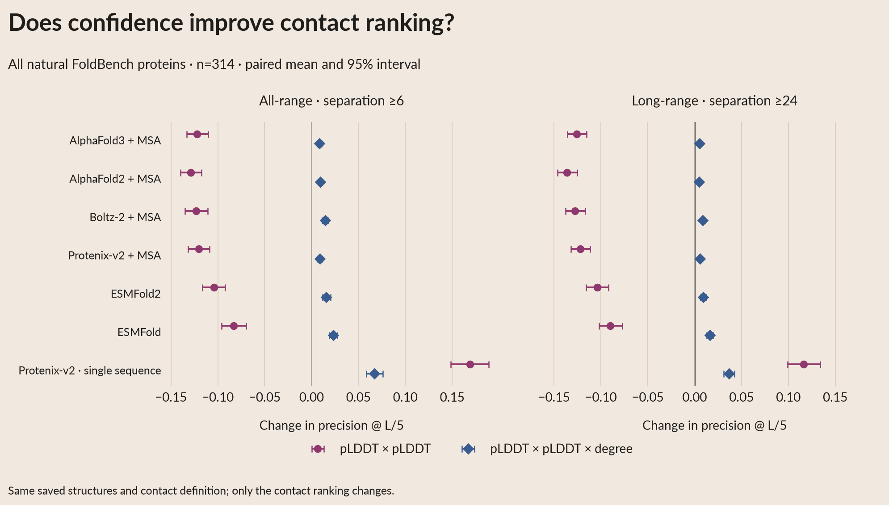
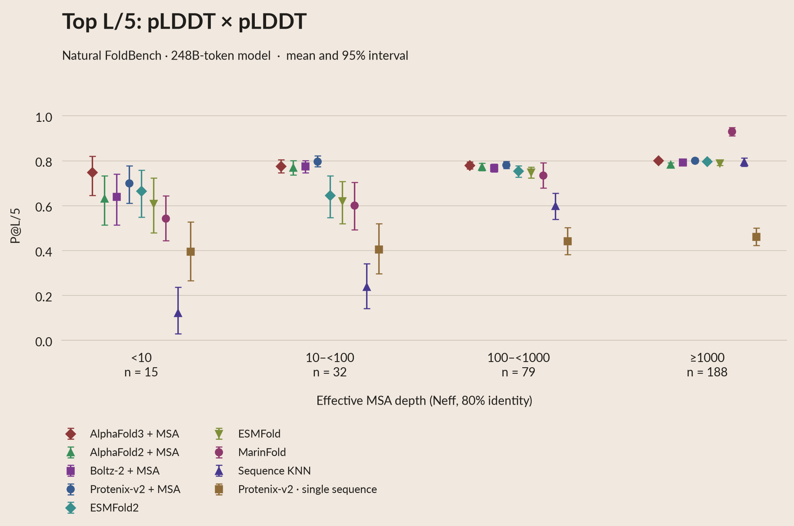
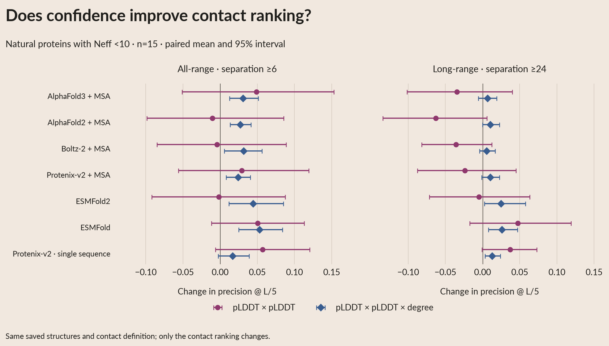

# Confidence-weighted structural contact rankings

Multiplying contact degree by both residues' predicted lDDT improves mean
P@L/5 for every structure-predictor arm, in both all-range and long-range
evaluation. Using pLDDT alone usually worsens the overall mean, although
single-sequence Protenix benefits substantially. These are paired comparisons
of the **same saved structures**, with no new predictor inference.



[White poster PDF](https://huggingface.co/buckets/open-athena/MarinFold/resolve/data/exp325-writeup-analysis/poster-2026-10-08/poster_plots/pdf/04e_pl5_ranking_deltas.pdf)

## Exact scoring rules

Let `d_ij` be the archived ConFind degree, and `q_i` the residue's predicted
lDDT confidence normalized to [0,1]. Compare three scores:

1. Original: `d_ij`.
2. Confidence only: `q_i * q_j`.
3. Confidence times degree: `q_i * q_j * d_ij`.

Both new rankings consider **every ConFind-emitted pair with degree >0**,
including weak contacts below 0.001. They do not score arbitrary pairs of
confident residues that ConFind did not identify as contacts. Ground truth
remains the frozen **degree >=0.001** definition. Ground-truth labels never
enter the ranking or break ties.

`q_i` is the arithmetic mean of the saved confidence/B-factor field over
the residue's deposited non-hydrogen atoms. AF3, Protenix and ESMFold have
atom-specific values, so this mean matters; AF2, ESMFold2 and Boltz-2 repeat
the residue confidence across its atoms. The archived ESMFold values use
[0,1]; the other six arms use [0,100] and are divided by 100. This is
**predicted** lDDT, not accuracy measured against the experimental structure.

Residues are mapped through the same ConFind residue list and sequence
alignment used by the original scorer. Keep the shared frozen
ground-truth-resolved pair universe, then filter separation **>=6** for
all-range or **>=24** for long-range **before** selecting the top
`k=max(1,floor(L/5))`. `L` is the original full input sequence length.
Score ties preserve ascending input-sequence `(i,j)` order. Missing ranks
receive zero credit and retain denominator k.

Twenty-eight protein/method/range cases have fewer than k ConFind-positive
pairs. Restricting the degree-only control to emitted pairs reproduces every
original natural-protein P@L/5 exactly. One separate design case changes:
Boltz-2 on `5sbj_A`, long-range, had two emitted contacts for k=6; the original
zero-score padding accidentally credited one non-emitted true pair (0.500
versus 0.333 under the contact-only control). That case remains explicit in
the saved control rows and never enters the natural-protein figures.

## Natural-protein results

Means over all **314 natural proteins**, with validation and test results
also available separately. Each cell is all-range / long-range P@L/5.

| Predictor | Degree | pLDDT product | pLDDT product × degree |
|---|---:|---:|---:|
| AlphaFold3 + MSA | 0.912 / 0.904 | 0.790 / 0.778 | **0.921 / 0.909** |
| AlphaFold2 + MSA | 0.901 / 0.890 | 0.772 / 0.754 | **0.911 / 0.895** |
| Boltz-2 + MSA | 0.901 / 0.888 | 0.778 / 0.761 | **0.915 / 0.897** |
| Protenix-v2 + MSA | 0.912 / 0.898 | 0.792 / 0.777 | **0.921 / 0.904** |
| ESMFold2 | 0.869 / 0.856 | 0.765 / 0.752 | **0.885 / 0.865** |
| ESMFold | 0.837 / 0.822 | 0.753 / 0.733 | **0.860 / 0.839** |
| Protenix-v2 single sequence | 0.279 / 0.248 | **0.448 / 0.364** | 0.346 / 0.285 |

MarinFold stays at **0.830 / 0.761**, and Sequence KNN at **0.657 / 0.595**.
Their contact rankings and scores are unchanged. The label now reads
**Sequence KNN** in every plot; the underlying baseline remains the same.



[All-range poster PDF](https://huggingface.co/buckets/open-athena/MarinFold/resolve/data/exp325-writeup-analysis/poster-2026-10-08/poster_plots/pdf/04c_pl5_plddt_neff.pdf) ·
[Long-range poster PDF](https://huggingface.co/buckets/open-athena/MarinFold/resolve/data/exp325-writeup-analysis/poster-2026-10-08/poster_plots/pdf/04c_pl5_plddt_neff_long.pdf)


[All-range poster PDF](https://huggingface.co/buckets/open-athena/MarinFold/resolve/data/exp325-writeup-analysis/poster-2026-10-08/poster_plots/pdf/04d_pl5_plddt_degree_neff.pdf) ·
[Long-range poster PDF](https://huggingface.co/buckets/open-athena/MarinFold/resolve/data/exp325-writeup-analysis/poster-2026-10-08/poster_plots/pdf/04d_pl5_plddt_degree_neff_long.pdf)

For **Neff<10 (15 natural proteins)**, the three-way product raises ESMFold2
from **0.668 to 0.712** all-range and **0.646 to 0.671** long-range. Paired
changes are +0.044 [0.012,0.085] and +0.025 [0.003,0.058]. All-range means
increase for every arm, although the single-sequence Protenix interval
includes zero. Small long-range differences for AF3, Boltz-2 and Protenix
+MSA also have intervals including zero.



## Validation and provenance

All **2,331 selected structures (333 proteins × seven predictor arms)**
reproduce the original raw ConFind degree matrices **exactly**, including
every positive pair. Both archived P@L/5 and R-precision reproduce for both
ranges: **9,324 score checks**, repeated from stored and recomputed degrees.
The original prediction selection, structures, checkpoint, MSAs, Neff and
all previous scientific tables are preserved.

The [public bundle](https://huggingface.co/buckets/open-athena/MarinFold/tree/data/exp325-writeup-analysis/contact-confidence-2026-10-13)
contains the selected structures, complete pair features, residue confidences,
each selected contact's rank, hashes, tables, scripts and figures.

| Element | Source |
|---|---|
| Predictor/structure identity | `data/contact_confidence_sources.csv`: coordinate hash, original location, original score row |
| Every contact score | `scored/<method>/<stem>/pairs.parquet`: i, j, degree, both pLDDTs, truth and pair-row ID |
| Selected contact ranks | `scored/<method>/<stem>/selected.parquet`: ranking, range, rank, pair-row ID |
| Residue confidence | `scored/<method>/<stem>/residues.parquet`: mapped input position and mean pLDDT |
| Protein precision | `data/contact_confidence_metrics.csv`: k, number selected/correct, original score |
| Tier figure dot/interval | `data/contact_confidence_summary.csv` → `contact_confidence_figure_rows.csv` → metric row |
| Paired change/interval | `data/contact_confidence_deltas.csv`: both means, within-protein difference, CI, members |
| Exact coordinate/contact check | `data/contact_confidence_validation.csv`: degree/support differences, hash, elapsed time |

Neff bins are <10 / 10–<100 / 100–<1000 / >=1000. Means weight proteins
equally; 95% intervals use 5,000 protein bootstraps, seed325. Delta intervals
bootstrap **within-protein differences**. Cohorts include validation, test,
viral/nonviral and designs separately. Raw-depth delta strata are also saved.
This is an exploratory ranking comparison after inspecting earlier results;
the authorized test-split reuse is recorded in exp245's read ledger.

```bash
# Preprocessing once; no model inference.
uv run python generation/contact_confidence_sources.py
uv run --project /home/bizon/git/helico --no-sync --with scikit-learn --with pyarrow python generation/score_contact_confidence.py --workers 12
uv run python prepare_contact_confidence.py

# Fast appearance-only regeneration from cached tables.
uv run python render.py
uv run python build_summary.py
uv run python export_poster.py --upload
uv run python publish_contact_confidence.py --upload
```
