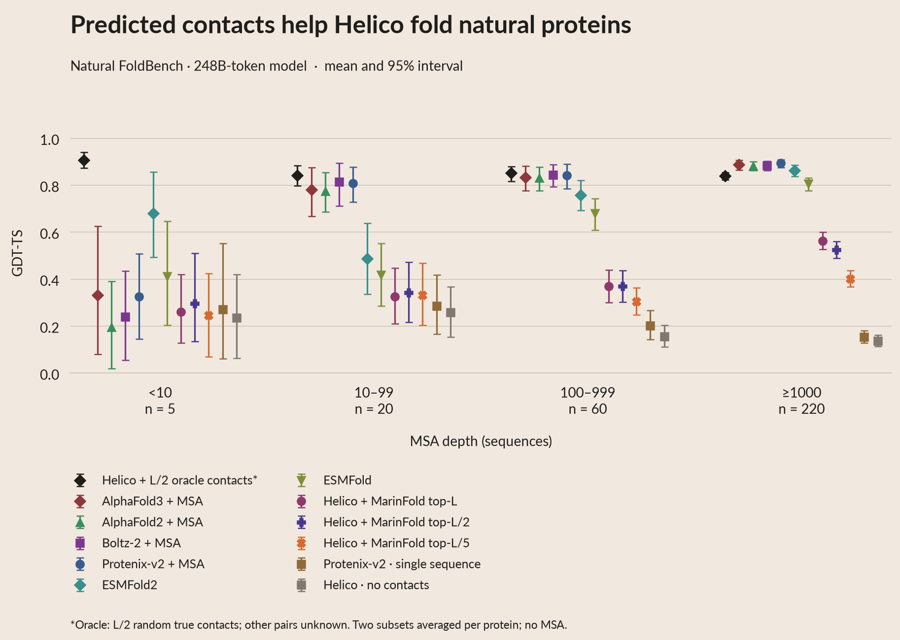

# MarinFold top-L/2 contacts through Helico

Figure 05 now compares **top-L/2 and top-L predicted contacts** from the same
248B-token MarinFold model, alongside **L/2 oracle contacts** and all existing
predictors. Every arm covers the same **305 natural proteins**: 95 validation
and 210 test, with 5 / 20 / 60 / 220 in the four MSA-depth tiers.
The figure also includes the subsequent [L/5 follow-up](MARINFOLD_L5.md);
the results below retain the original L/2 comparison.



[PDF](plots/05_folding.pdf) · [lDDT PDF](plots/05_folding_lddt.pdf) ·
[Interactive figure](site/index.html#section-05_folding) ·
[White poster PDF](https://huggingface.co/buckets/open-athena/MarinFold/resolve/data/exp325-writeup-analysis/poster-2026-10-08/poster_plots/pdf/05_folding.pdf).

## Result

Halving the predicted-contact budget modestly reduces overall accuracy:
mean GDT-TS **0.504 → 0.478**, a paired change of **−0.026**
(95% protein-bootstrap interval **[−0.041, −0.012]**).
The decline is concentrated in the deepest MSA tier. The shallower tiers show
small increases, but their paired intervals include zero.

| MSA depth | Proteins | MarinFold top-L | MarinFold top-L/2 | Oracle L/2 | L/2 minus L, 95% interval |
|---|---:|---:|---:|---:|---:|
| <10 | 5 | 0.261 | 0.297 | 0.906 | +0.036 [−0.033, +0.120] |
| 10–99 | 20 | 0.325 | 0.341 | 0.841 | +0.016 [−0.020, +0.051] |
| 100–999 | 60 | 0.369 | 0.370 | 0.853 | +0.001 [−0.039, +0.041] |
| ≥1000 | 220 | 0.563 | 0.524 | 0.839 | −0.039 [−0.055, −0.023] |
| All | 305 | 0.504 | 0.478 | 0.843 | −0.026 [−0.041, −0.012] |

Values are mean GDT-TS, with proteins equally weighted. Matching the oracle's
contact count leaves a large accuracy gap. Only five proteins occupy the lowest
tier; its mean increase should not be read as an established benefit.
All existing predictor points remain unchanged in Figure 05.
Mean lDDT also decreases, **0.637 → 0.623**. Selecting the new arm by pTM
instead gives mean GDT-TS **0.479**, nearly identical to ranking-score selection.

## Fixed comparison

The new arm takes **floor(L/2) predicted positive contacts**, where L is the
frozen input sequence length, and marks all other pairs unknown. It uses no
oracle seed contacts and no MSA. The predictor remains
`contacts-v1-exp277-m2-p06-full-epoch-1.5B-step-266344`, trained on
248,583,762,834 raw tokens.

The existing 100-rollout consensus rankings are reused: exp311 for validation
and exp325's publication run for test. No MarinFold inference was repeated.
The validation ranking file is verified against its published SHA256; all
210 test lists are independently reconstructed from their saved sparse votes.
The original top-L lists supply enough candidates for every exact L/2 map.

Helico rejects pairs less than six residues apart after mapping to its sequence.
The new arm **filters before truncating**, so every map contains exactly L/2
contacts: 51 pairs are skipped across 27 proteins, at most four for a protein.
The archived top-L arm retains its original filter-after-truncation behavior;
its actual count can be slightly below L. Pair order and vote ties are unchanged,
and no correctness labels participate in ranking or selection.

Helico retains the pinned step6000 checkpoint and source `b10385d`, with six
recycles, seed42 and three diffusion samples per map. Highest `ranking_score`
selects one sample, matching Figure 05; pTM-selected results are also saved.
Every prediction records direct inference time and worker metadata.
The [completed inference run](https://modal.com/apps/open-athena/main/ap-ipzXPTlzN5JGGClUXkLXag)
produced 915 structures from 305 maps. Measured model inference totals
4,905.7 H100-seconds (median 13.9 seconds per protein, excluding model loading).

The oracle reference is unchanged: two random subsets of L/2 true contacts,
confidence-select within each subset and average the two subset accuracies.
`8f8n_A` has only 109 eligible true contacts for a 110-contact request, so its
oracle count is one below the new MarinFold arm. The oracle uses two maps per
protein; MarinFold uses one. This matches contact count, not total sampling
compute or the information contained in those contacts.

The user selected this comparison after inspecting earlier test results.
It is an exploratory contact-budget comparison, not a new untouched test claim.

## Data and reproduction

- `marinfold_l2_pairs.csv`: each selected pair, its original rank and its Helico
  protein-residue indices; corresponding explicit token matrices are archived.
- `marinfold_l2_maps.csv`: requested/effective counts, skipped pairs and hashes.
- `helico_marinfold_l2_samples.csv`: every diffusion sample's measured scores.
- `marinfold_l2_selected.csv` and `marinfold_l2_per_protein.csv`: both confidence
  selectors, selected sample ID, source CSV and zero-based source row.
- `marinfold_l2_summary.csv` and `marinfold_l2_deltas.csv`: equal-weight protein
  means and paired differences, with 5,000 protein-bootstrap replicates.
- `figure_rows.csv` → `marinfold_l2_per_protein.csv` → raw sample CSV traces
  each new Figure 05 dot. `summary.csv` stores the exact plotted tier means.

The raw conditioning inputs, coordinates, metrics and timing records are in
the [public artifact bundle](https://huggingface.co/buckets/open-athena/MarinFold/tree/data/exp325-writeup-analysis/marinfold-l2-2026-10-12).
Its committed publication manifest pins all artifact hashes.

From this experiment directory, using the existing frozen exp325 inputs and
the pinned Helico checkout:

```bash
mkdir -p scratch/marinfold_l2
hf buckets cp hf://buckets/open-athena/MarinFold/data/exp311-helico-exp277-contact-count-sweep/inputs/ranked_pairs.json scratch/marinfold_l2/exp311_ranked_pairs.json
uv run --project /home/bizon/git/helico --no-sync --with pyarrow python generation/prepare_marinfold_l2.py
WRITEUP_PHASE=marinfold_l2 HELICO_DRY_RUN=1 PYTHONPATH=. uv run --project generation python generation/run_helico.py
WRITEUP_PHASE=marinfold_l2 PYTHONPATH=. uv run --project generation python generation/run_helico.py
uv run --project generation modal run generation/archive_helico.py --marinfold-l2
uv run python prepare_marinfold_l2_analysis.py
uv run python prepare.py
```

The analysis audits every raw contact map and coordinate set. After preprocessing,
appearance changes run only the cached-data renderers:

```bash
uv run python render.py
uv run python build_summary.py
uv run python export_poster.py --upload
uv run python publish_oracle_budget.py --marinfold-l2 --upload
```
