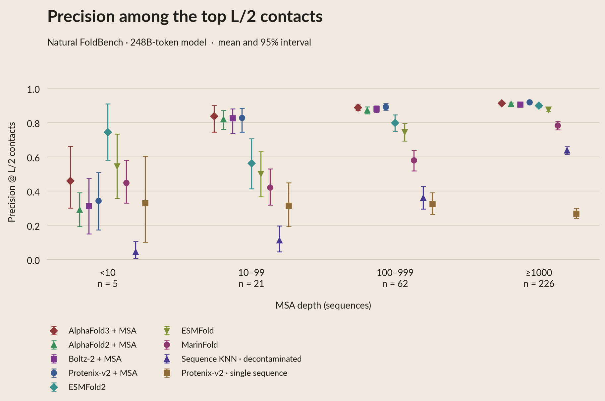

# Precision at L/2 contacts

The P@L/2 panel uses the same nine predictors, archived predictions and
248B-token MarinFold checkpoint as [P@L/5](PL5_ANALYSIS.md). Only the evaluation
cutoff changes. No predictor inference or contact ranking is repeated.



[PDF](plots/04_contacts_pl2.pdf) · [Long-range PDF](plots/04_contacts_pl2_long.pdf) ·
[Interactive figure](site/index.html#section-04_contacts_pl2) ·
[White poster PDF](https://huggingface.co/buckets/open-athena/MarinFold/resolve/data/exp325-writeup-analysis/poster-2026-10-08/poster_plots/pdf/04_contacts_pl2.pdf).

## Metric and population

**Precision @ L/2 contacts** is the number of true contacts among the top
**floor(L/2)** ranked pairs divided by that cutoff. L is the frozen input
sequence length, including unresolved input residues. The evaluator uses
`min(max(1, floor(L/2)), n_candidate)`; every natural-protein row has enough
candidates to use the full L/2 denominator.

Contacts and eligibility are unchanged: pyconfind degree >=0.001, both residues
resolved, separation >=6 for all-range or >=24 for long-range. Structures rank
by contact degree, MarinFold by consensus votes, and KNN by archived transferred
scores. Ties keep stable candidate order. KNN indexes the native decontaminated
corpus, excluding the added ProteinMPNN redesign sequences.

All nine methods cover **314 natural proteins**: 97 validation and 217 test,
with **5 / 21 / 62 / 226** in the four MSA-depth tiers. Means weight proteins
equally; 95% intervals use 5,000 protein bootstraps, seed325. The interactive
menu retains split, viral/nonviral, and separate design views. Among the
19 designs, `5sbj_A` has only 10 long-range candidate pairs versus L/2=15;
all nine methods therefore use denominator10 for that diagnostic row.

## Results

| Predictor | All-range P@L/2 | Long-range P@L/2 | All-range, depth <10 (n=5) |
|---|---:|---:|---:|
| AlphaFold3 + MSA | 0.897 | 0.838 | 0.459 |
| AlphaFold2 + MSA | 0.886 | 0.828 | 0.292 |
| Boltz-2 + MSA | 0.886 | 0.831 | 0.312 |
| Protenix-v2 + MSA | 0.899 | 0.841 | 0.345 |
| ESMFold2 | 0.855 | 0.796 | 0.746 |
| ESMFold | 0.821 | 0.756 | 0.545 |
| MarinFold, 248B tokens | 0.713 | 0.597 | 0.449 |
| Sequence-KNN, decontaminated | 0.539 | 0.458 | 0.046 |
| Protenix-v2 single sequence | 0.284 | 0.228 | 0.331 |

## Figure lineage and reproduction

- `data/pl2_summary.csv`: each point and interval, keyed by method, metric,
  cohort and tier, with contributing stems.
- `data/pl2_figure_rows.csv`: per-protein precision, sequence length, requested
  and effective cutoff, candidate count, and original CSV filename/row/column.
- `data/pl2_analysis.json`: source/output hashes, fixed checkpoint, definitions,
  and the nine capped designed-protein rows.

`prepare_pl2.py` reuses `prepare_pl5.contact_sources(divisor=2)`. The source
selection reproduces all 5,994 original predictor R-precision cells within
1e-12 before selecting the corresponding archived L/2 scores. The test split
was previously authorized for this writeup; this additional metric read is
recorded in exp245's ledger.

```bash
uv run python prepare_pl2.py
uv run python render.py
uv run python build_summary.py
uv run python export_poster.py --upload
uv run python publish_oracle_budget.py --marinfold-l5 --upload
```

Only preprocessing reads source scores and computes intervals. The render,
summary and poster commands use cached tables. All previous L/5 and
R-precision results remain available.
