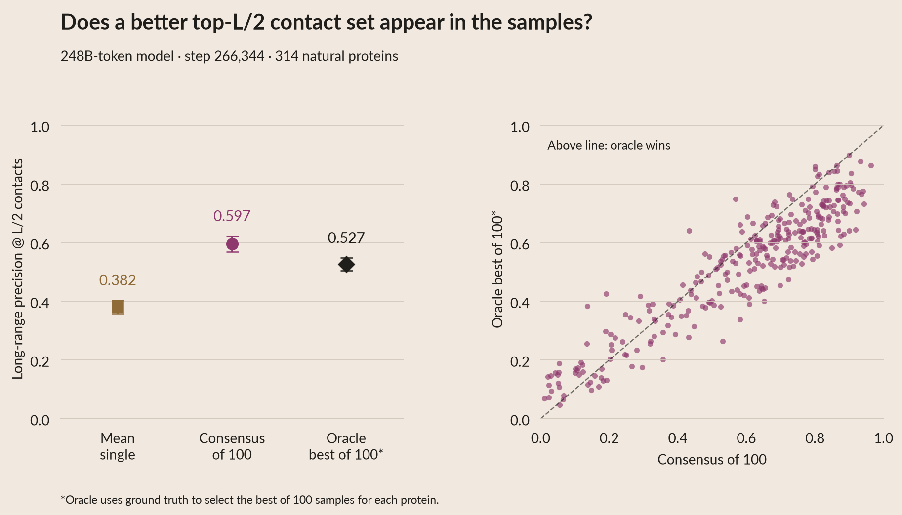

# Sampling contacts: precision at L/2

[White vector PDF](https://huggingface.co/buckets/open-athena/MarinFold/resolve/data/exp325-writeup-analysis/poster-neff-product-2026-10-13/poster_neff_product/pdf/06_sampling_pl2.pdf) ·
[7,200-pixel PNG](https://huggingface.co/buckets/open-athena/MarinFold/resolve/data/exp325-writeup-analysis/poster-neff-product-2026-10-13/poster_neff_product/png/06_sampling_pl2.png) ·
[Long-range PDF](https://huggingface.co/buckets/open-athena/MarinFold/resolve/data/exp325-writeup-analysis/poster-neff-product-2026-10-13/poster_neff_product/pdf/06_sampling_pl2_long.pdf) ·
[Long-range PNG](https://huggingface.co/buckets/open-athena/MarinFold/resolve/data/exp325-writeup-analysis/poster-neff-product-2026-10-13/poster_neff_product/png/06_sampling_pl2_long.png) ·
[Complete poster package](POSTER_NEFF.md).

The L/2 counterpart of the original sampling figure uses the same **314 natural
proteins** (97 validation, 217 test), fixed **exp277 step266344, 248.584B-token
model**, and first **100 saved iid samples per protein**. No new inference ran.

| Contact range | Mean individual sample | Consensus of 100 | Oracle best of 100 |
|---|---:|---:|---:|
| All, separation ≥6 | 0.414 | **0.714** | 0.570 |
| Long, separation ≥24 | 0.382 | **0.597** | 0.527 |

All-range consensus exceeds oracle by **0.144** (95% protein-bootstrap interval
0.132–0.156). Consensus wins on 273 proteins, oracle on 33, with 8 ties.
Long-range consensus exceeds oracle by **0.069** (0.058–0.080): 227 consensus
wins, 70 oracle wins, 17 ties. This compares contact accuracy, not structural
diversity. The oracle is the best *individual* sample and cannot bound a
consensus assembled from multiple samples.




## Exact scoring

Let `k = max(1, floor(L/2))`, where L is frozen input-sequence length. All these
natural proteins use the full floor(L/2) denominator. Contact truth and resolved
pair universe are unchanged: ConFind degree ≥0.001, restricted to eligible
resolved endpoints and the selected sequence-separation range.

- **Individual:** filter to eligible pairs, remove duplicate undirected pairs,
  retain emission order, then take k. Precision is correct/k; missing ranks
  receive zero credit. Invalid or unfinished individual maps receive zero.
- **Mean single:** mean of those 100 individual scores for each protein, then
  equal-weight mean across proteins.
- **Consensus:** rank by the original stable contact-vote rule, then take k
  eligible pairs. This sampling diagnostic uses all parsed maps, matching the
  original R and L/5 sampling figures. Main predictor-comparison panels exclude
  unfinished maps from consensus votes, so their MarinFold P@L/2 is slightly
  different: 0.713291 instead of 0.714128.
- **Oracle best of 100:** select the highest individual **P@L/2** for each
  protein, separately for each range. Ties choose the earliest rollout index.
  This reselects the sample at the new cutoff; it uses ground truth.

Intervals use 5,000 protein bootstraps, seed 325. The right panel plots each
protein's consensus and oracle scores; points above the diagonal favor oracle.
Interactive scatter colors and cached subgroup summaries use Neff80. Overall
means do not depend on depth grouping. At Neff<10 (15 proteins), all-range mean
single / consensus / oracle are 0.171 / 0.396 / 0.369; long-range values are
0.111 / 0.261 / 0.309. Subgroup intervals are in the cached tables.

## Trace and reproduce

`prepare_sampling_pl2.py` performs analysis once; `render.py` reads only its
cached outputs. Every pool SHA256 and the frozen truth SHA256 match the L/5
analysis. All 62,800 individual validity/R-score rows and 1,884 aggregate
R-precision rows reproduce before these new scores are accepted.

| Figure element | Cached source |
|---|---|
| Left-panel value and error bar | `data/pl2_sampling_summary.csv`: metric, cohort, tier, method |
| Right-panel protein | `data/pl2_sampling_figure_rows.csv`: stem, metric, method; source row and column |
| Consensus, single mean, oracle and selected index | `data/pl2_sampling_per_protein.csv`: stem, range |
| Every individual score and validity flag | `data/pl2_sampling_individual.csv.gz`: stem, range, rollout |
| Paired intervals and win counts | `data/pl2_sampling_deltas.csv`: metric, cohort, Neff tier |
| Input/output hashes and raw restoration URLs | `data/pl2_sampling_analysis.json` |

Restore the existing saved pools as in [PL5_ANALYSIS.md](PL5_ANALYSIS.md), then:

```bash
# Preprocessing only when scores need rebuilding:
uv run python prepare_sampling_pl2.py
uv run pytest -q test_pl5.py
# Fast aesthetic iteration from cached tables:
uv run python render.py
uv run python build_summary.py
# White, native-vector and high-resolution print exports:
uv run python export_poster.py --upload
uv run python export_poster_neff.py --upload
```

Both new figures and all six sampling tables/manifest are included in the
curated poster ZIP. Test reuse is recorded as read 23 in the exp245 ledger;
this is an exploratory follow-up on previously examined test data.
