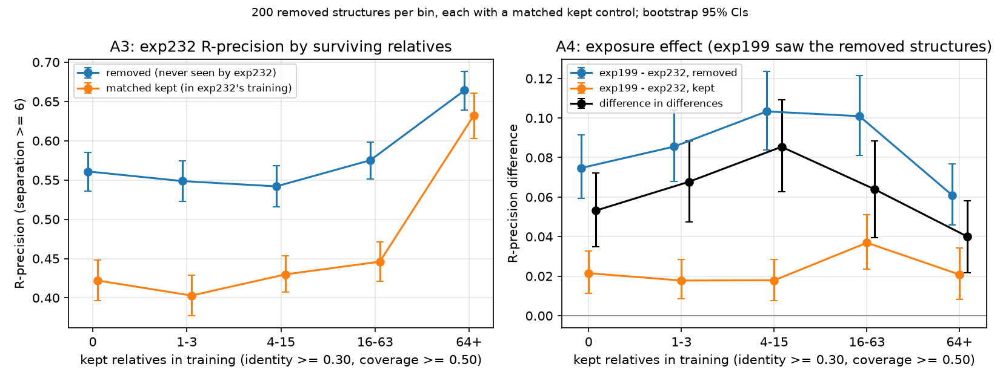

---
marinfold_experiment:
  issue: 341
  title: 'exp: Interpretability of contacts-v1: chain reconstruction, contact heads, and memorization vs coevolution'
  kind: evals
  branch: main
---

# exp: Interpretability of contacts-v1: chain reconstruction, contact heads, and memorization vs coevolution

**Issue:** [#341](https://github.com/Open-Athena/MarinFold/issues/341) · **Kind:** `evals` · **Branch:** `main`

## Question

Two training decisions for the next contacts-v1 model, each with a rule for
both outcomes fixed in advance ([`research_plan.md`](research_plan.md),
section 1.2):

- **A.** Cap how often each protein family is sampled, or keep the corpus's
  family redundancy? This turns on whether the model recalls families and
  individual structures or learns couplings from family statistics.
- **B.** Should extra capacity go to depth or width, and does the 8192-token
  contact budget withhold supervision on long proteins?

## Status

| Part | What it measures | State |
|---|---|---|
| Harness checks 1, 2, 5 | RoPE repair took; hooks leave the readout unchanged; timed readout | Done (L40S) |
| Harness checks 3, 4 | | Not run |
| **A3** | exp232 accuracy on #225-removed structures vs surviving relatives | **Readouts done**; control premise failed (below) |
| **A4** | exp199 vs exp232 difference in differences on the same panel | **Readouts done**; Jacobian subset not run |
| A1, A2 | Sequence-section and contact Jacobians | Not started (needs a gradient forward path) |
| **B2 count** | How often the contact budget truncates training documents | **Done** |
| B2 matched-degree recall, B1 | | Not started |

Track A is not complete. A3 and A4's behavioural readouts are in; A1, A2
and the A4 Jacobian subset, which tell recall from coupling at the
mechanism level, have not run.

## Approach

All readouts use the production pairwise P(contact) readout
(`marinfold.document_structures.contacts_v1.inference.pairwise_score_matrix`,
4 seeds) through [`harness.py`](harness.py), scored as R-precision: of the R
highest-scoring residue pairs, the fraction that are true contacts, where R
is the number of true contacts at sequence separation >= 6 (>= 24 for long
range). Means are over proteins.

### The held-out panel (A3, A4)

[#225](https://github.com/Open-Athena/MarinFold/issues/225) removed 166,679
AFDB structures (4.04% of 4,129,682) from the training corpus because they
resembled eval proteins. exp199 trained on them; exp232 never saw them. Each
removed structure keeps some number of relatives in exp232's training data.

1. **Candidates** ([`panel_candidates.py`](panel_candidates.py)): 300 of the
   2,067 AFDB shards, read by column projection from the public HF bucket.
   23,745 removed structures (through the drop list's `(shard, row)`
   pointers, each `entry_id` checked) and 12,000 kept structures (40 per
   shard from the decontaminated corpus). Sequence and ground truth come from
   each untruncated contacts-v1 document, whose contact list is exactly the
   pairs at degree >= 0.001 and separation >= 6. This replaces the plan's
   mmCIF + pyconfind recomputation; [`data/panel_candidates_summary.json`](data/panel_candidates_summary.json).
2. **Relative counts** ([`relative_counts.py`](relative_counts.py)): MMseqs2
   at `-s 7.5` of all candidates against all 69,516,181 training sequences of
   the two decontaminated native corpora, counting hits at identity >= 0.30
   and coverage >= 0.50. r7i.8xlarge in us-west-2, 2.8 h decode + 2.1 h
   search; outputs at
   `s3://marinfold-exp91-usw2/exp341/relatives/20261011T004828Z-56fab471/`.
   [`data/relative_counts.parquet`](data/relative_counts.parquet).
3. **Selection** ([`panel_select.py`](panel_select.py)): 200 removed
   structures per bin (0, 1-3, 4-15, 16-63, 64+ relatives), each paired with
   a kept structure from the same bin by optimal one-to-one matching on log
   length, pLDDT and log(1 + relatives). Every standardized mean difference
   is <= 0.08 ([`data/panel_balance.csv`](data/panel_balance.csv)).
4. **Readouts** ([`score_panel.py`](score_panel.py)) on one L40S
   (g6e.xlarge, us-east-2), 1.39 h per model:
   `contacts-v1-exp232-m2-p06-train-1.5B` (step 363000) and
   `contacts-v1-exp199-cooldown-1.5B` (step 290400). Per-structure scores and
   timings in [`data/panel_scores/`](data/panel_scores/); P(contact)
   matrices at
   `s3://marinfold-exp91-usw2/exp341/panel/20261011T201436Z-93433199/out/panel/`.
5. **Analysis** ([`analyze_panel.py`](analyze_panel.py)): every quantity per
   matched pair, bootstrapped over pairs within bin (10,000 resamples).

Relative count is strongly confounded with protein length and pLDDT: median
removed length falls from 540 in bin 0 to 138 in 64+, and median pLDDT rises
from 78.5 to 90.1. The within-bin matching controls removed against kept; it
does not control one bin against another.

## Results

Source data: [`data/relative_dose_response.csv`](data/relative_dose_response.csv),
[`data/contamination_did.csv`](data/contamination_did.csv); plot script
[`plot_panel.py`](plot_panel.py). R-precision over all separations below;
long range shows the same pattern in both CSVs.

### A4: training on a structure adds 0.04-0.085 R-precision

exp199 minus exp232 on removed structures, minus the same difference on their
matched kept controls:

| Bin | exp199 - exp232, removed | exp199 - exp232, kept | Difference in differences [95% CI] |
|---|---|---|---|
| 0 | 0.075 | 0.021 | 0.053 [0.035, 0.072] |
| 1-3 | 0.086 | 0.018 | 0.068 [0.047, 0.089] |
| 4-15 | 0.103 | 0.018 | 0.085 [0.063, 0.109] |
| 16-63 | 0.101 | 0.037 | 0.064 [0.040, 0.088] |
| 64+ | 0.061 | 0.021 | 0.040 [0.022, 0.058] |

The effect is positive in every bin, including 64+ surviving relatives. By
the plan's reading, exposure to the structure adds accuracy beyond what
surviving relatives supply. Two qualifications:

- exp199 saw each removed structure together with its removed relatives
  (#225 purged whole Foldseek clusters), so this measures exposure to the
  structure and its purged cluster, not to one structure.
- The effect is small next to what the model gets without exposure: on bin 0,
  exp232 scores 0.561 on structures it never saw, and exp199 scores 0.636
  after about 16 AFDB epochs over them. On the scale of recipe changes it is
  not small; exp199's promotion over exp166 was +0.026, and #245's H2
  measured +0.024 [-0.022, +0.073] for the same model families on eval
  proteins without resolving it.

### A3: no dose-response, and the kept controls are not a ceiling

exp232 only:

| Bin | Removed | Matched kept | Removed - kept [95% CI] |
|---|---|---|---|
| 0 | 0.561 | 0.422 | 0.139 [0.104, 0.173] |
| 1-3 | 0.549 | 0.403 | 0.146 [0.108, 0.183] |
| 4-15 | 0.542 | 0.430 | 0.112 [0.077, 0.147] |
| 16-63 | 0.575 | 0.446 | 0.129 [0.094, 0.165] |
| 64+ | 0.664 | 0.632 | 0.032 [-0.002, 0.066] |

1. **Removed structures with no surviving relatives score as well as those
   with 16-63.** The rise at 64+ appears in the kept controls too
   (0.446 to 0.632), and that bin's proteins are much shorter, so it does not
   isolate the effect of relatives.
2. **The saturation breakpoint is unresolved.** A piecewise-linear fit on
   log(1 + relatives) puts it at 7 relatives with a bootstrap CI of 2 to 435
   ([`data/relative_dose_fit.json`](data/relative_dose_fit.json)). An OLS
   adjusting for log length and pLDDT gives a positive slope, 0.033
   [0.027, 0.039] per unit of log(1 + relatives), but it rests on a linear
   length adjustment with an unexpectedly positive length coefficient
   (+0.070 per unit log length), so it should not set a cap.
3. **exp232 scores structures it never saw 0.11-0.15 above matched
   structures it trained on.** The plan treated the kept controls as a
   ceiling for each bin; the data contradict that. Two explanations were
   tested and neither accounts for the gap
   ([`data/removed_gap_checks.json`](data/removed_gap_checks.json)):
   - *Removed structures are easier because they resemble eval proteins.*
     Within the removed set, R-precision falls as identity to the nearest
     eval reference rises: 0.609 in the lowest identity quartile, 0.541 in
     the highest; adjusted coefficient -0.148 per unit identity.
   - *Contact density or long-range share differs.* Removed structures have
     0.021 more contacts per residue and a 0.030 lower long-range share
     within pairs; 0.103 of the 0.112 mean gap remains after adjusting for
     both.

   The gap is unexplained. Until it is, the kept set cannot serve as A3's
   counterfactual, and A3 cannot supply the per-cluster cap value the plan
   wanted from it.

### B2 count: the budget almost never truncates

[`budget_counts.py`](budget_counts.py) over every shard of both native
corpora ([`data/budget_counts.csv`](data/budget_counts.csv),
[`data/budget_summary.json`](data/budget_summary.json)):

- AFDB: 229 of 3,963,003 documents truncated (5.8e-05), all longer than
  1,000 residues; 224 of the 523 documents at 1,501-2,000 residues.
  7.0e-05 of eligible contacts dropped.
- ESM Atlas: no document exceeds 1,000 residues; none of 65,553,178 is
  truncated.

The ProteinMPNN redesign corpora keep each structure's length and contact
set, so they inherit these rates. This meets the plan's "truncation is rare"
outcome for decision B: the budget is not what limits long proteins.

### Harness

Checks 1 and 2 pass on an L40S at 4 seeds
([`data/harness_checks_l40s_4seed.json`](data/harness_checks_l40s_4seed.json)).
The timed readout over eval-val and eval-denovo ran at 5,933 tokens/s
([`data/readout_l40s/`](data/readout_l40s/)), against the plan's assumed
50,000 per H100; the panel runs measured 4,150 tokens/s. The plan's compute
estimates (section 4.8) are low by roughly that factor.

## Conclusion (interim)

- **Decision B, budget half:** the contact budget truncates 229 of 69.5M
  native training documents. Leave it; the L^0.79 scaling of long-protein
  contact enrichment (#262) has another cause.
- **Decision A:** the evidence so far points to the plan's "recalls families
  and individual structures" row on exposure: training on a structure and its
  cluster adds 0.04-0.085 R-precision even where 64+ relatives remain.
  The effect is a small fraction of accuracy; most of what exp199 scores on
  those structures, exp232 scores without ever seeing them. A per-cluster cap
  would trim that memorized component. A3 does not yet give a cap value: its
  curve is flat from zero relatives, and its control set is not comparable to
  the removed structures for reasons not yet identified.
- **Remaining for Track A:** a control for A3 that matches removed
  structures on whatever makes them easier, and A1, A2 and the A4 Jacobian
  subset, which separate recall from coupling directly.
