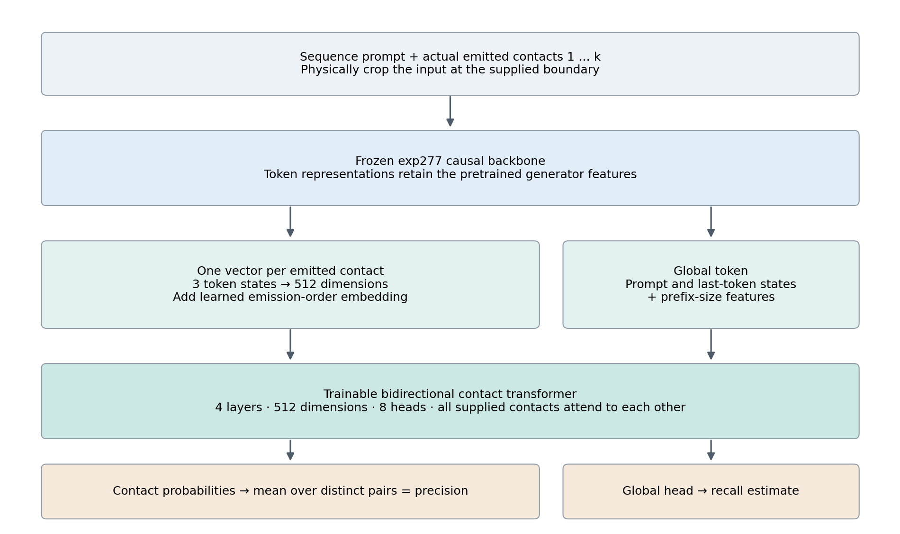
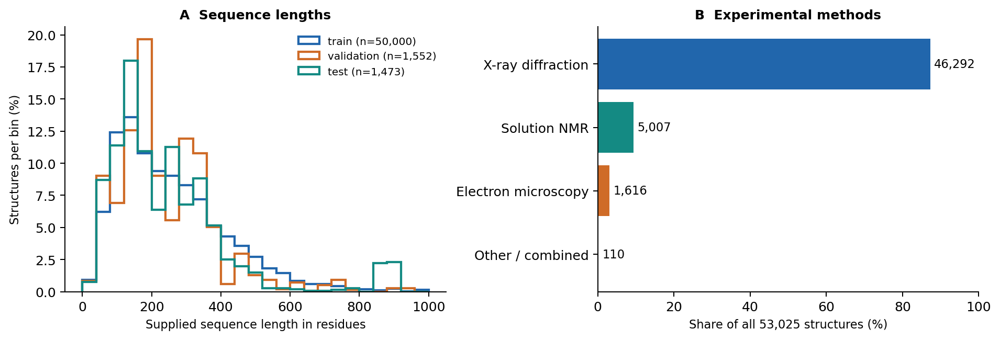
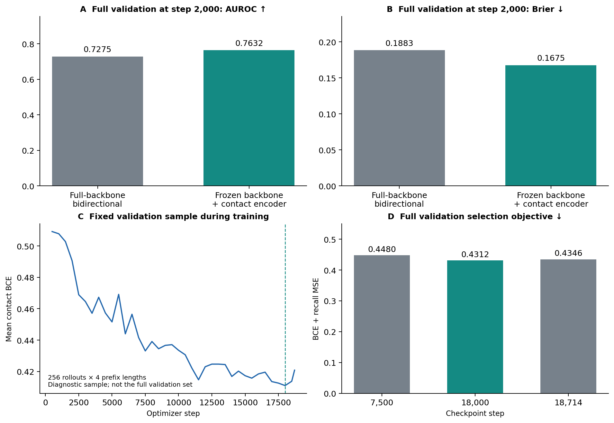
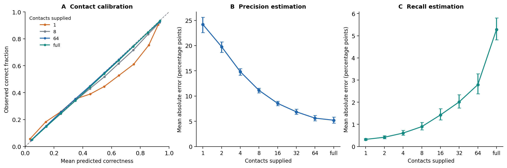
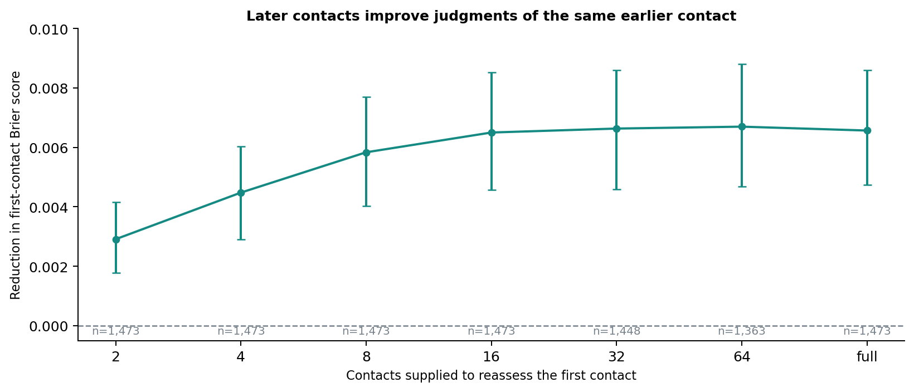
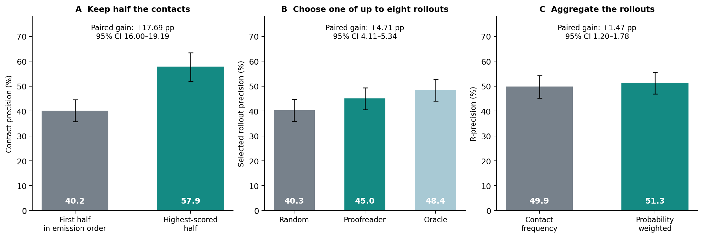

# MarinFold rollout proofreading experiment setup and results

**Experiment 356 · Training and evaluation completed 10 October 2026 · Report prepared 19 October 2026**

The MarinFold proofreader learns to judge contacts in an actual model rollout, revise those judgments when later contacts become available, and estimate the precision and recall of the supplied predictions. It works on a sequence prompt plus any nonempty contact prefix, including a single contact. The released model combines the frozen MarinFold generator with a small bidirectional contact transformer trained on 50,000 experimental PDB chain structures.

On 1,473 reserved test structures, full-rollout contact discrimination reaches **0.7933 AUROC**, with precision and recall mean absolute errors of **5.21 and 5.28 percentage points**. Supplying the complete rollout improves the same first contact's Brier score by **0.00656**, with a 95% confidence interval of **0.00474–0.00859**. The scores are useful operationally: selecting a rollout by estimated precision improves actual precision from **40.33% to 45.04%**, and weighting contacts by their probabilities improves aggregation R-precision from **49.87% to 51.35%**.

These results support contextual proofreading and quality estimation for the evaluated generator and data distribution. They do not establish equal reliability at every prefix length: single-contact calibration is weaker, and the small absolute recall error at one contact is largely a consequence of the very small recall target. The test structures were held out from proofreader training; their exclusion from the pretrained generator's corpus is not established.

## Research question and prediction task

The motivating question is whether the consistency of an entire contact rollout contains evidence that a causal generator cannot use when it first emits a contact. An early pair may appear plausible in isolation but conflict with the pattern of later pairs. A useful proofreader must let that later evidence change the earlier score while remaining usable before the rollout has finished.

For a supplied prefix with k emitted contacts, the model returns one correctness probability for each emission, an estimated precision, and an estimated recall. The sequence prompt is always available: “one contact” means one contact plus the protein sequence and its original prompt encoding. No experimental coordinates, reference labels, or unsupplied continuation enter the model input.

Correctness is defined against the experimental reference contact set for the supplied sequence. Precision is the number of distinct correct proposed pairs divided by the number of distinct proposed pairs. Recall is the number of distinct correct proposed pairs divided by the complete reference contact count. Invalid proposed pairs remain negative examples and count in the precision denominator. Repeated emissions receive individual scores, but reference metrics and precision estimates count a pair once, using its first occurrence. This prevents repeated contacts from inflating precision or recall. [Target and prefix implementation](https://github.com/Open-Athena/MarinFold/blob/785ae43ba5cdaa244e118fd84b558dd9fd9adb8c/experiments/exp356_models_pdb_rollout_proofreader/records.py).

## Model architecture

The selected architecture preserves the generator's causal representations and learns a separate bidirectional readout. The backbone is the exp277 step-266344 contacts-v1 Qwen3 model, the default generator used for this experiment. Its parameters are frozen throughout proofreader training.

For each emitted contact, the model gathers the hidden states at its three tokens: the contact marker and two residue indices. Concatenating the three 2,048-dimensional states produces a 6,144-dimensional vector, projected to 512 dimensions. A learned emission-order embedding preserves where each proposal appeared in the rollout. A separate global token combines the prompt-boundary state, the final supplied token state, and logarithmic prompt-length and contact-count features.

The contact vectors and global token pass through four bidirectional transformer layers with width 512, eight attention heads, feed-forward width 2,048, GELU activation, pre-normalization, and zero dropout. The layers are independently initialized. A shared 512-to-128-to-1 head predicts each contact's correctness probability. A second head reads the contextualized global token and predicts recall. Estimated precision is the mean correctness probability over distinct proposed pairs, so it is consistent with the contact scores rather than a separately fitted scalar.

The model contains **1,487,731,202 parameters**, of which **22,181,378 are trainable**, approximately 1.49%. Although the backbone is causal, the contact encoder can attend to every contact in the supplied prefix. This gives earlier contacts access to later evidence without updating the generator. The implementation recomputes the supplied prefix at inference; incremental caching is not implemented. [Architecture implementation](https://github.com/Open-Athena/MarinFold/blob/785ae43ba5cdaa244e118fd84b558dd9fd9adb8c/experiments/exp356_models_pdb_rollout_proofreader/model.py).

**Figure 1. Architecture.** The supplied token sequence is physically cropped before encoding. Bidirectional mixing occurs over contact representations and a global token. The graph therefore supports both single-contact scoring and retrospective revision. All report figures are generated by `uv run --project experiments/exp356_models_pdb_rollout_proofreader --no-sync python experiments/exp356_models_pdb_rollout_proofreader/plot_report.py` with no additional arguments.

## Experimental structures and split construction

The target corpus comes from the exp222 curated PDB monomer collection and its native-only contact references. Eligibility requires 32–1,000 supplied residues, at least five reference contacts, and resolution no worse than 4 Å when a resolution value is present. Only observed residues enter the supplied sequence. An eligible chain is either the complete canonical sequence or a uniquely matching contiguous segment covering at least 90% of that sequence, with at most 20 omitted residues at either terminus. Internal gaps and incomplete reference sets are rejected.

The contact definition is the contacts-v1 pyconfind native reference: a 3 Å side-chain contact threshold, minimum contact degree 0.001, and sequence separation of at least six residues. The source extraction also records a 25 Å distance cutoff and 2 Å clash threshold. Recall uses the complete reference set for the supplied sequence, including after permitted terminal cropping. This definition is more specific than a generic Cα distance contact map. [Target provenance and reference definition](https://github.com/Open-Athena/MarinFold/blob/785ae43ba5cdaa244e118fd84b558dd9fd9adb8c/experiments/exp356_models_pdb_rollout_proofreader/data/targets_provenance.json).

| Split | Chain structures | Distinct supplied sequences | Connected related groups | Retained rollouts |
| --- | ---: | ---: | ---: | ---: |
| Training | 50,000 | 34,894 | 9,074 | 399,213 |
| Validation | 1,552 | 1,061 | 287 | 12,394 |
| Reserved test | 1,473 | 1,085 | 295 | 11,764 |
| Total | 53,025 | — | 9,656 | 423,371 |

The 50,000 training chain structures come from 46,933 PDB entries. They are not 50,000 independent proteins: exact sequences repeat, and the largest training related group contains 409 structures. Related PDB entries, identical sequences, source families, and connected MMseqs homology relationships remain together. Homology uses at least 30% sequence identity and 50% coverage of the shorter sequence. Benchmark homologs are excluded and an explicit cross-split search checks separation. The preparation ledger records 37,209 benchmark-homolog removals and 161 cross-split group removals. Group-based uncertainty estimates account for some of this dependence; the structural sample size should not be mistaken for the number of unrelated folds.

The corpus contains 46,292 structures labeled X-ray diffraction, 5,007 solution NMR, 1,616 electron microscopy, and 110 other or combined experimental methods. Six records have combined NMR and theoretical-model metadata; they are included within the combined-method category. The distribution is dominated by shorter proteins, with different family and length mixtures across splits. [Structure manifest](https://github.com/Open-Athena/MarinFold/blob/785ae43ba5cdaa244e118fd84b558dd9fd9adb8c/experiments/exp356_models_pdb_rollout_proofreader/data/structure_manifest.csv.gz), [experimental methods](https://github.com/Open-Athena/MarinFold/blob/785ae43ba5cdaa244e118fd84b558dd9fd9adb8c/experiments/exp356_models_pdb_rollout_proofreader/data/experimental_methods.csv).

**Figure 2. Dataset composition.** Length histograms are normalized separately within each split; experimental-method counts combine all 53,025 structures. The pronounced test tail around 850–900 residues is a property of this grouped split. Source: `data/structure_manifest.csv.gz`; generator: `plot_report.py`, no arguments, using the invocation below Figure 1.

## Rollout generation and audit

The frozen exp277 generator produced eight samples per structure at temperature 1 and top-p 0.95. Sequence-statement order and circular residue-number offsets were randomized, and the raw prompt IDs, completion IDs, and contact emission order were retained. The completion budget was the smaller of 6L + 128 tokens and the remaining 8,192-token context after reserving room for the prompt and an assessment token.

Generation ran across 32 CoreWeave H100 shards and produced 3,328 parquet batches. Of 424,200 requested trajectories, the audit retained 423,371, or 99.80%. It excluded 703 malformed and 126 empty trajectories. Seven well-formed unfinished trajectories remained usable. The audited corpus contains **109,251,347 contact labels across all splits**, including 22,163 invalid proposed contacts labeled as incorrect. Every target structure retains at least one usable trajectory.

The audit independently checks token-to-pair alignment, circular-offset conversion, reference labels, duplicate accounting, sequence mappings, target coverage, and file checksums. Per-input inference timings and worker metadata were saved during generation. Incorrect proposals are part of the training signal; they are not discarded simply because the generator made an error. [Generation audit manifest](https://github.com/Open-Athena/MarinFold/blob/785ae43ba5cdaa244e118fd84b558dd9fd9adb8c/experiments/exp356_models_pdb_rollout_proofreader/data/production_rollout_manifest.json), [public rollout corpus](https://huggingface.co/buckets/open-athena/MarinFold/tree/data/exp356/rollouts-v1).

## Prefix training and optimization

Each training exposure selects a prefix from a deterministic mixture: 25% use the full rollout, 25% choose uniformly among eligible lengths 1, 2, 4, and 8, and 50% choose uniformly from all contact counts between one and the full length. Prefix selection changes deterministically with rollout identity and epoch. The token sequence is physically sliced before the backbone runs, so unseen contacts cannot leak through its hidden states.

The loss is the per-example mean binary cross-entropy across emitted contact labels plus squared error for recall, with recall weight one. Contact supervision includes all emissions; precision and recall targets use distinct pairs. No separate precision loss or post-hoc calibration is applied.

| Training setting | Value |
| --- | --- |
| Hardware | Eight CoreWeave H100 GPUs |
| Training trajectories | 399,213 |
| Epochs completed | 3 |
| Optimizer steps | 18,714 |
| Effective global batch | 64 |
| Per-GPU microbatch and accumulation | 1 example, 8 accumulation steps |
| Optimizer | AdamW, weight decay 0.01 |
| Trainable-head learning rate | 0.0002 |
| Schedule | 200-step warmup, cosine decay to 10% of peak |
| Gradient norm clipping | 1.0 |
| Arithmetic | bfloat16 autocast |
| Routine validation | Every 500 steps on 256 fixed validation rollouts at prefixes 1, 4, 16, and full |

Every training trajectory is visited each epoch. The distributed ordering pads the final global batch by 19 repeated examples per epoch. Routine validation is a diagnostic subset, distinct from the complete validation evaluations used for architecture comparison and release selection. [Training implementation](https://github.com/Open-Athena/MarinFold/blob/785ae43ba5cdaa244e118fd84b558dd9fd9adb8c/experiments/exp356_models_pdb_rollout_proofreader/train.py), [production W&B run](https://wandb.ai/open-athena/MarinFold/runs/exp356-exp277-frozen-contact-pdb50k-v2).

### Architecture comparison

An earlier alternative fine-tuned the full backbone with bidirectional token attention and separate prediction heads. At matched optimizer step 2,000, the frozen-backbone contact encoder performed better on all validation structures:

| Full-rollout validation metric | Full-backbone bidirectional fine-tuning | Frozen backbone and contact encoder |
| --- | ---: | ---: |
| AUROC, higher is better | 0.7275 | **0.7632** |
| Brier score, lower is better | 0.1883 | **0.1675** |
| Precision MAE | 0.1092 | **0.0958** |
| Recall MAE | 0.1140 | **0.1027** |

The selected model also trained about four times faster in the observed runs: roughly 0.25–0.30 seconds per optimizer step versus about 1.12 seconds for full-backbone fine-tuning. This is an observed throughput comparison, not an equal-compute architecture sweep. The initial alternative was stopped after its durable step-3,000 checkpoint. [Full-backbone comparison results](https://github.com/Open-Athena/MarinFold/blob/785ae43ba5cdaa244e118fd84b558dd9fd9adb8c/experiments/exp356_models_pdb_rollout_proofreader/data/validation_step2000_metrics.json), [frozen-backbone comparison results](https://github.com/Open-Athena/MarinFold/blob/785ae43ba5cdaa244e118fd84b558dd9fd9adb8c/experiments/exp356_models_pdb_rollout_proofreader/data/frozen_validation_step2000_metrics.json).

### Checkpoint selection before the test

The final candidate pool was declared before the reserved test: retained step 7,500, the best fixed-sample validation checkpoint available at completion, and the final checkpoint. Selection evaluated all 1,552 validation structures at prefixes 1, 2, 4, 8, 16, 32, 64, and full. The objective equally averages the eight prefix-specific, structure-mean values of contact BCE plus recall squared error.

| Candidate step | Full-validation selection objective | Decision |
| --- | ---: | --- |
| 7,500 | 0.447985 | Retained baseline |
| 18,000 | **0.431166** | **Released checkpoint** |
| 18,714 | 0.434612 | Final training checkpoint |

The selection record was frozen at 01:00:10 UTC on 10 October and committed before test submission. The reserved test then evaluated the selected checkpoint once. The training run completed three epochs, while the released weights come from step 18,000, approximately 2.89 epochs. No test-dependent model tuning or calibration followed. The candidate pool covers retained checkpoints, not every intermediate training state. [Selection protocol](https://github.com/Open-Athena/MarinFold/blob/785ae43ba5cdaa244e118fd84b558dd9fd9adb8c/experiments/exp356_models_pdb_rollout_proofreader/data/release_selection_protocol.json), [selection record](https://github.com/Open-Athena/MarinFold/blob/785ae43ba5cdaa244e118fd84b558dd9fd9adb8c/experiments/exp356_models_pdb_rollout_proofreader/data/release_selection.json).

**Figure 3. Development and selection.** Panels A and B compare architectures at step 2,000 on the complete validation set. Panel C shows contact BCE on the smaller fixed training-time validation sample. Panel D shows the final selection objective across eight prefix lengths. Lower BCE, Brier, and selection objective are better; higher AUROC is better. Generator: `plot_report.py`, no arguments, using the invocation below Figure 1.

## Evaluation and uncertainty

Final test evaluation covers 11,764 retained rollouts from 1,473 structures in 295 connected related groups. It scores each available prefix at lengths 1, 2, 4, 8, 16, 32, and 64, plus the complete rollout. A fixed-length condition includes a trajectory only if it contains that many contacts. Explicit prefixes stop exactly at the last requested contact, excluding any later end marker; full rollouts may include the genuinely observed end marker.

For most reported metrics, evaluation first averages rollouts within each structure and then averages structures. The “protein” count in the saved metrics is therefore the number of chain-structure targets, including repeated supplied sequences. Confidence intervals use 1,000 bootstrap replicates that resample entire related groups while preserving structure weighting within the sampled groups. They describe uncertainty over this grouped test set, not variation across independently trained models.

Contact Brier score is the mean squared difference between predicted probability and the binary label; lower is better. AUROC is computed within each rollout, excluding rollouts with only one label class, and then averaged using the same structure hierarchy. It is not a single AUROC pooled over all contacts. Calibration plots do pool distinct contact predictions within probability bins, so their weighting differs from the structure-mean error metrics. [Evaluator](https://github.com/Open-Athena/MarinFold/blob/785ae43ba5cdaa244e118fd84b558dd9fd9adb8c/experiments/exp356_models_pdb_rollout_proofreader/evaluate.py), [aggregation and bootstrap analysis](https://github.com/Open-Athena/MarinFold/blob/785ae43ba5cdaa244e118fd84b558dd9fd9adb8c/experiments/exp356_models_pdb_rollout_proofreader/analyze.py).

An earlier explicit-prefix boundary implementation included a later end marker in 75 of 12,394 validation trajectories at matching final-contact boundaries. Full-rollout metrics were unaffected. The final selection and test reports use the corrected boundary policy; historical prefix reports should not be substituted for these final measurements.

## Reserved test results

### Full rollout accuracy and quality estimation

| Metric | Estimate | 95% group-bootstrap interval |
| --- | ---: | ---: |
| Within-rollout AUROC | 0.7933 | 0.7808–0.8042 |
| Contact Brier score | 0.1438 | 0.1348–0.1511 |
| Precision MAE | 5.21 percentage points | 4.64–5.83 |
| Recall MAE | 5.28 percentage points | 4.82–5.80 |

The average underlying rollout has actual precision 40.33% and recall 41.25%. Thus the reported estimation errors are measured against a broad quality distribution, not against uniformly accurate rollouts. The final validation results are close to the reserved test results: AUROC 0.7911, Brier 0.1490, precision MAE 5.22 points, and recall MAE 5.64 points. [Reserved-test metrics](https://github.com/Open-Athena/MarinFold/blob/785ae43ba5cdaa244e118fd84b558dd9fd9adb8c/experiments/exp356_models_pdb_rollout_proofreader/data/final_test_metrics.json), [selected-checkpoint validation metrics](https://github.com/Open-Athena/MarinFold/blob/785ae43ba5cdaa244e118fd84b558dd9fd9adb8c/experiments/exp356_models_pdb_rollout_proofreader/data/final_validation_best_metrics.json).

### Performance across prefix lengths

| Contacts supplied | Eligible structures | Contact Brier | Precision MAE in points | Recall MAE in points |
| --- | ---: | ---: | ---: | ---: |
| 1 | 1,473 | 0.1350 | 24.19 | 0.32 |
| 2 | 1,473 | 0.1330 | 19.78 | 0.42 |
| 4 | 1,473 | 0.1318 | 14.83 | 0.61 |
| 8 | 1,473 | 0.1322 | 11.13 | 0.90 |
| 16 | 1,473 | 0.1333 | 8.55 | 1.42 |
| 32 | 1,448 | 0.1356 | 6.87 | 2.01 |
| 64 | 1,363 | 0.1376 | 5.62 | 2.79 |
| Full | 1,473 | 0.1438 | 5.21 | 5.28 |

Precision estimation becomes more accurate as more contacts are supplied. At one contact, actual precision is a binary outcome, so even a useful probability estimator can have substantial absolute error. Longer-prefix and full-rollout calibration curves lie close to the diagonal. Single-contact predictions are less well calibrated, particularly in intermediate-to-high confidence bins: a bin averaging roughly 0.7 predicted correctness has an observed correct fraction around 0.61.

Recall error needs a different interpretation. At one contact, mean true recall is only **0.2806%**. Always predicting zero recall would therefore achieve an MAE of **0.2806 percentage points**, slightly lower than this model's **0.3204 points** under that metric. The model is trained with squared error, but this absolute-error comparison shows why a small early-prefix MAE alone is weak evidence of useful recall estimation. At full length, the analogous zero baseline is 41.25 points versus the model's 5.28 points.

The rise in all-contact Brier from short prefixes to full rollouts does not show that later context hurts earlier judgments. Each row scores a changing set of contacts and, for longer fixed prefixes, a changing eligible population. The paired analysis below isolates the effect of additional evidence on the same target.

**Figure 4. Calibration and quality estimation.** Panel A pools contacts within probability bins; panels B and C use structure-mean errors with 95% group-bootstrap intervals. “Full” is a variable-length condition, not the next fixed length after 64. Source: `final_test_metrics.json` and `final_test_calibration.csv`; generator: `plot_report.py`, no arguments, using the invocation below Figure 1.

### Later contacts improve earlier judgments

The decisive contextual test holds the target fixed: score the first contact using only that contact, then score the same contact again using a longer supplied prefix. The measured quantity is the paired reduction in first-contact Brier score. A positive value means the later evidence improved the probability estimate.

At 64 contacts, the reduction is **0.00669**, with a 95% interval of **0.00469–0.00880**, across 1,363 eligible structures and 270 groups. Using the complete rollout yields a reduction of **0.00656**, interval **0.00474–0.00859**, across all 1,473 structures and 295 groups. The fixed-prefix result excludes the later end marker, so the measured benefit cannot be attributed solely to knowing the rollout ended. The pattern rises through the first several contacts and then approximately plateaus; these intervals do not establish a meaningful difference between 32, 64, and full context.

**Figure 5. Context benefit on a fixed target.** Each point compares the same eligible trajectories with and without additional context. Error bars are 95% intervals from resampling related groups. The sample size beneath each point counts structures. Source: `final_test_metrics.json`, `context_by_prefix`; generator: `plot_report.py`, no arguments, using the invocation below Figure 1.

### Contact filtering and rollout selection

At the same retained-contact budget, keeping the highest-scored half of distinct contacts yields **57.88% precision**, compared with **40.19%** for the first half in emission order. The paired improvement is **17.69 percentage points**, with interval **16.00–19.19**. This establishes useful ranking within a rollout; discarding contacts also reduces coverage, so it does not imply a free improvement in recall.

Across the available samples for each structure, selecting the rollout with the highest estimated precision raises actual precision from **40.33%** for a random rollout to **45.04%**. The paired gain is **4.71 points**, interval **4.11–5.34**. An oracle choosing by true precision reaches **48.40%**, showing that additional selection headroom remains. In a separate selection rule, choosing by estimated F1, computed from the predicted precision and recall, improves actual F1 from **0.4055 to 0.4458**, a paired gain of **0.04027**, interval **0.03450–0.04650**.

For aggregation, frequency scoring counts each distinct pair once per rollout. Probability weighting instead sums its correctness probability across rollouts. Ranking the pooled pairs this way improves R-precision from **49.87% to 51.35%**, a paired gain of **1.47 points**, interval **1.20–1.78**. Here R is the number of native reference contacts; the score measures correct pairs among the top R candidates, with absent candidates contributing zero when fewer than R exist. R is an evaluation denominator requiring the reference structure, not information supplied to the proofreader during inference.

**Figure 6. Practical uses of the probabilities.** The three panels evaluate different decisions and denominators. Error bars on scores describe grouped test uncertainty; paired-gain intervals quantify the improvements directly. Oracle selection uses unavailable reference knowledge and serves only as a comparison. Source: `final_test_metrics.json`; generator: `plot_report.py`, no arguments, using the invocation below Figure 1.

## Runtime and production verification

The final evaluation timing ledger contains 92,373 prefix-scoring calls at batch size one on NVIDIA H100 80 GB GPUs. Across the 11,764 full-rollout calls, synchronized model-forward time has median **21.3 ms** and 95th percentile **53.8 ms**. Single-contact calls have median **14.4 ms** and 95th percentile **22.9 ms**. These measurements exclude model/data staging, loading, preprocessing, and output serialization; they are not end-to-end request latencies or throughput benchmarks. Model setup is recorded separately for each evaluation process. [Public timing ledgers](https://huggingface.co/buckets/open-athena/MarinFold/tree/data/exp356/reports).

Three late-training object-storage stalls required recovery. Checkpoints include optimizer state, exact epoch and batch cursors, and schedule configuration; recovery reproduced validation values and replayed training metrics exactly. A complete local step-17,000 checkpoint was salvaged through the same-region object-store origin, and connection renewal plus bounded upload deadlines allowed the final attempt to finish. Recovery pointers advanced only after complete checkpoint verification. The model and training schedule did not change during those recoveries.

Validation of the release included 21 tests covering attention behavior, physical prefix boundaries, padding, duplicate accounting, frozen gradients, checkpoint round trips, retention, and release selection. Single- and eight-GPU smoke runs exercised optimizer recovery. A separate GPU verification downloaded all 13 public checkpoint files anonymously, verified their hashes, and ran the shipped inference CLI offline on a single-contact prefix and a full rollout. This verifies that the exported artifact loads and executes; the reserved test provides the accuracy evidence. [Public verification record](https://github.com/Open-Athena/MarinFold/blob/785ae43ba5cdaa244e118fd84b558dd9fd9adb8c/experiments/exp356_models_pdb_rollout_proofreader/data/public_verification.json).

## Interpretation and limits

The strongest result is the combination of an explicit paired context benefit and useful downstream ranking. The model does more than assign a fixed confidence to a contact at emission: its bidirectional readout uses the supplied continuation to improve an earlier judgment. The frozen-backbone design also offers a practical training advantage, adapting approximately 22 million parameters while retaining the generator's representations.

The validated scope is single-chain exp277 rollouts for 32–1,000 residues at temperature 1 and top-p 0.95, under this experimental contact definition. Other generators, sampling settings, complexes, manually edited trajectories, and longer sequences require separate evaluation. A contact labeled incorrect against one experimental structure may be compatible with another conformation; these probabilities are not universal physical-validity judgments.

Homology-aware proofreader splits reduce direct train/test overlap, but the study does not establish decontamination from the generator's pretraining corpus. The comparison also uses one production training run rather than multiple independent seeds. No fixed binary decision threshold was validated. The released interface supplies probabilities and quality estimates, and a downstream application should choose its operating point for its own precision–coverage tradeoff.

The most useful follow-up tests would assess transfer to a newer generator, calibrate very short prefixes using validation data, and measure the effect of proofreading on final structure reconstruction. The present experiment establishes contact-level and rollout-selection gains; it does not measure a resulting improvement in three-dimensional reconstruction accuracy.

## Released artifacts and reproduction

The selected release is **exp356-exp277-frozen-contact-pdb50k-v2, step 18,000**. Its public bundle contains the frozen backbone, trained contact encoder and heads, tokenizer, inference code, pinned dependencies, model card, and SHA256 manifest. The model card documents both raw-rollout input and a sequence-plus-contact-list interface. For the measured distribution, preserving the actual rollout encoding is the most direct way to match the evaluated input.

- [Production model and inference instructions](https://huggingface.co/buckets/open-athena/MarinFold/tree/checkpoints/exp356-exp277-frozen-contact-pdb50k-v2/step-18000).
- [Audited rollout corpus and targets](https://huggingface.co/buckets/open-athena/MarinFold/tree/data/exp356/rollouts-v1).
- [Evaluation reports, per-rollout tables, timings, and provenance](https://huggingface.co/buckets/open-athena/MarinFold/tree/data/exp356/reports).
- [Production training run on W&B](https://wandb.ai/open-athena/MarinFold/runs/exp356-exp277-frozen-contact-pdb50k-v2).
- [Implementation and experiment record](https://github.com/Open-Athena/MarinFold/pull/358).

The scientific figures in this report consume saved JSON and CSV measurements and do not rerun a predictor. Their source is `plot_report.py`; each PNG has a metadata sidecar with its caption and exact invocation. The report's sources are pinned to experiment commit `785ae43ba5cdaa244e118fd84b558dd9fd9adb8c`, so the reported results remain traceable independently of later code changes.
