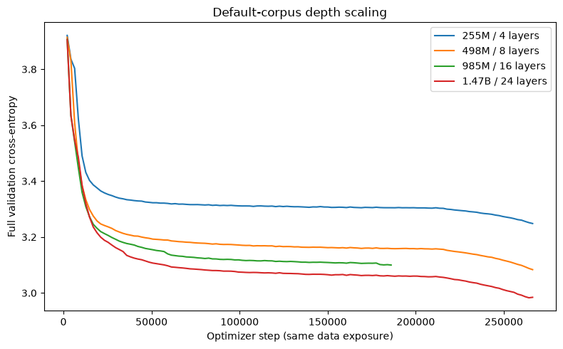

---
marinfold_experiment:
  issue: 362
  title: 'exp: smaller-model scaling on the full default corpus'
  kind: models
  branch: exp/362-smaller-model-scaling
---

# exp: smaller-model scaling on the full default corpus

**Issue:** [#362](https://github.com/Open-Athena/MarinFold/issues/362) · **Kind:** `models` · **Branch:** `exp/362-smaller-model-scaling`

## Question

Does model scale still improve contact prediction at the current 1.47B default, after training three smaller models to completion on the identical full corpus?

## Hypothesis

Validation cross-entropy and contact-prediction accuracy will improve with parameter count through the 1.47B baseline, providing evidence about whether training larger models is worthwhile. A plateau is also informative.

## Background

The default is exp277's first-epoch `contacts-v1-exp277-m2-p06-full-epoch-1.5B`, final step 266344, not its second-epoch continuation. See #277 and LATEST_RESULTS.md. The approximate 250M-document corpus is exactly 232,090,905 native plus ProteinMPNN documents, containing 248,583,762,834 raw tokens and 34,092,146 packed examples.

## Approach

Train three scratch-initialized Qwen3 models with 4, 8, and 16 layers (approximately 250M, 500M, and 1B parameters), versus the existing 24-layer 1.47B control. Change only depth within the model configuration. Preserve hidden size 2048, intermediate size 8192, attention heads 32 / KV heads 8, QK norm, RoPE, tokenizer, sequence length 8192, global batch 128, AdamW LR 0.001 / weight decay 0.2, WSD warmup 10% / decay 20% / minimum LR ratio 0.1, seeds, finite globally shuffled full-corpus traversal, blocked cross-document attention, and scheduled amino-acid order augmentation.

Each production trial must complete all 266,345 optimizer updates (final checkpoint step 266344); smoke runs are separate identities. Record exact parameter counts and executable configuration comparisons to the baseline. Preserve resume state and publish final HF exports with tokenizers.

Try TRC TPU placement first, requiring verified region-local complete inputs. If that cannot work without an unapproved bulk transfer or fails operationally, use existing CoreWeave inputs and batch-priority GPUs. Do not move more than 10 GB across regions without explicit authorization.

Compare final/full learning curves at matched training exposure, and score eval-val and eval-denovo with the exp82/exp245 fixed rollout recipe and paired uncertainty against exp277. Do not access held-out eval-test. Report the scope explicitly: this is a fixed-recipe depth scaling experiment, with one seed per size; extrapolation beyond the measured range is suggestive, not definitive.

## Success criteria

All three runs complete the entire corpus, with reachable native final checkpoints and HF exports including tokenizers. Commit training/evaluation summaries, per-input evaluation timings, plots and summary PDF. Report whether loss and contact accuracy continue improving up to 1.47B and quantify the observed increments without treating an extrapolation as a measured larger-model result.

## Results

All three ten-update smokes completed successfully on 2026-10-13. Their full-corpus count checks passed, observed parameter counts matched the analytic counts, and native step-9 checkpoints and HF exports contain the expected model/config/tokenizer files. The cold startup spent several minutes reconstructing packing before optimizer updates. Measured step times were 0.489 s for 255M on 32 H100s, 1.787 s for 498M on 16 H100s, and 0.996 s for 985M on 64 H100s; these short tests are throughput checks, not model-quality comparisons. The 498M smoke uses fewer GPUs and a larger microbatch than its planned production placement. Exact identities and measurements are in [training_smokes.csv](data/training_smokes.csv).

`verify_checkpoint.py` checked native completion metadata and manifests, HF tensor counts/shapes and object sizes, and the contacts-v1 tokenizer for each smoke. The resulting `data/smoke_depth*_checkpoint.json` manifests record source object identities. This lightweight check does not download or hash the weight payloads; publication and inference must verify the downloaded bytes.

[The 985M production run](https://wandb.ai/open-athena/MarinFold/runs/contacts-v1-exp362-depth16-full-epoch) was submitted as `/bizon/exp362-depth16-train-a01`, using source `5c036e962efe4b8f4156b1d8d89623c968bd1ab2`. Full training and evaluation are pending.

[The 255M production run](https://wandb.ai/open-athena/MarinFold/runs/contacts-v1-exp362-depth4-full-epoch) was submitted as `/bizon/exp362-depth4-train-a01`, using source `6e2df4371275d11287aa9974fe72ae7d2aff0753`. Both 255M and 985M have reached optimizer updates with finite loss.

The [498M production run](https://wandb.ai/open-athena/MarinFold/runs/contacts-v1-exp362-depth8-full-epoch) was submitted as `/bizon/exp362-depth8-train-a01`, using source `6aad8f15e5c092dc54022d900ef56fd1c245315a`. W&B registered it at 18:47 UTC on 2026-10-13, following initial GPU gang admission delay. At 14:10 UTC on 2026-10-14 its training child reported nine preemptions, zero failures, and all four workers running. Initial production placements requested 32, 32, and 64 H100s respectively, at batch priority in `cw-us-east-02a`.

At 13:18 UTC on 2026-10-19, fresh W&B and Iris checks show two completed training runs and one advancing run:

| Model | Completed updates | Progress | Validation loss | Current execution |
| --- | ---: | ---: | ---: | --- |
| 255M | 266,345 | 100% | 3.2483 (final) | Root and training child succeeded |
| 498M | 266,345 | 100% | 3.0834 (final) | Root and training child succeeded |
| 985M | 187,560 | 70.4% | 3.0998 (latest) | Training on eight nodes / 64 H100s |
| 1.47B control | 266,345 | 100% | 2.9844 (final) | Previously completed exp277 baseline |

The 255M and 498M runs report `run_progress=1` and final optimizer step 266344. Their final native checkpoints and HF exports are reachable, with the expected architecture, parameter counts, and contacts-v1 tokenizer. The [255M verification manifest](data/final_depth4_checkpoint.json) and [498M verification manifest](data/final_depth8_checkpoint.json) record source paths, object sizes, and ETags. This checks native metadata/manifests and HF configuration, tokenizer, tensor headers and object sizes; weight payload bytes have not been downloaded or hashed. The native checkpoint timestamps are October 19 at 09:23 UTC and October 17 at 18:22 UTC, respectively.

At the same full training exposure, moving from 255M to 498M lowers final validation loss by 0.1649; moving from 498M to the 1.47B control lowers it by another 0.0990. The 985M run has not reached the final 20% learning-rate decay, so its latest loss is not a final size comparison. Updated learning curves retain optimizer step as their matched-exposure axis.

The 255M run finished through its one-node replacement `/bizon/exp362-depth4-train-a02`, submitted on October 15 using source `14b2a33243bcd1eea576444b61747d91ab45a7e3`. It preserved the full schedule, global batch, optimizer, W&B identity, and checkpoint root. Iris retried the preempted parent tasks during the monitoring gap and created replacement children: `exp362-train-f3e68aae` for 255M, `exp362-train-0590ceee` for 498M, and `exp362-train-a45b279a` for 985M. The old children are killed with reason `Parent task retried`; the new children are recorded in the existing run histories. No new logical trial or W&B identity was created.

Only the 985M production dispatch remains active, requesting 64 H100s. It advanced from 25.4% at the previous live check to 70.4%, with a fresh W&B heartbeat at 13:17:54 UTC. Keep this progressing dispatch. The eligible east02 cluster has zero free H100s; other regions remain unvalidated for these inputs. No corpus transfer or shared-cluster change was made.

There have been 128 failed scheduled observations because the resumed environment denies required filesystem/socket access. This interactive pass restored live visibility, but does not establish that future scheduled passes can run. The existing timer is enabled. Remaining work is the 985M full training run, matched contact evaluations with per-input timings, public HF publication, and the final scaling conclusion.

Setup: the exact sizes are 254,941,696; 498,228,224; and 984,801,280 parameters, versus exp277's 1,471,374,336. All 26 configuration and finite-dataset tests plus eight fleet/persistence tests pass. The full resolved configuration matches exp277 after normalizing depth and operational identities.

TRC preflight inspected the configured GCS regions and found no complete regional MPNN caches. The CoreWeave fallback reuses the exact existing inputs without a corpus transfer. The launch and worker environments retain exp277's committed dependency lock.

## Conclusion

The completed 255M, 498M, and 1.47B models show lower final validation loss as depth increases under the fixed recipe. The 985M final result and matched contact evaluations remain pending, so the contact-accuracy scaling conclusion is not yet available. No model above 1.47B has been measured in this experiment.
