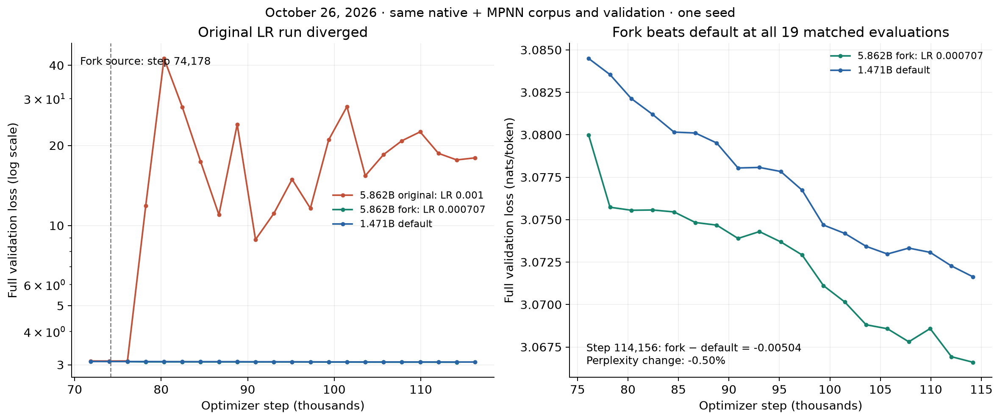
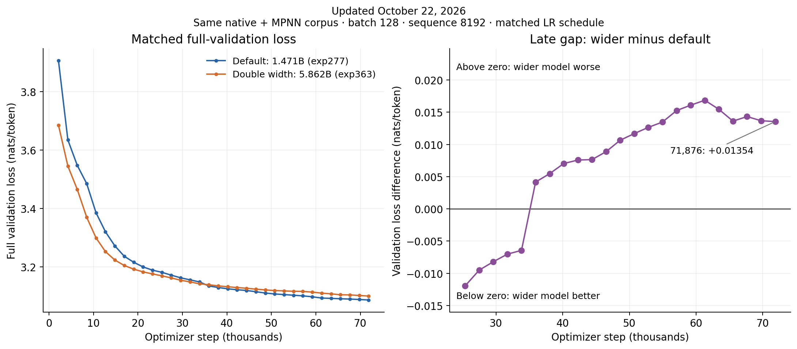

---
marinfold_experiment:
  issue: 363
  title: 'exp: double the channel width of the default exp277 model'
  kind: models
  branch: exp363/double-channel-width
---

# exp: double the channel width of the default exp277 model

**Issue:** [#363](https://github.com/Open-Athena/MarinFold/issues/363) · **Kind:** `models` · **Branch:** `exp363/double-channel-width`

## Current result: lower LR is stable; original diverged (2026-10-26)

At **11:55 EDT**, both a04 drivers and accelerator jobs remain running on
32 H100s each. The original reports step **117,186** (44.00% of 266,345 updates)
at LR **0.001**; the fork reports **116,027** (43.56%) at **0.000707**.
Their latest metric timestamps are 11:51:56 and 11:54:33 EDT, respectively.

The original has diverged. In the inspected step-76,000–78,299 training history,
the first loss above 4 occurs at **77,229** (5.54151). Full-validation loss rises
from **3.09974 at 76,104** to **11.88947 at 78,218**, peaks at **42.43565 at
80,332**, and remains **17.96501 at 116,270**. This is persistent training
instability, despite the scheduler and W&B continuing to report running jobs.

The fork is stable and has lower full-validation loss than the default exp277
model at **all 19 exact-step comparisons** since the fork. The first comparison
at 76,104 is near the end of the LR transition; subsequent comparisons are on
the 0.000707 plateau. At the latest shared evaluation:

| Run at step 114,156 | Full-validation loss |
| --- | ---: |
| Default 1.471B, exp277 | 3.071639 |
| Wide 5.862B, original LR 0.001 | 17.649031 |
| Wide 5.862B, fork LR 0.000707 | **3.066603** |

The fork's advantage over the default is **0.005036 nats/token**, or **0.50%
lower perplexity**. This supports reducing the LR for this width change; the
gain over the smaller default remains modest and is from a single seed before
final cooldown. It does not establish improved protein-contact accuracy.



Both runs were left active under the request to keep the original going.
Stopping the divergent 0.001 control is recommended; no cancellation or schedule
change was made during this status check. The fork still begins final cooldown
at **213,076** and finishes at **266,345 updates**. The W&B snapshot and exact
comparison are in `data/progress_20261026.json`, the plotted observations in
`data/lr_fork_validation_20261026.csv`, and training-loss onset evidence in
`data/original_loss_onset_20261026.csv`. Run identities are linked below.
`plot_lr_fork.py` regenerates this figure offline.

## Both runs recovered (2026-10-23; historical)

**Both jobs are training.** The original completed its first resumed update at
**10:43:58 EDT** and is producing fresh losses. The fork completed its first
update at **10:51:32 EDT**; at 10:52 EDT W&B reports **step 74,190**, LR
**0.00099847547**, and approximately **5.59 seconds/update**. The first nine
recorded fork LRs match the planned ramp (maximum absolute error 1.14e-10).
At the shared first step, **74,179**, the fork and original both report loss
**2.90014386177063**, corroborating the restored state and data position.
There was no post-fork full-validation comparison at that time.

The refreshed CoreWeave key passed authenticated reads through both fsspec and
TensorStore at 10:33 EDT. The original's complete checkpoint **75,031** restores
trainer, Adam and schedule counters **75,032** at LR **0.001**. The fork's preserved
checkpoint **74,178** restores the same counters at **74,179**, with its planned
reduction to **0.000707**. These scalar states were read directly from storage;
the original will replay 91 updates since its last complete checkpoint.

Original driver `/bizon/exp363-train-a04` was submitted at **10:34 EDT** from
commit `563579f2`. Fork driver `/bizon/exp363-fork-train-a04` was submitted at
**10:41 EDT** from commit `d923758f`. Both retain their W&B identities and training
schedules, and request four nodes / 32 H100s each at batch priority. Startup
verification and job details are recorded in `data/recovery_20261023.json`.

Fork attempt a03 passed authentication but exposed a separate configuration
serialization error: defining `ForkAdamConfig` in the CLI module made its remote
identity `__main__.ForkAdamConfig`, which the choice registry could not encode.
It was cancelled before training and replaced with a04. The registered class
now lives in importable `fork_optimizer.py`. All **14 tests pass**, including a
new driver-entrypoint/cloudpickle/subprocess encoding and decoding regression.
The optimizer calculations and checkpoint state structure are unchanged.

## Earlier credential failure (2026-10-23, 10:27 EDT)

At 10:27 EDT, both production jobs were stopped. The original run last reported
**step 75,122** (28.21% of 266,345 updates) at **18:02 EDT on October 22**,
LR **0.001**, train loss **2.86937**. Its latest full validation, at **73,990**,
is **3.09826**. Iris reports that the original child could not restart because
its old submission lacked the now-required `CW_KEY_ID` / `CW_KEY_SECRET`.

The lower-LR fork initialized W&B at 17:08 EDT on October 22 but failed before
its first update. TensorStore's default AWS credential chain could not source
credentials, and reading the first data-cache metadata returned **403
AccessDenied**. The accelerator job's zero exit and W&B's finished label are
misleading: the driver's final-checkpoint guard correctly marked the run failed.
There are no fork loss measurements or LR updates to compare yet.

The runtime now explicitly supplies `AWS_ACCESS_KEY_ID` and
`AWS_SECRET_ACCESS_KEY` from the same CoreWeave credentials used by fsspec.
All 13 local tests passed. Initially, live validation and relaunch were blocked
because CoreWeave's public storage endpoint rejected the workstation's `[cw]`
key with **InvalidAccessKeyId**. The credential refresh and checkpoint
verification above resolved that blocker.

Evidence and prepared recovery commands are in `data/recovery_20261023.json`.
The fork's [W&B record](https://wandb.ai/open-athena/MarinFold/runs/contacts-v1-exp363-m2-p06-full-epoch-5.86B-fork74178-lr7p07e-4)
has a history entry recording its startup failure and the subsequent recovery.
No replacement jobs were submitted with the rejected key.

## Lower-learning-rate fork (2026-10-22)

The requester authorized a parallel continuation at LR **0.000707**, with the
original run continuing at its existing LR. The fork restores the full state
after checkpoint **74,178**: trainer step, Adam count and schedule count are all
**74,179**. The 70.326 GB checkpoint was preserved using a same-bucket server-side
copy in US-EAST-02A; all 89 object sizes were verified and completion metadata was
copied last. The preserved counters were read back through TensorStore. Source
and copy evidence are in `data/fork_source.json` and `data/fork_source_counters.json`.

The fork's LR decreases linearly from **0.001 at step 74,179** to **0.000707 at
step 76,293** (2,114 updates, one validation interval). It then holds 0.000707
through the original plateau, with the final linear cooldown still starting at
**step 213,076** and ending at the original **266,345-update** horizon. The original
10% floor ratio gives a final target LR of **0.0000707**. No warmup is repeated.

`fork_optimizer.py` subclasses the supported AdamConfig scheduler interface while
retaining the original optimizer-state structure. It uses
`TrainerConfig.initialize_from` to preserve weights, Adam moments, RNG and the
absolute data cursor; all corpus/shuffle/augmentation settings remain identical.
Recovery first searches the fork's own checkpoints. Its distinct run identity is
`contacts-v1-exp363-m2-p06-full-epoch-5.86B-fork74178-lr7p07e-4`, with outputs under
the same experiment's `runs/` prefix. The original run's identity and storage
paths are unchanged.

Thirteen local tests passed, including an actual checkpoint round-trip of
nonzero Adam moments and counters, use of the new LR schedule after restoration,
subsequent fork recovery, exact schedule endpoints, matching data configuration
and disjoint output paths. The fork uses the already exercised four-node / 32-H100
profile at batch priority in `cw-us-east-02a`. Driver
`/bizon/exp363-fork-train-a02` was submitted at 20:39:50 UTC; its accelerator child
is `/bizon/exp363-fork-train-a02/exp363-train-755515df`. At 20:45 UTC the fork was
**queued for 32 H100s**: Kueue reports insufficient unused GPU/RDMA quota and all
four pods are scheduling-gated. Iris labels the job running and its tasks
building, but no GPUs have been allocated and no training or W&B initialization
has occurred. The original run remained running at step 74,366 with LR 0.001.
Launch/status evidence is in `data/fork_execution.json`.

The current controller rejects old workstation submission clients. The launcher
uses an isolated Iris checkout at `fe4fbd383dd8ad37a0839b15fb09811b6a72f342`, synced
with its committed lock; the experiment's training dependency lock is unchanged.
CoreWeave also now requires named `CW_KEY_ID` / `CW_KEY_SECRET` credentials for
both driver and child submission. The launcher forwards these through the
supported environment API. Attempt a01 was rejected before execution because
it supplied only the existing `FSSPEC_S3` blob; a02 includes both forms.

## Previous comparison update (2026-10-22)

W&B reports step **73,740**, **27.69%** complete, with the run marked running.
Latest full validation at step **71,876** is **3.09976**, versus **3.08621** for
exp277 at the same step. The [updated comparison](#comparison-with-previous-architectures-2026-10-22)
includes all 34 full-validation observations. This update refreshed W&B metrics;
the checkpoint and hardware verification below is the dated October 19 record.

## Previous infrastructure status (2026-10-19)

**GPU production is running at 18.19% of its epoch.** The latest observed W&B
step is 48,451 (48,452 optimizer updates of 266,345), train loss **2.89288** and
last full validation loss **3.12334**, improved from 3.46485 on October 16.
A subsequently committed rolling checkpoint at **step 48,452** was verified at
13:19 UTC; permanent step 26,634 is also present. The recovery a03 child has had
two preemptions and no recorded failures. Its current optimizer time is
**5.612 seconds/update** on 32 H100s, implying approximately **14.2 remaining
compute days**, excluding validation, checkpointing, queueing and preemptions.
[Production W&B](https://wandb.ai/open-athena/MarinFold/runs/contacts-v1-exp363-m2-p06-full-epoch-5.86B).

**The Interactive v5p-64 trial succeeded on October 16.** All eight workers
completed; no failures or preemptions. The child began at 17:04 UTC, roughly
68 minutes after submission, and finished at 17:18 UTC. It completed 20 updates,
validation, a native step-19 checkpoint, and a 23.448 GB HF export including
`tokenizer.json` and `tokenizer_config.json`. The final smoke losses were 6.64660
train and 6.56125 validation. Its fresh initialization, native-only data and
compressed LR schedule make these smoke losses unsuitable for comparison with
production convergence.
[TPU W&B](https://wandb.ai/open-athena/MarinFold/runs/contacts-v1-exp363-m2-p06-full-epoch-5.86B-tpu-smoke-v5p-64-a03).

The median TPU optimizer time for steps 5–19 is **7.399 seconds/update**
(about 142k tokens/s), versus approximately 5.612 seconds/update (187k tokens/s)
on the current GPU run. This is about **32% longer per update** on 32 v5p chips.
It is an initial execution comparison with different data mixes and attention
kernels, not a tuned hardware benchmark or cost comparison. Production continues
on GPUs; no bulk transfer or production migration has occurred. The previously
estimated migration remains approximately 320.4 GB and would require explicit
cross-region transfer approval.

Evidence: `data/progress_20261019.json`,
`data/checkpoint_verification_20261019.json`, and the TPU run history. The
historical launch/recovery notes below preserve what was known at each stage.

## Comparison with previous architectures (2026-10-22)

**The wider model is still behind at matched training exposure.** The October 22
W&B snapshot reports step **73,740**, or **27.69%** of the planned 266,345 updates,
with the run marked running. Its latest full validation is at **step 71,876**:
**3.09976** versus exp277's **3.08621**, a gap of **+0.01354 nats/token** or
**1.36% higher perplexity**. The gap peaked at +0.01685 at step 61,306 and has
narrowed since, but remains larger than the October 19 observation (+0.00887).
Both losses continue downward; no width advantage is established yet.

The wider model led at the first 16 evaluations; exp277 overtook it between
steps 33,824 and 35,938 and has lower loss at all 18 subsequent observations.
This is a single-seed, incomplete training comparison. Contact accuracy has not
yet been evaluated for exp363.

| Exact matched step | Default 1.471B | Double width 5.862B | Wider minus default |
| ---: | ---: | ---: | ---: |
| 10,570 | 3.38477 | 3.29881 | -0.08595 |
| 21,140 | 3.19945 | 3.18248 | -0.01696 |
| 33,824 | 3.14812 | 3.14168 | -0.00644 |
| 35,938 | 3.13426 | 3.13841 | +0.00415 |
| 46,508 | 3.11447 | 3.12334 | +0.00887 |
| 61,306 | 3.09283 | 3.10968 | +0.01685 |
| 71,876 | 3.08621 | 3.09976 | +0.01354 |



This is the strongest available comparison: the recorded optimizer configs are
identical, data configs differ only in the tokenizer location (the wider run
bundles the verified pinned snapshot), and model configs differ only in
`hidden_dim` and `intermediate_dim`. Both use the same four caches, full
validation cache, global batch 128, sequence length 8192, 266,345-update schedule,
augmentation and seeds. Hardware allocation and gradient accumulation differ.
The baseline learning rate was retained without tuning for the larger model.
Exp277 eventually reached 2.98441 at step 266,344, which is a final target rather
than a matched-exposure comparison.
[Default run](https://wandb.ai/open-athena/MarinFold/runs/contacts-v1-exp277-m2-p06-full-epoch-1.5B)
and [wider run](https://wandb.ai/open-athena/MarinFold/runs/contacts-v1-exp363-m2-p06-full-epoch-5.86B).

Earlier architecture experiments provide context, with their own controls:

| Experiment / architecture | Observed result | How it informs this run |
| --- | --- | --- |
| #108: 48 layers, 2048 hidden, 2.931B, Q/K norm off | All three LR trials became unstable around 6.8–6.9k updates and were stopped | The present width-scaled run has passed that stage with decreasing full-validation loss. This does not isolate depth: Q/K normalization and training recipes also differ. |
| #108: 24 layers, 2816 hidden, 2.776B, Q/K norm on | All three width-scaled trials completed; best final logged loss 2.74185 | Width scaling has trained successfully before. Its older corpus, repeated epochs and validation path prevent ranking that raw loss against this run. |
| #262: NoPE + causal token smear versus its 1.471B control | Final 3.00207 versus 2.97454, a +0.02752 penalty after 145,200 updates | An early advantage reversed at full scale/budget; mid-run rankings can mislead. Different native-only corpus and schedule from exp363. |
| #157: learned RoPE position deltas versus vanilla input embeddings | Corrected same-cache final CE 3.0654 versus 3.0815 | A small positive result within that older recipe; not a direct comparison to the current native-plus-MPNN model. |

Sources: [#108 architecture and stability record](../exp108_models_qwen_3b_contacts_v1/README.md),
[#262 full-budget comparison](../exp262_models_nope_token_smearing/README.md),
and [#157 corrected validation comparison](../exp157_models_fixed_position_embeddings/README.md).
In particular, #157's direct reevaluation of the old vanilla checkpoint changed
its apparent CE from the old logged 2.7037 to 3.0815 on the comparison cache;
historical raw W&B loss values are not a common leaderboard.

The committed `data/training_comparison_curves.csv` contains all 34 wider-model
and 126 baseline full-validation observations available at export time.
`data/matched_width_comparison.csv` is the exact-step join, and
`data/training_comparison_provenance.json` records W&B links, configs and the
historical run inventory. `data/comparison_progress_20261022.json` records the
latest W&B status and validation step. Every baseline observation was checked against
exp277's committed epoch-validation CSV. `plot_training_comparison.py` regenerates
the figure offline without interpolation or smoothing.

**Interpretation:** training remains numerically healthy, but the nearly 4x
parameter increase has not yet earned a validation improvement over the default.
Continue the fixed-recipe comparison; no new learning-rate or architecture change
was made in response to these interim results. Contact accuracy for exp363 has
not yet been evaluated, so these language-model losses do not establish its
protein-contact quality.

## Question

Does doubling the channel width of the current default exp277 model improve contact accuracy at the same one-epoch training exposure?

## Hypothesis

The wider model will reduce held-out language-model loss and improve natural eval-val contact R-precision by at least 0.005 absolute over exp277. This is a single-seed model-capacity comparison, not a compute-matched comparison.

## Background

The current default is `contacts-v1-exp277-m2-p06-full-epoch-1.5B`, trained from scratch in #277 for one epoch over 232,090,905 native plus ProteinMPNN documents (248.584B raw tokens). Its published step-266344 config has 24 layers, hidden width 2048, MLP width 8192, 32 query heads, 8 KV heads, head dimension 64, vocabulary 2845, and untied embeddings. The exact parameter count including Q/K norms is 1,471,374,336.

The requested variant doubles both hidden and MLP widths, as explicitly confirmed by the requester. Keep head counts fixed so the head dimension doubles too:

| Setting | Current default | Wider variant |
| --- | ---: | ---: |
| Hidden width | 2048 | 4096 |
| MLP width | 8192 | 16384 |
| Layers | 24 | 24 |
| Query / KV heads | 32 / 8 | 32 / 8 |
| Head dimension | 64 | 128 |
| Parameters | 1,471,374,336 | 5,861,984,256 |

This is approximately 5.862B parameters, 3.984x the default. The parameter calculation includes both vocabulary matrices, attention projections, three gated-MLP matrices per layer, residual/final RMS norms, and Q/K norms. Validate it against the actual model parameter tree before launch.

## Approach

- Train from scratch on the exact four completed exp277 caches, with the same finite globally shuffled epoch: 34,092,146 packed examples and 266,345 optimizer updates at global batch 128 and sequence length 8192.
- Retain exp277's optimizer/schedule, seeds, RoPE, full validation set, contact document format, and scheduled amino-acid augmentation. Pin the existing tokenizer revision explicitly. This isolates width; optimizer tuning would be follow-up work.
- Use a feature branch and PR with an experiment-local launcher, committed dependency lock, architecture/count audit, and tests of the resolved training configuration.
- Inspect live CoreWeave capacity, keep data and training in US-EAST-02A, and run a short GPU smoke before production. Adjust only execution settings such as per-device microbatching to fit the larger model while preserving global batch.
- Log training to `open-athena/MarinFold`, create run history immediately when W&B initializes, and retain resumable checkpoints with run name and step.
- Export/publish checkpoints with tokenizer files. Evaluate contact rollout-v2 on eval-val and eval-denovo against exp277, recording per-input timings. Do not use eval-test for routine iteration.
- Maintain the experiment README and summary slides with observed results and runtime.

## Success criteria

- Exact architecture and parameter-tree count validated before GPU production launch.
- Smoke completes optimizer updates, validation, and checkpoint writing with finite metrics.
- Production completes the same full corpus epoch, with durable checkpoints and tokenizer.
- Report paired contact R-precision differences with protein-bootstrap intervals; a >=0.005 natural eval-val gain supports the stated hypothesis. Report eval-denovo separately and preserve the single-seed and increased-compute caveats.

## Results

The abstract Levanter model-tree audit confirms **5,861,984,256 parameters**, versus **1,471,374,336** for exp277 (3.984x). The audit allocates no model weights; its output is committed in `data/parameter_counts.csv`.

Twelve local tests pass, including the resolved Marin training contract and the inherited finite-epoch dataset tests. Only `hidden_dim` and `intermediate_dim` differ in the model configuration. Per-device microbatch is one; global batch remains 128. The tokenizer is pinned to revision `80f4e411b957641e8c350b07bbe1e2c832697518`.

The live federation inventory at 2026-10-13 14:43 UTC reports 248 available H100s in `cw-us-east-02a`, with no pending tasks. An initial 16-node / 128-H100 smoke was attempted at batch priority; subsequent placement was reduced to 64 H100s as recorded below. The data is already in the regional CoreWeave bucket; no corpus transfer is required. See `data/launch_capacity.json`.

The 64-H100 smoke completed successfully: ten optimizer updates, final train loss **8.56948**, two-batch validation loss **8.03575**, and **2.821 seconds/update**. Native and HF step-9 checkpoints are present; the HF export includes tokenizer files. `data/smoke_metrics.json` records the final W&B summary and exported file sizes. The compressed ten-step LR schedule produced finite but spiky training losses (including 31.25); the smoke establishes execution/memory/checkpoint correctness, not convergence. Production retains exp277's full 10% warmup (~26,634 updates), with no LR retuning.

Production uses **four nodes / 32 H100s**, microbatch one per GPU and accumulation four, preserving global batch 128 and all 266,345 updates. Driver [`/bizon/exp363-train-a02`](https://iris.oa.dev/#/job/%2Fbizon%2Fexp363-train-a02), source `56f10733`, submitted at 2026-10-13 15:14:24 UTC. Child: `/bizon/exp363-train-a02/exp363-train-4fae9eab`. The [production W&B run](https://wandb.ai/open-athena/MarinFold/runs/contacts-v1-exp363-m2-p06-full-epoch-5.86B) initialized at 15:15:36 UTC and reports 32 H100 devices. Subsequent progress and TPU exploration are recorded below. See `data/production_startup.json` and the committed run history. The first production submission requested 64 H100s but was cancelled before GPU/W&B initialization because other full training runs left only 56 H100s available. The smaller allocation starts within that capacity. The original smoke remains the 64-H100 execution check; the resolved 32-H100 production configuration also passed the batch/update-count check.

Production measured **5.608 seconds/update** on 32 H100s, approximately **17.3 days of optimizer time** for the full epoch, excluding validation, checkpointing, and preemptions. Repeated preemptions make a calendar completion estimate unreliable. The CPU parent has a 30-day timeout and waits for the GPU child. Production retains the baseline's full validation schedule.

The first GPU smoke `/bizon/exp363-train-smoke-a01` failed before model/W&B initialization because this Levanter release passes `repo@revision` to Hugging Face without parsing it. The tokenizer is now bundled as an unmodified, explicitly revisioned local snapshot using the loader's supported directory interface. A new integration test loads it through the actual training backend and checks the exported HF tokenizer vocabulary. The second smoke was cancelled before GPU startup because other jobs consumed capacity, leaving 88 free H100s. The third smoke uses eight nodes / 64 H100s and gradient accumulation to retain global batch 128. Its run is [contacts-v1-exp363-m2-p06-full-epoch-5.86B-smoke-n8-a03](https://wandb.ai/open-athena/MarinFold/runs/contacts-v1-exp363-m2-p06-full-epoch-5.86B-smoke-n8-a03), Iris `/bizon/exp363-train-smoke-a03/exp363-train-ecf49211`, source `65e00f6332d7ca39580d69c4eac8f900aebc2b26`. All eight workers completed distributed initialization and W&B reports 64 H100 devices.

## Conclusion

The requested architecture has **5,861,984,256 parameters**. Keeping the default
LR of 0.001 led to persistent divergence, first apparent in full validation at
step 78,218. The full-state fork with a reduction to **0.000707** remains stable
and beats the smaller default at all 19 matched post-fork evaluations available
on October 26. At step 114,156 its advantage is **0.005036 nats/token** (0.50%
lower perplexity). This is a small, single-seed improvement before final
cooldown; final training-quality and contact-accuracy conclusions remain open.

## TPU trial (2026-10-14)

The GPU job has encountered eleven preemptions and is again queued. A completed
step-3848 optimizer checkpoint exists on CoreWeave. Its observed steady compute
speed is approximately 5.6 seconds/update; interrupted wall time is much longer.

The requester asked to try TPUs. `tpu_smoke.py` runs twenty updates on **v6e-32
(32 actual chips), pinned to us-east5-b**, at global batch 128, sequence length
8192, per-device microbatch one, and tensor parallelism one. It changes only the
attention implementation to the TPU Splash kernel; architecture and parameter
count are unchanged. Native AFDB/ESM and validation caches already exist under
`gs://marin-us-east5/protein-structure/MarinFold/exp232_train_trc/tokenized/`.
The trial uses those native caches, a fresh initialization and compressed smoke
schedule. It measures hardware compatibility/throughput, not production
convergence or a continuation of the native/MPNN epoch.

The initial v5p-64 attempt was cancelled before execution because the pool was
in degraded provisioning backoff. The replacement uses the same data region.
Driver: `/bizon/exp363-tpu-smoke-v6e-32-a01`; child:
`/bizon/exp363-tpu-smoke-v6e-32-a01/exp363-train-952f2c08`; source:
`8ddd24eba02e501d6314ba022d3af20782bf7f1f`. Submitted at
2026-10-14 20:43:52 UTC; awaiting TPU slice startup. The CPU driver and TPU child
use batch priority. All trial inputs, compilation caches, checkpoints and
exports remain in us-east5. Seven architecture, tokenizer and resolved GPU/TPU
configuration tests pass. The dependency lock adds libtpu and CPU Torch wheels
without removing or changing an existing package version.

Migrating production requires **250,073,316,791 bytes** of MPNN caches plus
**70,326,053,055 bytes** for the observed full step-3848 checkpoint: **320.4 GB**
total from CoreWeave to GCS. Native and validation caches need no copy.
`data/tpu_migration_assessment.json` records source prefixes, object counts and
byte totals. No bulk transfer has been performed; root AGENTS.md requires
explicit human sign-off for cross-region copies larger than 10 GB.

### 2026-10-15 recovery

The first v6e trial never initialized W&B or reached training. Its CPU driver
was preempted five times, killing and requeuing the TPU children, then exceeded
the two-hour execution timeout. The launcher now explicitly pins the CPU driver
to non-preemptible workers and allows 24 hours for queueing and the short test;
the TPU allocation remains preemptible. The replacement driver is
`/bizon/exp363-tpu-smoke-v6e-32-a02`, source
`288a63cdbf7a0aacde5b7ba389b72ae6c37eab83`, submitted 2026-10-15 14:39 UTC.
TPU optimizer throughput remains unmeasured.

GPU production has twelve preemptions and is queued. Last reported optimizer
step is 3918 (1.47% of the epoch), train loss 3.45197; the last validation loss
is 3.68509. Those metrics were logged on 2026-10-14 at 20:03:50 UTC, so they do
not establish overnight progress. The complete step-3848 checkpoint remains
reachable. The 320.4 GB production migration is still awaiting explicit transfer
approval; no bulk copy has been started.

### 2026-10-16 checkpoint failure and recovery

GPU training reached step **8438** (8,439 updates, **3.17%**), with train loss
**3.15777**, last validation loss **3.46485**, and **5.638 seconds/update**.
The job then failed in the asynchronous checkpoint barrier
`tensorstore_checkpoint_28::0` after a 30-minute timeout. Iris and W&B marked
the run finished despite the incomplete epoch. The last complete checkpoint is
**step 8120**, committed at 02:02:09 UTC; step 8279 has no completion metadata.
See `data/recovery_20261016.json` for the observed metrics and storage evidence.

The runtime now requires a committed final step-266344 checkpoint before
recording production success. Recovery bypasses the stale executor success
marker while retaining the fixed input versions, run identity, checkpoint path,
and full training schedule. Ten architecture, GPU/TPU configuration, tokenizer,
and recovery tests pass. Restart `/bizon/exp363-train-a03`, source
`241b26c99ea261a57a2695fe3b937471968e4da7`, was submitted at 15:42:01 UTC
on 32 H100s. Child `/bizon/exp363-train-a03/exp363-train-0cdc9fb5` is running
startup. Checkpoint restoration and new updates are not yet confirmed; this restart does not establish a fix for the underlying
checkpoint barrier failure.

The TPU a02 driver remained pending because it requested 8 GB while 2.1 GB was
available. Building and fingerprinting its actual plan used 451,380 KB peak RSS
locally, so the replacement requests 0.5 CPU and 2 GB on non-preemptible workers.
Trial `/bizon/exp363-tpu-smoke-v6e-32-a03` was submitted at 15:41:57 UTC from
the same source revision. Its CPU driver has started dependency setup; no TPU
child or optimizer throughput is confirmed yet.

The migration assessment now references the complete step-8120 checkpoint
(70,326,130,929 bytes). Together with MPNN caches it remains approximately
**320.4 GB**. Transfer approval is still pending and no bulk copy has occurred.

### TPU selection revision (2026-10-16)

The requester questioned the v6e choice. v6e was an availability fallback after
v5p provisioning failures; it had not demonstrated better training performance.
The v6e a03 TPU child was still pending and was cancelled before training.
The preferred trial is now **v5p-64: 32 chips across eight VMs in us-east5-a**,
submitted as `/bizon/exp363-tpu-smoke-v5p-64-a02` from source
`3ee08a5cf209e7d7e4b9d3af75ab13f03da757a9`. The existing tested configuration,
20-step budget, regional native data and stable CPU-driver settings apply.

Google documents v6e as supporting transformer training and serving; the
single-VM v6e-8 configuration is specifically optimized for inference. v5p
provides 95 GiB HBM/chip and 2,765 GB/s HBM bandwidth, versus v6e's reported
32 GB and 1,638 GB/s. v5p also has higher per-chip bidirectional ICI bandwidth
(1,200 versus 800 GB/s), while v6e has higher peak BF16 compute (918 versus
459 TFLOP/s/chip). We prioritize v5p's memory and communication headroom for
5.862B training at 8K context; superior measured throughput is not established.
Sources: [v5p](https://docs.cloud.google.com/tpu/docs/v5p),
[v6e](https://docs.cloud.google.com/tpu/docs/v6e).

At 15:49 UTC the regional v5p-64 pool reported one ready slice and one booting,
but provisioning health remained degraded with recent failures. Ready does not
establish that a slice is free. Placement and TPU optimizer results are pending.

### Interactive TPU priority (2026-10-16)

The requester shared prior cluster guidance that batch jobs occupied much of
the TPU fleet and Interactive jobs could obtain capacity promptly. The old
screenshot is historical evidence, not current availability. Both the CPU
driver and accelerator child had been explicitly submitted at Batch priority.
The launcher and runtime now explicitly select Interactive for TPU trials;
setting only the driver would leave our previously explicit child band at Batch.
The GPU production submission settings are unaffected.

The batch v5p a02 child remained pending while requesting eight co-scheduled
workers. It was cancelled before training and replaced by
`/bizon/exp363-tpu-smoke-v5p-64-a03`, source
`2bc4cf065a95da2bd4244afe04bb050216238328`, submitted at 15:54:20 UTC.
Both requested bands are Interactive. The non-preemptible CPU driver and
preemptible TPU hardware settings are separate from scheduler priority.
Ten existing architecture, configuration, tokenizer and recovery tests pass.
At 15:55:42 UTC, all 16 healthy workers across the two regional v5p-64
slices reported Batch TPU jobs. Iris recorded the replacement driver as
Interactive. Its child `/bizon/exp363-tpu-smoke-v5p-64-a03/exp363-train-3f5081a0`
submitted at 15:56:03 UTC and also has verified Interactive priority. It remains
pending: eight-worker coscheduling requires 224 GB host RAM per worker while
the reported slice has 176.8 GB free, and the autoscaler reports quota-pool tier
monotonicity blocking additional provisioning. The account budget permits
Interactive and reports no spend against its 75,000 limit. See
`data/priority_capacity_20261016.json`. Optimizer execution and throughput
must still be established.

## Reproduction

Run from the repository root:

```bash
JAX_PLATFORMS=cpu uv run --project experiments/exp363_models_double_channel_width --locked python -m experiments.exp363_models_double_channel_width.count_parameters
JAX_PLATFORMS=cpu uv run --project experiments/exp363_models_double_channel_width --locked --with pytest python -m pytest -q experiments/exp363_models_double_channel_width/test_train.py experiments/exp277_models_single_mpnn_pilot/test_epoch_data.py
uv run --no-project python experiments/exp363_models_double_channel_width/launch.py train-smoke --nodes 8 --attempt 3
# After the smoke succeeds:
uv run --no-project python experiments/exp363_models_double_channel_width/launch.py train --nodes 4 --attempt 2
uv run --no-project python experiments/exp363_models_double_channel_width/launch.py train --nodes 4 --attempt 3 --resume
uv run --no-project python experiments/exp363_models_double_channel_width/launch.py tpu-smoke --tpu v5p-64 --attempt 3
uv run --no-project --with matplotlib python experiments/exp363_models_double_channel_width/build_summary.py
```

The launcher submits a CPU parent through the current Iris CLI and bundles the pinned exp277 training runtime. Its GPU child is also batch priority; the parent waits for the child. Production has bounded task-failure recovery and resumes from its own checkpoint. Smoke attempts use separate run identities. No exp277 weights are restored.

Production run name: `contacts-v1-exp363-m2-p06-full-epoch-5.86B`.
Checkpoints: `s3://marin-us-east-02a/MarinFold/exp363_models_double_channel_width/runs/contacts-v1-exp363-m2-p06-full-epoch-5.86B/checkpoints/step-<N>/`.

The implementation reuses exp277's finite-epoch dataset, cache verification, and pinned CUDA setup. It retains the baseline's 1e-3 learning rate; whether that remains optimal at 5.86B is an experimental uncertainty, not a result already established by the smoke.
