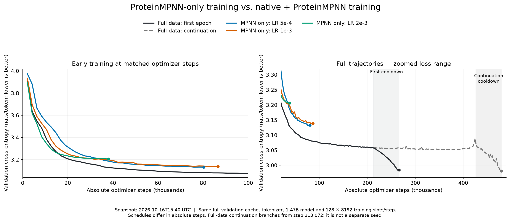

---
marinfold_experiment:
  issue: 364
  title: 'exp: ProteinMPNN-only training for two epochs with a learning-rate sweep'
  kind: models
  branch: main
---

# exp: ProteinMPNN-only training for two epochs with a learning-rate sweep

**Issue:** [#364](https://github.com/Open-Athena/MarinFold/issues/364) · **Kind:** `models` · **Branch:** `main`

## Question

How does the current default 1.47B contacts-v1 model train when its training data contains only ProteinMPNN redesigns, with no native-sequence training documents?

## Hypothesis

Training exclusively on inverse-folded sequences may retain structural learning while changing generalization to natural versus designed proteins. A three-point learning-rate sweep tests optimization sensitivity without changing the default architecture or other training settings.

## Background

The current default is #277's scratch-trained `contacts-v1-exp277-m2-p06-full-epoch-1.5B` (final checkpoint step 266344), as recorded in LATEST_RESULTS.md. Its #266 redesign subset contains exactly 162,574,724 documents (31,702,680 AFDB plus 130,872,044 ESM-Atlas), approximately the requested 166 million. Existing audited token caches reside on CoreWeave and contain 174,107,898,831 raw tokens. Native documents are excluded from training; the default validation set remains unchanged.

## Approach

Train three models from scratch for two complete epochs of the redesign subset, with peak learning rates 0.0005, 0.001, and 0.002. Preserve exp277's 24-layer Qwen3 (hidden 2048, MLP 8192, 32 attention / 8 KV heads, QK norm and RoPE), tokenizer, sequence length 8192, global batch 128, AdamW weight decay 0.2 and other optimizer parameters, WSD warmup 10% / cooldown 20% / minimum ratio 0.1, model/data/augmentation seeds, document packing and clipping, blocked cross-document attention, validation, and scheduled amino-acid statement-order augmentation. Scale the schedule over the requested two-epoch duration. Traverse the complete concatenated redesign corpus once per epoch with a fresh deterministic shuffle, without equal-source reweighting, oversampling, or native training documents.

Audit the packed-example counts before launch, enforce exact finite two-epoch coverage, and retain stable per-trial W&B/checkpoint identities for recovery. Use existing CoreWeave inputs and available batch-priority GPUs; TRC remains permitted if complete regional data already exists. No bulk cross-region transfer is authorized. Keep W&B routing at open-athena/MarinFold. Launch separate smoke identities before production.

## Success criteria

All three trials complete two full redesign epochs with verified final native checkpoints. Preserve per-trial run history, learning curves, provenance, and final HF exports with co-located tokenizers. Report validation losses at matched exposure and any operational failures. Contact benchmark evaluation is a follow-up rather than a prerequisite for launching these requested runs.

## Results

The 2026-10-13 in-region audit (`/bizon/exp364-lr1e-3-audit-a01`) succeeded and independently reproduced the source counts in `data/epoch_corpus_counts.csv`: 23,921,189 packed examples per epoch. Two epochs expose exactly 47,842,378 examples; 373,769 updates at batch 128 leave 74 real examples and 54 padding examples in the last batch. The first epoch boundary is crossed without padding or repeating examples. The inherited 8192-token clipping policy removes one trailing token from each of 772 documents per pass; no document is dropped.

Six CPU tests pass. They compare the resolved recipe directly against exp277, enforce redesign-only training with unchanged validation, exercise complete traversal and deterministic resume across the epoch boundary through Levanter's actual loader, and check that resizing a gang does not change production identity. The default run's recorded W&B model and optimizer settings were also checked; `data/default_recipe.json` preserves that reference.

The isolated [64-H100 smoke](https://wandb.ai/open-athena/MarinFold/runs/contacts-v1-exp364-mpnn-only-2ep-lr1e-3-1.5B-smoke-a01) completed all ten updates with finite losses. Native step-9 metadata and HF weights plus `tokenizer.json` / `tokenizer_config.json` were verified in S3. Metrics are in `data/smoke.csv`; its short-run losses are only a pipeline check.

Production launched with 32 H100s per trial on `cw-us-east-02a` at batch priority (96 GPUs total). The four-sequence microbatch is below exp199/exp232's measured limit of eight sequences per H100; global batch remains 128. The 64-H100 smoke validated the complete two-epoch data path, training, validation and checkpoint/export behavior. Gang size is independent of run identity, so capacity changes resume the same trial.

| Peak LR | Production W&B | Initial Iris root |
| --- | --- | --- |
| 0.0005 | [lr5e-4](https://wandb.ai/open-athena/MarinFold/runs/contacts-v1-exp364-mpnn-only-2ep-lr5e-4-1.5B) | `/bizon/exp364-lr5e-4-train-a01` |
| 0.001 | [lr1e-3](https://wandb.ai/open-athena/MarinFold/runs/contacts-v1-exp364-mpnn-only-2ep-lr1e-3-1.5B) | `/bizon/exp364-lr1e-3-train-a01` |
| 0.002 | [lr2e-3](https://wandb.ai/open-athena/MarinFold/runs/contacts-v1-exp364-mpnn-only-2ep-lr2e-3-1.5B) | `/bizon/exp364-lr2e-3-train-a01` |

All three trials were registered as running in W&B on 2026-10-13 at 15:10 UTC. Their live saved configurations were checked against the actual default run: model fields and all optimizer values match except the requested learning rate; the exact two-source training subset, global batch 128, 373,769-step target, and augmentation duration were verified. Final results are pending.

### Validation comparison, 2026-10-16

The current curves remain above the completed native-plus-ProteinMPNN exp277 run at matched optimizer steps. All five saved W&B configurations agree on the model, tokenizer, validation component and cache, context length, precision, blocked document attention, and full (uncapped) validation. Global training batch is 128 throughout. Equal steps therefore match packed token slots, although padding and corpus composition mean they do not match the number of real tokens or proteins.

| exp364 peak LR | Latest validation step | Redesign-only loss | exp277 loss at the same step | Gap (nats/token) |
| --- | ---: | ---: | ---: | ---: |
| 0.0005 | 80,332 | 3.13276 | 3.08213 | +0.05062 |
| 0.001 | 86,674 | 3.13842 | 3.08010 | +0.05831 |
| 0.002 | 38,052 | 3.20600 | 3.12896 | +0.07704 |

At the common step 38,052, redesign-only losses are 3.18634, 3.19716, and 3.20600 in ascending LR order, against exp277's 3.12896. The smallest LR currently leads this sweep. Both longer-running trials continue to improve slowly around loss 3.13; none has reached its cooldown.

The completed [exp277 first epoch](https://wandb.ai/open-athena/MarinFold/runs/contacts-v1-exp277-m2-p06-full-epoch-1.5B) ended at loss **2.98441**, step 266,344 (best 2.98274 at 264,250). Its [additional full-corpus epoch](https://wandb.ai/open-athena/MarinFold/runs/contacts-v1-exp277-m2-p06-full-epoch2-from213072-1.5B) ended at **2.98099**, absolute step 479,417. The latter restores the first run's pre-cooldown checkpoint at 213,072 and adds a fresh full-corpus pass; these are two completed trajectories, not independent seeds. The first run was already at about 3.059 before cooldown, so cooldown alone does not explain the current matched-step gap.

Schedule timing remains a confound: the two-epoch redesign-only schedule warms up over 37,376 updates, versus 26,634 for the first full-data run, and its amino-acid augmentation ramps over 373,769 rather than 266,345 updates. These are preliminary LM-validation results, not measurements of contact accuracy or a final causal estimate of removing native sequences.

`compare_validation.py` reproduces the figure from `data/validation_comparison.csv`; `--refresh` retrieves current W&B histories, checks every expected validation step, and verifies the saved validation configurations against the full-data run. Completed curves come from exp277's audited committed CSVs, including the continuation's deduplicated resume history. `data/validation_comparison.json` records source hashes, W&B links, observed progress, schedules, and the comparison contract.

The [public comparison artifacts](https://huggingface.co/buckets/open-athena/MarinFold/tree/data/exp364-models-mpnn-only-lr-sweep/validation/2026-10-16) include the source CSV, provenance, PNG, PDF, and generating script. From the repository root, reproduce with `uv run --project experiments/exp364_models_mpnn_only_lr_sweep --frozen --with matplotlib python experiments/exp364_models_mpnn_only_lr_sweep/compare_validation.py`; append `--publish` to upload the saved snapshot with the HF CLI.

## Reproduction

`launch.py audit` verifies the regional token caches and recomputes packed-example counts. `launch.py train-smoke --trial lr1e-3 --nodes 8 --attempt 1` launches the isolated ten-update gate. `launch.py train --trial <lr5e-4|lr1e-3|lr2e-3> --nodes 4 --attempt 1` launches one production trial. Run launch commands with `uv run --project scripts python experiments/exp364_models_mpnn_only_lr_sweep/launch.py` from the repository root. The launcher uses the experiment's committed lock and source bundle on workers.

`observe.py` reads the experiment's W&B group and optionally persists observations in the sweep SQLite database; it makes no placement or recovery decisions. `utilization.py` reads current Iris v3 fleet availability (free/held accounting is unchanged from v2; v3 changes priority-band ordering). Launch and recovery decisions remain agent-owned.

Each trial writes to `s3://marin-us-east-02a/MarinFold/exp364_models_mpnn_only_lr_sweep/runs/<run-id>/`, with native final checkpoint `checkpoints/step-373768` and the default trainer's HF export. Preserve the tokenizer with published exports. The run IDs are generated by `config.py` and stay fixed across attempts and gang sizes.

## Conclusion

Training is in progress. As of 2026-10-16, all three redesign-only trials have higher LM validation loss than the full-data run at matched optimizer steps; 5e-4 leads this sweep. Final checkpoints and contact evaluations are still needed, and differing schedule durations limit attribution to the training subset alone.
