---
marinfold_experiment:
  issue: 368
  title: 'exp: proofreader guided inference for accurate contact maps'
  kind: evals
  branch: codex/exp368-proofreader-guidance
---

# exp: proofreader guided inference for accurate contact maps

**Issue:** [#368](https://github.com/Open-Athena/MarinFold/issues/368) · **Kind:** `evals` · **Branch:** `codex/exp368-proofreader-guidance`

**Completed 2026-10-22.** The useful inference change is to generate ordinary
rollout pools and weight their contact votes by squared predicted rollout F1.
On the frozen 1,473-structure reserved comparison, this raises R-precision from
0.54501 to 0.55021: +0.00520 (95% paired group interval 0.00299–0.00767),
at 1.513 times the warm GPU cost. The original 15 guided policies and the
subsequent threshold mixtures do not improve the measured ordinary-pool
accuracy/cost frontier. All experiment jobs are terminal.

Read the [summary PDF](plots/summary.pdf), the
[reserved comparison](#completed-reserved-comparison), or the
[threshold-mixture results](#mixtures-of-thresholds-across-rollouts).
Figures, tables, scripts and immutable execution source bundles are also in the
[public artifact directory](https://huggingface.co/buckets/open-athena/MarinFold/tree/data/exp368/reports).

## Question

Can the released exp356 proofreader improve complete MarinFold contact maps by guiding candidate selection, lookahead, population search, repair, or aggregation at inference time?

## Hypothesis

Proofreader guidance will improve precision and recall at matched compute, with lookahead benefiting from the model's demonstrated retrospective contact judgments. Strong guidance may sacrifice candidate coverage or exploit score errors, so actual contact accuracy and diversity must be measured.

## Background

Builds on #356 and PR #358. Freeze generator exp277 step 266344 and proofreader exp356-exp277-frozen-contact-pdb50k-v2 step 18000. The user authorized autonomous implementation, CoreWeave execution, and job monitoring. Existing checkpoints and targets are co-located in CoreWeave us-east-02a.

The [released proofreader](https://huggingface.co/buckets/open-athena/MarinFold/tree/checkpoints/exp356-exp277-frozen-contact-pdb50k-v2/step-18000)
uses the frozen causal Qwen3 contact generator as its feature extractor. A
four-layer bidirectional transformer, width 512 with eight attention heads,
reads the three token states for every emitted contact, emission-order features,
and a global rollout token. The readout has 22,181,378 trainable parameters;
the complete frozen-backbone model has 1,487,731,202 parameters. Contact sigmoid
outputs estimate correctness, and a pooled sigmoid output estimates rollout
recall. All supplied contacts can inform each contact judgment. This experiment
keeps every model weight fixed and changes inference and map aggregation only.

The reader was trained on actual generator rollouts from 50,000 experimental
PDB chain structures (46,933 PDB entries), with 34,894 distinct supplied sequences
in 9,074 connected related groups. Its validation split has 1,552 structures in
287 groups. The larger inference-validation panel here excludes all 32 pilot
groups, leaving 1,375 structures in 255 groups; it is not simply the validation
split minus 32 individual proteins. Split construction and the original model
release are documented in [exp356](../exp356_models_pdb_rollout_proofreader/README.md).

Reference labels inherit exp356's audited experimental targets from exp222:
native-only pyconfind contacts, a 3 Å side-chain threshold, minimum contact
degree 0.001, and sequence separation at least six. Targets exclude internal
sequence gaps and truncated contact lists; short terminal omissions are accepted
only when the resolved sequence maps to one contiguous canonical span under
the frozen preparation rules. Recall uses the complete reference contact set
for that retained sequence. Long-range results further require separation at
least 24. The contact definition and target preparation remain fixed throughout.

## Approach

1. Implement and verify cached, batched contact proposals and proofreader readout against the released inference implementation. Preserve actual prompts and original contact semantics.
2. Use a deterministic group-aware validation pilot for candidate-ranking diagnostics and end-to-end policy comparisons: top-percentile filtering; soft probability weighting; short lookahead; population search; one-pass suffix repair; and larger independent rollout pools with alternative aggregators.
3. Measure all/long-range R-precision, average precision over the full eligible pair universe, precision at fixed L-based budgets, recall/precision curves, candidate coverage, diversity, and per-input GPU time. Include a fast ordinary-generation baseline and matched-compute comparisons; distinguish compute envelopes from exact matching.
4. Extend promising policies to a larger validation panel. Freeze selection and stopping rules before one final reserved-test comparison. Never select policies on test results.
5. Save resumable per-input artifacts, source hashes, timing CSVs, job and recovery metadata. Publish figures and a written result report, including negative results.

## Success criteria

At least one guided policy should improve final contact-map quality over ordinary sampling and proofreader-weighted aggregation at comparable measured GPU cost, with paired group-bootstrap uncertainty. A complete null result is acceptable if the planned policy families are tested and the failure mode is measured.

## Results

The original guided pilot completed on 2026-10-22 UTC: all 1,920 trajectories
and 480 protein-policy groups are committed. Eleven CPU tests
cover cache isolation, full-forward equivalence, proposal resampling, lookahead
commit boundaries, repair-prefix reconstruction, full-universe AP, exact
diversity-discount equivalence to a set-based reference, and restriction of
reserved-test analysis to one frozen pair on a complete cohort. The first
H100 smoke test verified that every frozen backbone weight matches the original
generator. It also caught a BF16 incremental/full-forward discrepancy (maximum
0.02394 contact probability); the experiment therefore tests FP32 cached search
and rescores final maps through the released BF16 full-forward implementation.
The complete guided pilot is reported below; no partial cohort was used for
final policy selection. The ordinary nested-pool baseline is complete on all 32
pilot structures. Sum-q R-precision rises from 0.5792 at eight rollouts to 0.5993
at 128; long-range R-precision rises from 0.5537 to 0.5806. The paired all-contact
gain is 0.0200 (95% group-bootstrap interval 0.0050–0.0329). Oracle candidate
coverage rises from 0.7765 to 0.9509. At 128 rollouts, frequency alone gives
0.6040 all-contact and 0.5864 long-range R-precision. These pilot means should
not be compared with means on the larger validation cohort.

Two aggregation variants were added after observing the pilot: confidence as a
tie-breaker for integer vote counts, and votes weighted by predicted rollout F1.
Their all-contact gains over frequency at 128 rollouts are 0.0004 and 0.0018;
both paired 95% intervals include zero. These are exploratory validation results.
CSV inputs and timings are in `data/pilot_pool/`; the figure is
`plots/pilot_pool.png`. An independent-pool latency benchmark requests each
pool in a single vLLM call, avoiding the staged baseline's repeated batch costs.

Ordinary-pool diagnostics now include fixed sequence-length-budget precision/recall
curves, emitted-contact calibration and trajectory overlap. On the 128-rollout
pilot, mean absolute error in per-rollout predicted precision is 0.0606 and in
predicted recall is 0.0547, averaged within each structure and then across the
32 structures. Mean pairwise trajectory Jaccard overlap is 0.3473 (at most 128
deterministically sampled trajectory pairs per protein). These measurements are
for ordinary generation; guided-rollout calibration is evaluated separately.
The calibration curve pools contacts, whereas the reported error means weight
structures equally. Figures and diagnostic CSVs are generated by
`diagnose_maps.py` and `plot_diagnostics.py`.

The separate single-batch pool benchmark is also complete on all 32 pilot
structures. At 128 rollouts, frequency ranking gives all-contact R-precision
0.6036 and long-range R-precision 0.5894, using 7.165 mean warm H100 seconds per
map. Relative to eight rollouts with sum-q aggregation (0.5792 all-contact,
0.5537 long-range, 2.649 seconds), the paired gains are 0.0244 (95% interval
0.0101–0.0373) and 0.0357 (0.0154–0.0519). At 128 rollouts, sum q gives 0.6006
all-contact and 0.5876 long-range R-precision at 9.581 seconds. The candidate
pool contains 95.39% of native contacts. These single-batch measurements are the
preferred practical cost baseline; nested pools remain a separate experiment.
Neither score nor timing comparisons treat stochastic completions from different
batch sizes or deployments as identical. Data are in `data/pilot_direct/`.

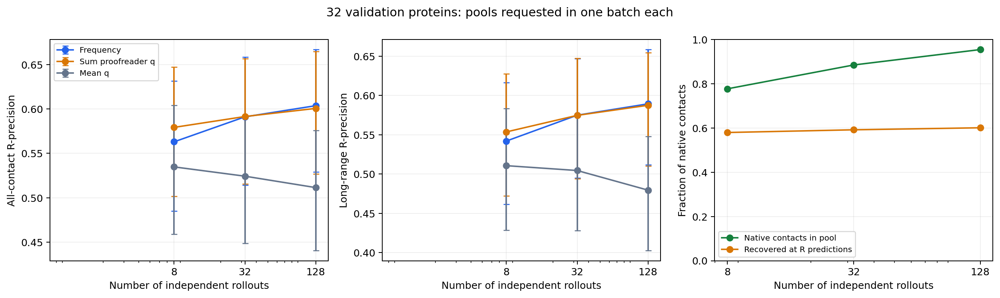

On the same complete pilot, `analyze_reranking.py` identifies exactly which
contacts enter and leave the top R when frequency ranking is replaced by sum q.
At eight rollouts, sum q changes 15.37% of those prediction slots on average and
improves all-contact R-precision by 0.0163 (95% paired interval 0.0090–0.0248).
At 128 rollouts, it changes 7.62% of slots and the mean effect is −0.0031
(−0.0099–0.0039), which does not establish a difference. True contacts gained
and lost by these swaps exactly reproduce the per-protein metric differences.
Thus the pilot supports proofreading small pools, but does not establish an
additional ranking benefit at 128 rollouts. This is a retrospective diagnostic
of existing complete pools; the larger validation comparison is reported below.

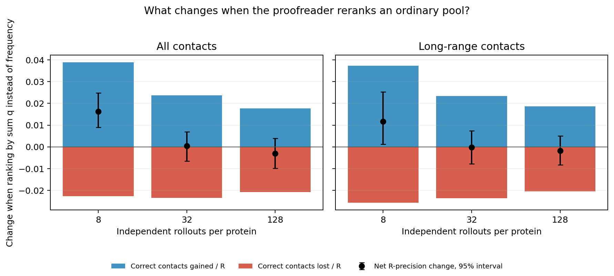

### Complete original guided pilot

All 15 policy families are complete on all 32 pilot proteins. No guided
configuration improves the measured H100 ordinary-sampling quality/cost frontier,
including any of the seven aggregation rules. The highest guided all-contact
R-precision is 0.56871 (soft guidance with exponent 1, four rollouts and
sqrt-frequency aggregation), versus 0.60365 for 128 ordinary frequency-ranked
rollouts. Its mean cost is 77.076 versus 7.165 warm H100 seconds. These are
implementation-level compute comparisons, not lower bounds on search cost.

| Policy (four rollouts, sum q) | R-precision | Long-range R-precision | Coverage | Mean warm H100 seconds |
| --- | ---: | ---: | ---: | ---: |
| control | 0.56322 | 0.52742 | 0.70294 | 32.504 |
| uniform-k16 | 0.55386 | 0.53310 | 0.68620 | 116.457 |
| top10-k16 | 0.51157 | 0.46787 | 0.51502 | 44.348 |
| top25-k16 | 0.52087 | 0.48558 | 0.52608 | 49.167 |
| top50-k16 | 0.56507 | 0.52850 | 0.58970 | 63.542 |
| top10-k64 | 0.49120 | 0.45467 | 0.49243 | 150.065 |
| soft1-k16 | 0.56773 | 0.54915 | 0.63991 | 77.076 |
| soft2-k16 | 0.55830 | 0.52851 | 0.59182 | 58.423 |
| soft4-k16 | 0.53864 | 0.50056 | 0.54824 | 48.604 |
| explore10-k16 | 0.52199 | 0.48822 | 0.52812 | 48.798 |
| look8-k16 | 0.51696 | 0.46836 | 0.51860 | 824.419 |
| look32-k16 | 0.49875 | 0.45427 | 0.50193 | 3117.978 |
| total-k16 | 0.51505 | 0.47178 | 0.52196 | 46.531 |
| particles8-b8 | 0.56620 | 0.53538 | 0.68123 | 510.151 |
| repair-k16 | 0.53922 | 0.50662 | 0.56137 | 79.652 |

Top-10%-of-16 filtering produces individually cleaner but shorter rollouts:
mean precision rises from 0.48287 for the matched control to 0.71445, while
contacts per sequence residue fall from 0.89804 to 0.46402 and recall falls
from 0.49001 to 0.40480. Four-rollout sum-q R-precision falls by 0.05164
(95% paired group interval −0.07400 to −0.02909), and long-range R-precision
falls by 0.05956 (−0.08403 to −0.03520), at 1.364 times control cost.

Soft exponent-1 guidance gives the best sum-q guided map: 0.56773 overall and
0.54915 long-range. Relative to the constrained control, the all-contact change
is +0.00452 (−0.00854 to +0.01625); long-range improves by 0.02173
(0.00974–0.03493), at 2.371 times the cost. Against 128 ordinary frequency
rollouts, however, it loses 0.03592 overall (−0.05070 to −0.02305) and 0.04023
long-range (−0.05398 to −0.02745), at 10.757 times the cost. Population search
has no established all-contact gain against its constrained control. Thirty-two
contact lookahead costs 3,117.978 seconds per four-rollout map and loses
0.06447 R-precision against that control (−0.08603 to −0.04204).

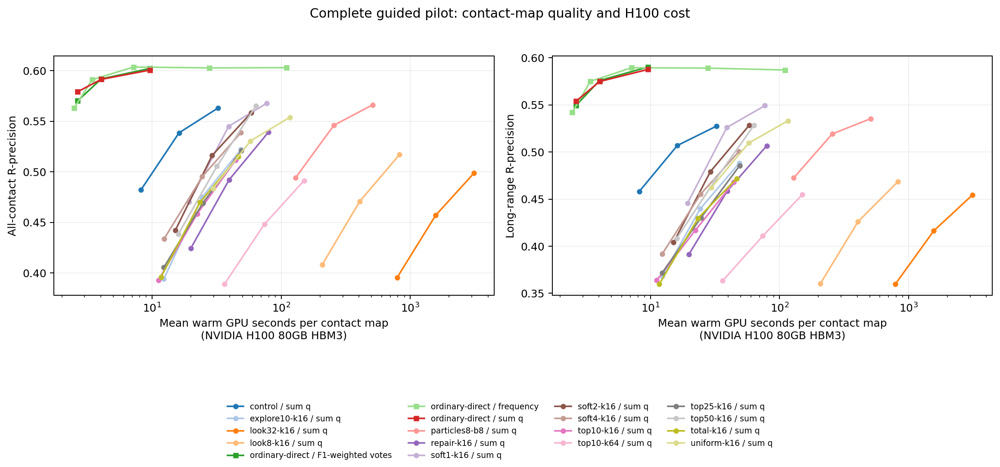

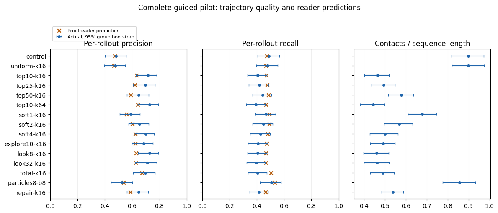

Conditional candidate diagnostics show that the reader does identify better
next contacts. For top-10%-of-16 sampling, within-prefix AUC is 0.77781 and
selected-contact accuracy exceeds the mean sampled-proposal accuracy by 0.26803.
The selected contacts are slightly underconfident in these ordinary-stopping
rollouts: mean immediate score 0.68368 versus actual accuracy 0.72061. This
local benefit fails to produce a better complete map because coverage and
trajectory length decline. It is distinct from the overconfidence observed
under forced 2L continuation below. Diagnostics sample the first four decisions
and every eighth thereafter, average within proteins, and retain proposal-slot
multiplicity. They are descriptive comparisons across each policy's own prefixes.

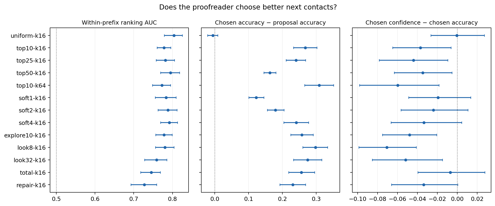

Data and all 1,920 measured inference timings are in `data/pilot_guided/`;
all candidate diagnostics are in `data/pilot_guided_candidates/`. After this complete pilot, only F1-weight power 2 advanced as a new aggregation
configuration on the existing larger-validation pools; its promotion rule was
committed before those new metrics were computed. The resulting frozen reserved
comparison is documented below.

### Mixtures of thresholds across rollouts

At the user's request, `pilot_mixtures.json` was committed at `576c86cb`
before a validation-only reuse analysis of the completed guided trajectories.
Two mixtures combine top-10%, top-25% and top-50% selection, either alone or
with ordinary constrained sampling. Top-20% was not separately generated;
with 16 proposals, both the nominal 20% and 25% gates retain four slots under
the ceiling rule. This tests
different fixed thresholds across rollouts; it does not test changing the
threshold within a rollout. The separately frozen reserved comparison is unchanged.

For a fixed budget of four rollouts, each sample identity appears once. All
three or four cyclic assignments of policies to sample identities are evaluated,
then their metrics and costs are averaged within each protein. No favorable
assignment is selected, and reused rotations do not count as independent
proteins. Full-pool mixtures instead include four trajectories from every
component, giving 12 or 16 rollouts. Frequency, sum q and squared-F1 votes were
specified before this analysis. No additional GPU inference was needed.

| Configuration | Rollouts | Aggregation | R-precision | Long-range | Coverage | Warm H100 seconds |
| --- | ---: | --- | ---: | ---: | ---: | ---: |
| Ordinary constrained control | 4 | Sum q | 0.56322 | 0.52742 | 0.70294 | 32.504 |
| Top 50% | 4 | Sum q | 0.56507 | 0.52850 | 0.58970 | 63.542 |
| 10/25/50% mixture | 4 | Sum q | 0.53920 | 0.50033 | 0.54825 | 52.352 |
| Ordinary + 10/25/50% mixture | 4 | Sum q | 0.56158 | 0.53120 | 0.60379 | 47.390 |
| 10/25/50% full pool | 12 | Sum q | 0.57042 | 0.53787 | 0.62196 | 157.057 |
| Ordinary + 10/25/50% full pool | 16 | Sum q | 0.58153 | 0.55412 | 0.74542 | 189.561 |
| Ordinary + 10/25/50% full pool | 16 | Squared F1 | 0.58393 | 0.55602 | 0.74542 | 189.561 |
| Fast ordinary pool | 128 | Frequency | 0.60365 | 0.58938 | 0.95392 | 7.165 |

The prespecified four-rollout 10/25/50% mixture loses 0.02587 R-precision
against top-50% alone (95% paired group interval −0.03373 to −0.01777).
Adding ordinary sampling gives a change of −0.00164 against the ordinary
four-rollout control (−0.00998 to +0.00628), with a long-range change of
+0.00378 (−0.00415 to +0.01249), at 1.458 times its cost. These mixtures
therefore do not establish a fixed-rollout-budget benefit.

Pooling more trajectories improves coverage, but remains uncompetitive with
the fast ordinary pool. Even the best all-contact mixture result among the
three fixed aggregation rules, 16 rollouts with squared-F1 votes, loses
0.01972 overall (−0.03135 to −0.00904) and 0.03336 long-range
(−0.04744 to −0.01944) against ordinary frequency at 128, at 26.456 times
the measured warm cost. This does not rule out other mixture weights or
within-rollout schedules; neither was selected or tested here.

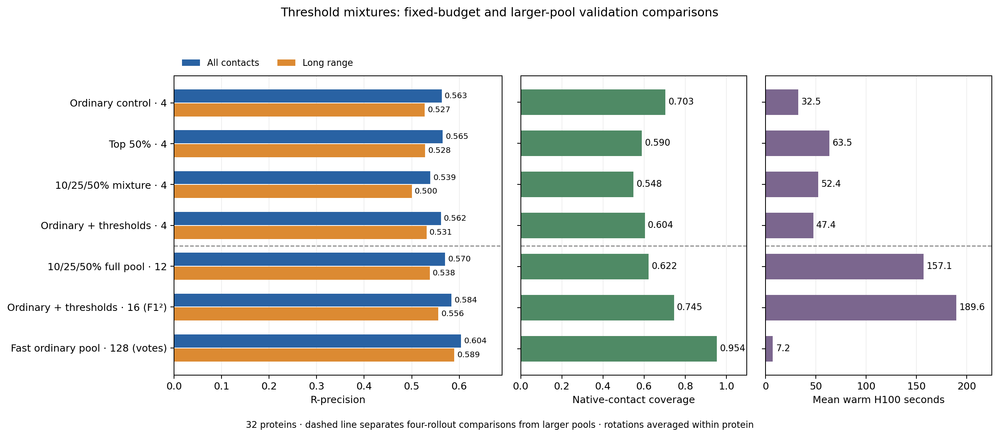

All assignment-level and protein-level metrics, paired comparisons, and
assignment/coverage/cost integrity checks are in `data/pilot_mixtures/`.
Uncertainty uses the same 32 pilot groups and is exploratory and unadjusted.

### Larger validation frequency baseline

Ordinary generation is complete for all 1,375 structures in the 255 validation
groups outside the pilot. With frequency ranking, increasing from eight to 128
rollouts improves all-contact R-precision from 0.5014 to 0.5477. The paired gain
is 0.0463 (95% group-bootstrap interval 0.0403–0.0526). Long-range R-precision
increases from 0.4709 to 0.5215, a gain of 0.0506 (0.0430–0.0586), over the
1,371 structures with at least one long-range native contact. Mean warm generation
cost increases from 2.431 to 6.599 H100 seconds per map (2.714 times the cost).

Oracle candidate coverage increases from 0.7392 to 0.9523, while full-universe AP
increases from 0.4565 to 0.5632. At 128 rollouts, precision at L, L/2 and L/5 is
0.5058, 0.6709 and 0.7932 respectively. This comparison uses frequency for both
pool sizes. Fresh proofreader-weighted scoring on the same generated pools is
now complete and reported below; the older 1,552-structure reanalysis uses a
different cohort. Data and all 2,750 contemporaneous
per-input generation timings are in `data/validation_frequency/`.

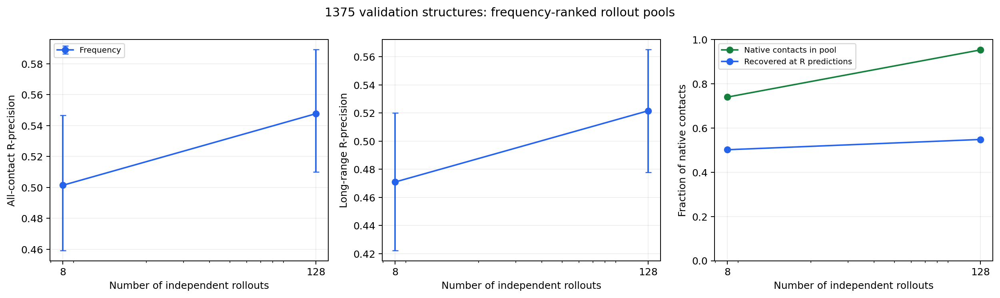

Across the larger validation panel, 1,196 structures improve with 128 votes,
63 tie and 116 worsen; the median R-precision gain is 0.0392. Descriptive
stratification at 128, 256 and 512 residues finds positive mean gains in every
length band, for both all-contact and long-range R-precision. The 128-rollout
median warm latency is 4.345 seconds, its 95th percentile is 17.024 seconds,
and the maximum is 63.331 seconds. These measured times exclude model loading
and output writes. Fixed length strata and underlying values are saved beside
the full-panel metrics.

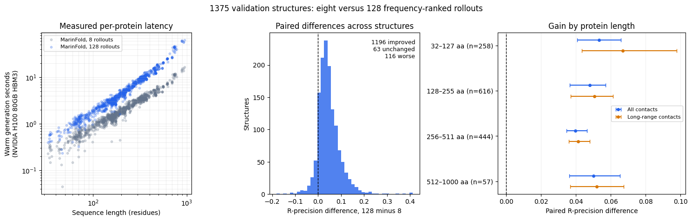

### Complete proofreader aggregation validation

All 2,750 pools have also been scored by the released full-forward reader.
The table uses all 1,375 structures; long-range metrics use the 1,371 with
at least one eligible native contact. Costs include generation and, where
needed, proofreading, excluding model load and artifact writes.
CPU map aggregation and metric computation are outside these GPU-stage timings;
they are not end-to-end serving latencies.

| Rollouts | Map ranking | R-precision | Long-range R-precision | Mean warm H100 seconds |
| ---: | --- | ---: | ---: | ---: |
| 8 | Frequency | 0.50137 | 0.47089 | 2.431 |
| 8 | Sum contact confidence | 0.51737 | 0.48799 | 2.580 |
| 128 | Frequency | 0.54769 | 0.52153 | 6.599 |
| 128 | Sum contact confidence | 0.54762 | 0.52242 | 8.921 |
| 128 | Confidence breaks vote ties | 0.54820 | 0.52216 | 8.921 |
| 128 | Votes weighted by predicted rollout F1 | 0.55195 | 0.52565 | 8.921 |

At eight rollouts, sum q improves R-precision over frequency by 0.01601
(95% paired group-bootstrap interval 0.01239–0.02033) and long-range
R-precision by 0.01710 (0.01240–0.02223). At 128, the corresponding changes
are −0.00008 (−0.00386–0.00424) and +0.00089 (−0.00371–0.00599), which do
not establish an additional benefit. Averaging confidence alone performs
poorly: R-precision is 0.47455 at eight and 0.45504 at 128 rollouts.

The exploratory rollout-F1 weighting is more promising at 128: relative to
frequency, its gains are 0.00426 (0.00173–0.00763) overall and 0.00412
(0.00129–0.00781) for long-range contacts, at 1.352 times the measured cost.
Every unique eligible contact in a rollout receives that rollout's predicted
F1 as its vote weight. Predicted precision is the mean confidence over all
unique parsed contact pairs, including invalid pairs; predicted recall is the
reader's rollout-level output. The trajectory weight is
$2\widehat P\widehat R/(\widehat P+\widehat R)$, with a numerical floor of
$10^{-8}$. Only eligible pairs vote in the final map, and native labels are not
used to set weights. This variant was added after the ordinary-pool pilot, and these
intervals are not adjusted for selecting among aggregation rules. This is
validation evidence, not a reserved-test confirmation.

Data, per-input timings, and all seven aggregation rules are in
`data/validation_pool/`. Paired comparisons use identical generated pools.

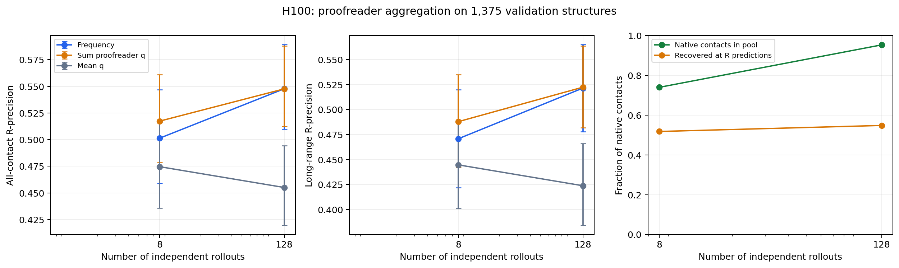

The contact-level audit over the full panel explains this pattern. Sum q
replaces 18.29% of top-R slots at eight rollouts, and 8.70% at 128. True
contacts entering minus true contacts leaving exactly reproduce each
protein's R-precision difference. At 128 the gained and lost fractions nearly
cancel. See `data/validation_pool/reranking_per_protein.csv.gz`.

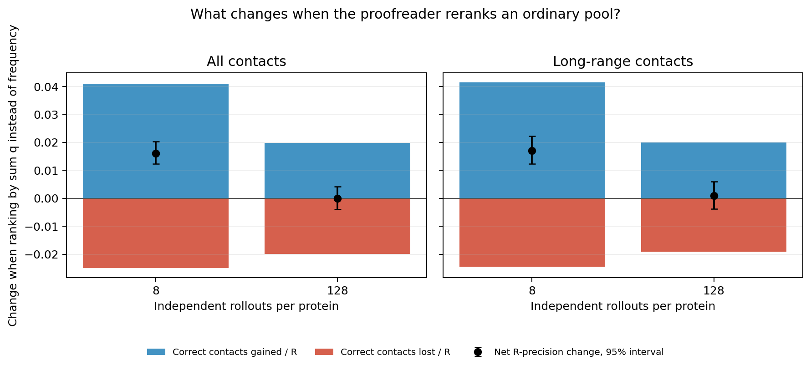

For 128-rollout ordinary pools, the per-structure mean absolute error in
predicted rollout precision is 0.05238 and in recall is 0.05768. Mean
predicted recall is 0.38840 versus observed recall 0.40864; the contact-level
calibration curve nevertheless closely follows the diagonal. This illustrates
why aggregate calibration does not guarantee optimal ranking of candidate
contacts or accurate rollout recall. Mean sampled trajectory-pair Jaccard
overlap is 0.26679. All trajectories in this panel ended with sampled EOS.
With 128-rollout F1 weighting, selecting L contacts gives mean precision
0.50908 and recall 0.59423; selecting L/2 gives precision 0.67623 and recall
0.40055. These fixed prediction budgets depend only on sequence length.
The diagnostic compares the eight-rollout sum-q and 128-rollout F1-weighted
configurations, so their difference combines pool size and aggregation.
Data are in `data/validation_diagnostics/`.

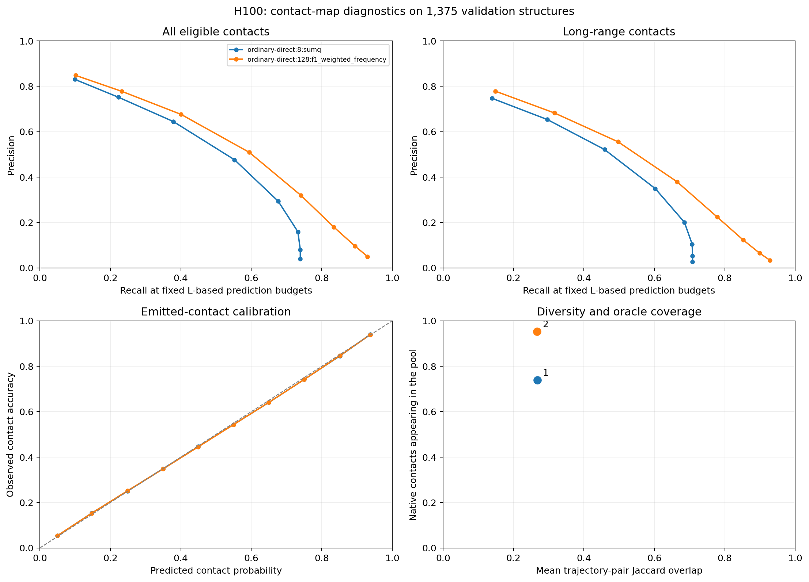

The following contact maps show the three proteins already chosen for numerical
checks: first, middle and last length ranks of the pilot (33, 193 and 937
residues). Both columns rank the same 128 H100 rollouts and select L contacts.
They were chosen without accuracy selection and illustrate individual maps;
the full-panel paired comparisons above establish the average effects.
The coordinate CSV in `data/contact_examples.csv.gz` reproduces the figure
without access to model weights or private rollout storage.

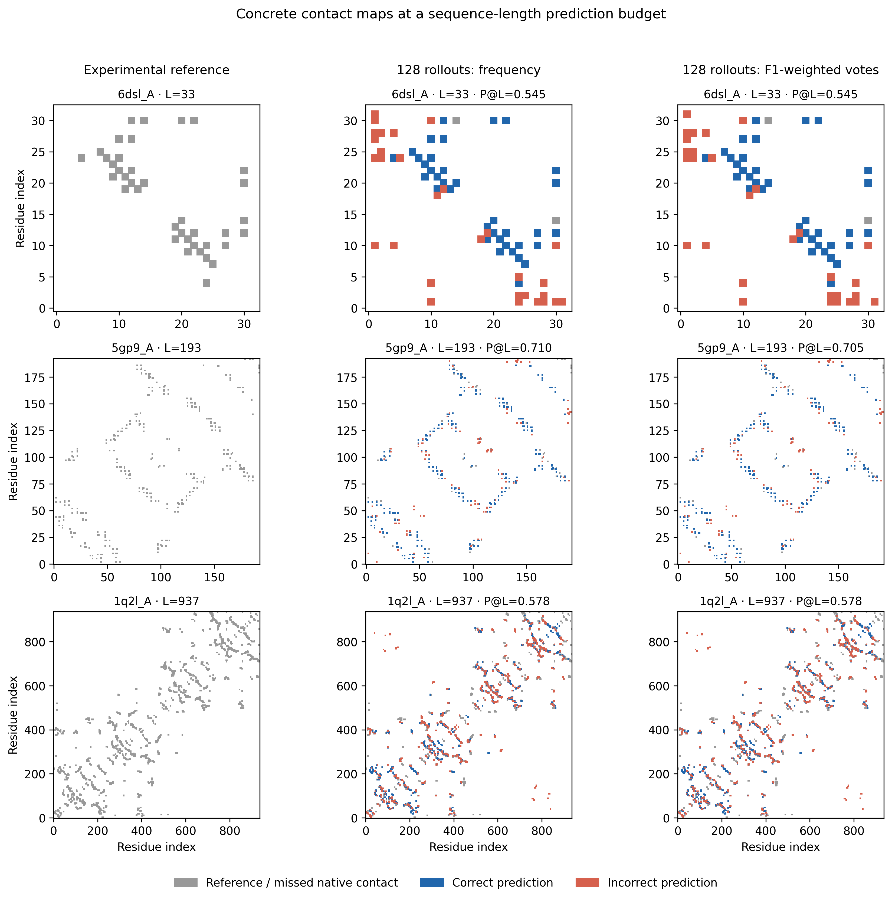

### Frozen pilot protocol

`pilot.json` fixes 32 validation proteins from 32 distinct homology groups,
spanning 33–937 residues. One representative per group is chosen by a SHA256
key, then 32 uniformly spaced length ranks are selected. Neither contact labels
nor previous model quality enters panel selection. Four independent prompts and
sampler seeds are used per guided policy and protein. The same prompt identities
seed the ordinary rollout pool.

The pilot includes an ordinary grammar-constrained control, uniform selection
from 16 proposals, top 10/25/50% of 16 proposals, top 10% of 64, soft weights
q^beta for beta 1/2/4, top-10% selection with 10% unguided exploration, 8/32-contact
lookahead with two continuations per proposal, ranking by total expected correct
contacts, eight-particle search in blocks of eight, and one-pass suffix repair.
Percentile gates retain ceil(fraction*K) proposals: the nominal 10% gate keeps
2/16 or 7/64. Generator probability is already represented by proposal sampling;
it is not multiplied into resampling weights again.

At a prefix $S$, the generator samples proposal contacts $c_1,\ldots,c_K$.
The bidirectional reader scores each hypothetical prefix $S+c_j$, giving
$q_j=\widehat P(\text{contact }c_j\text{ is correct}\mid S+c_j,\text{sequence})$.
Hard filtering samples uniformly among the highest-scoring $\lceil fK\rceil$
proposal slots. Soft filtering instead samples with weights
$w_j=\max(q_j,10^{-8})^\beta$. The exploration variant mixes the gated
distribution with 10% uniform probability over all proposal slots. Repeated
proposals remain separate slots, preserving the generator's sampled multiplicity;
previously committed contacts are excluded. This does not enumerate or rank
the complete residue-pair universe, or guarantee that retained contacts have
90% correctness probability.

Lookahead replaces $q_j$ by its mean after two separately sampled futures of
eight or 32 contacts, truncated only at the context/contact limit. Later
contacts may revise the judgment of $c_j$, but only $c_j$ is committed.
The total-score variant ranks candidates by the sum of the reader's revised
probabilities for **all** contacts in $S+c_j$, allowing a proposal to change
confidence in earlier contacts. These are validation experiments with the
existing reader; its probabilities are not assumed to remain calibrated under
the shifted distribution caused by guidance.

The constrained sampler permits valid contacts with sequence separation at least
six and no duplicate pairs. It samples the first endpoint, then the second,
using temperature 1 and top-p .95 after each grammar mask. It is consequently a
grammar-conditioned generator, with its own matched control. EOS is sampled
once at each contact boundary, without proofreader intervention. Lookahead uses
a fixed contact horizon and does not commit its future tokens; this is
length-conditioned evidence, not a trained terminal-value estimate. Population
search ranks current prefixes by predicted F1 and applies a 0.1 Jaccard penalty
while selecting survivors; descendants contribute one final map per run.
Repair uses future evidence to locate the lowest-confidence contact in the
first half, discards that contact and its suffix, then regenerates with guidance.

Independent ordinary generation uses the original unconstrained vLLM recipe.
Nested pools of 8, 32 and 128 rollouts are generated in waves of 8, 24 and 96,
so their cumulative generation and proofreading costs are measured directly.
Aggregation compares frequency, sum q, mean q, sqrt(frequency)*mean q, and sum q
with inverse-neighbor weights for trajectories whose Jaccard similarity is at
least 0.8. These pool comparisons retain the actual generator's invalid and
duplicate diagnostics; map metrics consider only eligible unique pairs.

The cost comparison evaluates the implementations actually run: ordinary pools
use vLLM batching, while guided search uses the verified PyTorch cache and
explicit branching. Search timings include discarded candidate and lookahead
work. They do not establish a lower bound on the achievable cost of guidance
with a different inference engine. Completed-trajectory timings exclude queue
waits and work lost to preemption; job and recovery ledgers separately record
those operational interruptions.

Primary outcomes are all-contact and long-range (separation at least 24)
R-precision and AP over the complete eligible pair universe, including all
unproposed pairs at score zero. We also report precision at L, L/2 and L/5,
candidate-pool oracle recall, and measured H100 inference time. Timing includes
discarded proposals, lookahead, repair and final rescoring; model loading is
reported separately. Cost claims distinguish measured envelopes from exact
matching. Group bootstrap intervals retain a mean-over-structures estimand.
R-precision uses R equal to the number of eligible native contacts solely for
evaluation; inference does not know R. The emitted map is a ranked contact-score
map, and deployable fixed-size outputs can instead select L, L/2 or L/5 pairs
using sequence length alone. Summed or F1-weighted votes are ranking scores,
not calibrated probabilities that a residue pair is in contact. Unfilled
prediction slots count as misses, and no native labels determine an inference
budget or a contact ranking.

After the pilot, choose at most three methods on the validation accuracy/cost
frontier, with all-contact R-precision primary and long-range R-precision used
to reject gains limited to local contacts. Extend these methods to the remaining
validation groups before writing a fixed test plan. No reserved-test scores are
read for tuning, panel selection or stopping decisions. The existing test set
was previously used for the proofreader release, as disclosed throughout this
report; generator pretraining decontamination is not established.

### Exploratory fixed-length control

An additional compute-envelope baseline, `pilot_large.json`, requests independent
ordinary pools of 512 and 2,048 rollouts on the same 32 pilot structures. It was
added before the full guided pilot was available because observed lookahead cost
already substantially exceeded the 128-rollout baseline. Pool sizes were fixed
before these runs; frequency ranking can be evaluated directly from raw outputs.
This adaptive baseline measures the benefit of spending more compute on ordinary
sampling and does not claim exact matching to every guided policy's cost.

While the original pilot was running, five short proteins had complete results
for every policy. On this shared, incomplete cohort, top-10% filtering increased
mean per-rollout precision from 0.5862 to 0.6956, but emitted 26.10 rather than
40.85 contacts and reduced recall from 0.5803 to 0.5193. Every trajectory in
these two groups ended with a sampled EOS. These observations motivate a
stopping-rule test; they do not select a winner or estimate full-pilot performance.

`length_probe.json` freezes an additional exploratory comparison on the same
32 pilot proteins: ordinary constrained sampling and top-10%-of-16 sampling,
each evaluated at exactly L and 2L unique contacts with EOS disabled. Four
independent continuations are generated per sampler and protein. The L map is
a prefix of its corresponding 2L continuation, giving 256 underlying trajectories
and 512 prefix maps. No artificial EOS is appended. Both methods receive the
same fixed budgets, which depend only on sequence length. Timings accumulate
generation and prefix scoring, including the intermediate L score in the 2L
cost, while excluding artifact writes. This addition is explicitly adaptive and
uses no new reserved-test scores. The original 15-policy protocol remains frozen.

### Execution and numerical validation

The primary guided and fixed-length experiments use H100 GPUs. FP32 cached
search passes the unchanged 1e-5 full-forward check, and final trajectories are
rescored through the released BF16 reader. The initial BF16 cache failed and
was rejected before the main experiment. Both source and plan are hash-pinned;
each completed trajectory has an independent durable commit marker and timing.

A separate ordinary-generation and full-forward-scoring replication runs on
GB200. The verified PyTorch 2.10.0+cu128 reader passes the original replay guard
on three length-selected reference proteins: exact contact-score agreement for
193 and 937 residues, and maximum difference 0.001523 at 33. GB200 cached search
fails the original FP32 tolerance and is excluded. vLLM differs between hardware
phases (0.9.2 on H100, 0.14.1 on GB200), so timings are reported separately and
do not isolate GPU speed alone.

The shared Iris controllers and batch capacity were intermittently unavailable.
The H100 campaign ultimately resumed as owned Kubernetes Jobs in the existing
Kueue batch queue, without changing shared cluster configuration or priority.
Completed outputs were preserved through source/ETag/SHA256-verified migrations;
original scientific bundles and seeds remained unchanged. Native workers retain
the inherited `runner_tag=iris` field, so `data/native_dispatches.jsonl` is the
authoritative submission-backend record.

An early preempted server repeated input staging and exceeded its intended
9.5 GB transfer ceiling. It was stopped when detected. Subsequent regional
mirrors reserve reads durably under a 7 GB cap, and large model reads are
colocated. The incident, failed numerical checks, exact storage locations,
recoveries and source audits are retained in [execution notes](execution_notes.md)
and the linked `data/` manifests. The scientific cost tables measure successful
warm inference work; they exclude queue time, staging and work lost to preemption.

### Separate GB200 ordinary-pool replication

The complete 32-protein GB200 replication has eight-rollout sum-q R-precision
0.5783 and long-range R-precision 0.5591. At 128 rollouts, frequency achieves
0.6025 and 0.5860, while sum-q achieves 0.5995 and 0.5846. Mean warm costs are
1.511 seconds for eight-rollout sum q, 3.471 seconds for 128-rollout frequency
and 5.204 seconds for 128-rollout sum q. Data are in `data/pilot_direct_gb200/`.
These are a separate hardware/runtime cohort: vLLM 0.14.1 on GB200 differs from
the H100 vLLM 0.9.2 baseline, so the timing difference does not isolate GPU speed.
The 512- and 2,048-rollout pools are also complete for all 32 structures:

| Independent rollouts | Frequency R-precision | Long-range R-precision | Native contacts present | Mean warm GB200 seconds |
| ---: | ---: | ---: | ---: | ---: |
| 128 | 0.60248 | 0.58597 | 95.20% | 3.471 |
| 512 | 0.60319 | 0.58579 | 98.60% | 18.404 |
| 2,048 | 0.60257 | 0.58449 | 99.33% | 82.198 |

Relative to 128 rollouts, 2,048 changes all-contact R-precision by +0.00009
(95% paired interval −0.00426–0.00503) and long-range R-precision by −0.00148
(−0.00687–0.00411), at 23.68 times the measured cost. This does not establish
an accuracy benefit. Candidate coverage approaches saturation while frequency
ranking plateaus; recovering additional true contacts requires better ranking
of the candidate pool. The frequency-only comparison is followed by an adaptive proofreading check below.
Data and paired comparisons are in `data/pilot_large_gb200/`; the combined
frequency curve is in `data/pilot_pool_scaling_gb200/`.

At 20:15 UTC, after observing the frequency plateau and the full-panel
128-rollout F1-weighting gains, an additional exploratory scoring phase was
frozen in `data/large_pool_proofreading_extension.json`. It applies the same
released full-forward reader to all 64 existing GB200 pools at 512 and 2,048
rollouts. Its primary contrast is 2,048 versus 128 with F1-weighted votes;
all seven existing aggregation rules will also be reported. It generates no
new rollouts, changes no weights, and uses no new reserved-test metrics.
This is an adaptive validation extension, not a prespecified confirmation.
All 64 pools have now been scored. F1-weighted R-precision is 0.60378,
0.60503 and 0.60380 at 128, 512 and 2,048 rollouts. The primary 2,048-minus-128
difference is +0.00002 (95% paired interval −0.00463–0.00500); long-range
changes by −0.00269 (−0.00911–0.00317). Mean warm generation-plus-proofreading
time rises from 5.204 to 108.403 GB200 seconds, a factor of 20.83. Thus larger
pools do not establish an R-precision gain even with this weighting. Secondary
full-universe average precision improves by 0.00897 (0.00480–0.01397), from
0.63904 to 0.64801. This is consistent with improved recovery below the top-R
cutoff, rather than a better top-R map. All seven aggregators and both same-pool
and across-pool comparisons are in `data/pilot_large_scored_gb200/`; the combined
curve is in `data/pilot_pool_scaling_scored_gb200/`.

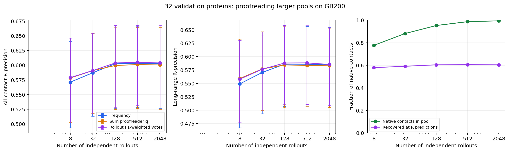

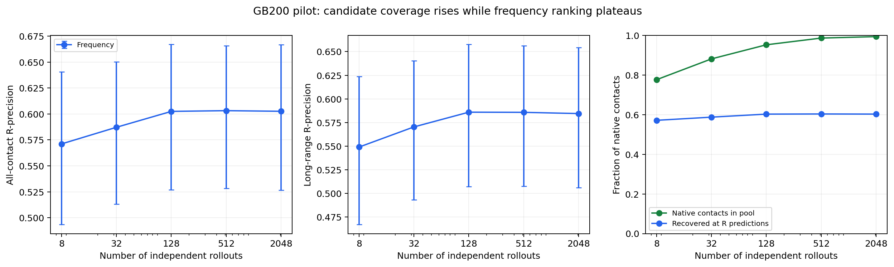

The separate larger GB200 validation panel is complete for frequency ranking:
1,375 structures from 255 groups, with 1,371 contributing long-range metrics.
Eight versus 128 rollouts gives R-precision 0.50086 versus 0.54779, a paired
gain of 0.04693 (95% interval 0.04052–0.05353). Long-range R-precision rises
from 0.47099 to 0.52194, a gain of 0.05096 (0.04338–0.05915). Mean warm cost
is 1.196 versus 3.054 GB200 seconds. These reproduce the H100 frequency result
under a separate runtime; the timings are not pooled across hardware. Data are in
`data/validation_frequency_gb200/`.

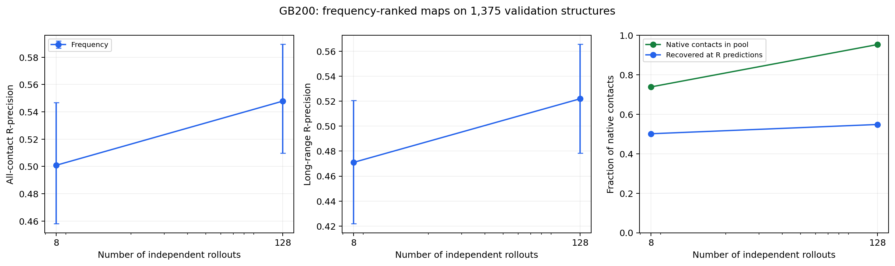

Full-forward proofreading is also complete for every GB200 validation pool.
At 128 rollouts, F1-weighted votes give all-contact R-precision 0.55239 and
long-range R-precision 0.52647. Relative to frequency, paired gains are
0.00459 (95% interval 0.00207–0.00790) and 0.00453 (0.00164–0.00813).
Mean warm generation-plus-proofreading time is 4.622 GB200 seconds, versus
3.054 for frequency alone. Sum q gives 0.54750 and 0.52249; its differences
from frequency again have intervals spanning zero. The same structures and
groups are used as in the H100 phase, so this is a stochastic/runtime
replication, not an independent biological validation cohort. Results and
all 5,500 stage timings are in `data/validation_pool_gb200/`.

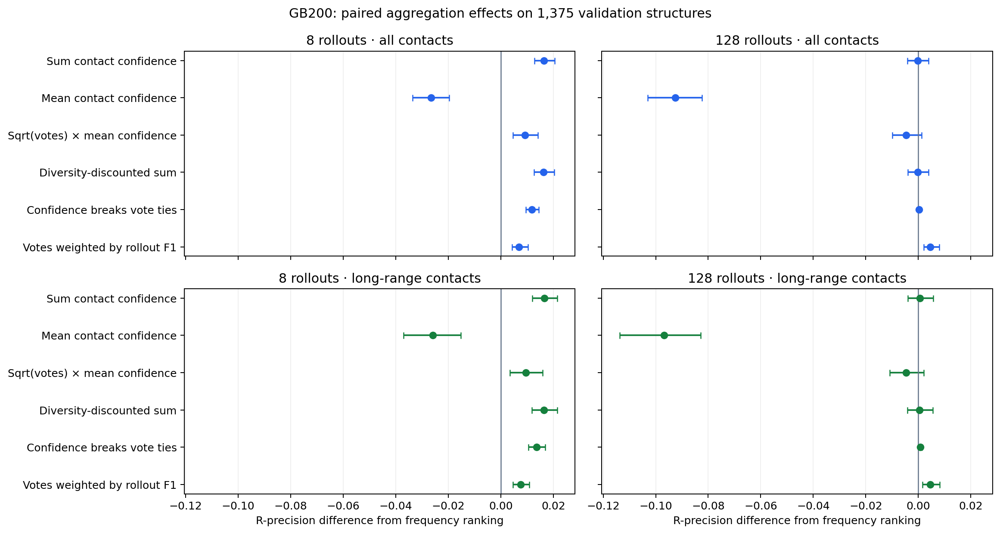

### Bounded refinement of rollout-quality weights

After the full-panel F1-weighting result, a small exploratory follow-up fixed
exponents 1, 2, 4 and 8 before computing their pilot outcomes
(`data/weight_power_refinement.json`, `pilot_weight_power.json`). It reuses
identical 128-rollout pools and released reader outputs on all 32 pilot proteins,
with no new GPU inference. The three new rules give each rollout's eligible
unique contacts weight equal to its predicted F1 raised to the stated power.
The original seven-method analysis remains unchanged unless a plan explicitly
requests these additional methods.

| F1 exponent | H100 R-precision | H100 long-range | GB200 R-precision | GB200 long-range |
| ---: | ---: | ---: | ---: | ---: |
| 1 | 0.60218 | 0.59013 | 0.60378 | 0.58808 |
| 2 | 0.60241 | 0.58890 | 0.60515 | 0.58973 |
| 4 | 0.60059 | 0.59098 | 0.60149 | 0.59175 |
| 8 | 0.60357 | 0.58942 | 0.60353 | 0.59021 |

Every paired R-precision interval for the new exponents versus exponent 1
includes zero, both overall and for long-range contacts. For exponent 2,
the all-contact differences are +0.00024 (95% interval −0.00204–0.00259)
on H100 and +0.00137 (−0.00181–0.00584) on GB200. This pilot does not establish
a stronger weighting rule. All variants reuse the same measured generation and
reader costs: 9.581 H100 or 5.204 GB200 seconds per map, excluding CPU aggregation.
The original frequency and exponent-1 values reproduce exactly for every input.
These adaptive validation comparisons preceded final policy selection and used
no new reserved-test metrics. Data are in `data/pilot_weight_power/`
and `data/pilot_weight_power_gb200/`.

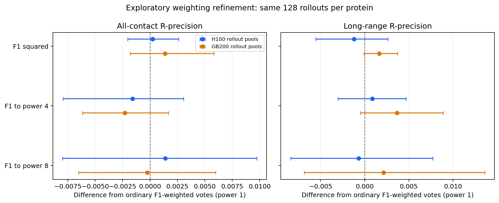

### One larger-validation refinement and frozen reserved comparison

After all original guided trajectories finished, `data/validation_weight_power_decision.json`
committed a single new larger-validation configuration: F1 squared. Powers 4 and
8 were not extended. The promotion rule required a positive lower 95% bound for
all-contact R-precision versus power 1 on H100, a positive GB200 point effect,
and nonnegative long-range point effects on both. The same 1,375 structures and
existing 128-rollout pools were used; no extra GPU inference was needed.

| Runtime | Weight | R-precision | Long-range R-precision | Mean warm GPU seconds |
| --- | --- | ---: | ---: | ---: |
| H100 | Frequency | 0.54769 | 0.52153 | 6.599 |
| H100 | F1 | 0.55195 | 0.52565 | 8.921 |
| H100 | F1 squared | 0.55435 | 0.52870 | 8.921 |
| GB200 | Frequency | 0.54779 | 0.52194 | 3.054 |
| GB200 | F1 | 0.55239 | 0.52647 | 4.622 |
| GB200 | F1 squared | 0.55518 | 0.53016 | 4.622 |

F1 squared met every promotion condition. Against F1, its all-contact gain is
0.00239 (95% paired interval 0.00022–0.00508) on H100 and 0.00279
(0.00076–0.00523) on GB200. Long-range gains are 0.00305 (0.00064–0.00615)
and 0.00369 (0.00077–0.00703). Against frequency, H100 gains are 0.00665
(0.00224–0.01256) overall and 0.00717 (0.00237–0.01394) long-range; GB200
gains are 0.00738 (0.00303–0.01313) and 0.00822 (0.00300–0.01445).
Original frequency and power-1 metrics reproduce exactly for all 2,750 rows
per runtime. This is an adaptive validation refinement, with unadjusted intervals.

At 14:51 UTC on 2026-10-22, before new test generation, `final_test.json` froze
exactly two configurations on all 1,473 reserved structures from 295 groups:
128 ordinary rollouts ranked by frequency and the identical rollouts ranked by
F1-squared votes. The plan and selection evidence were committed in `ce6bd1a1`.
Its SHA256 is `35a563b7c067b8eaf98b63e140d79f8bb7be58d2023989b01a6cd2beaa31a9e8`.
The GB200 runtime matches the verified validation replication. Every protein
must finish generation and full-forward proofreading before test metric analysis;
no further test configurations or policy changes are allowed after those scores.
The reserved set was previously used for the reader release. The new frozen
comparison is now complete, with its results below.

### Completed reserved comparison

All 188,544 ordinary rollouts and their full-forward reader outputs completed
before metrics were computed. The 1,473 structures belong to 295 related groups;
1,465 structures in 292 groups have long-range native contacts. Both methods
rank exactly the same sampled contact pool. The primary outcome is all-contact
R-precision; other intervals are secondary and not multiplicity-adjusted.

| Metric | Frequency | Squared F1 votes | Paired difference [95% interval] |
| --- | ---: | ---: | --- |
| R-precision (primary) | 0.54501 | 0.55021 | +0.00520 [0.00299, 0.00767] |
| Long-range R-precision | 0.51188 | 0.51607 | +0.00419 [0.00199, 0.00657] |
| Average precision | 0.56273 | 0.57373 | +0.01100 [0.00852, 0.01393] |
| Long-range average precision | 0.53135 | 0.54156 | +0.01021 [0.00780, 0.01305] |
| Precision at L | 0.51320 | 0.51785 | +0.00465 [0.00286, 0.00691] |
| Precision at L/2 | 0.67841 | 0.68422 | +0.00581 [0.00293, 0.00921] |
| Precision at L/5 | 0.79621 | 0.80449 | +0.00828 [0.00484, 0.01210] |
| Candidate coverage | 0.94524 | 0.94524 | 0 |
| Long-range candidate coverage | 0.92892 | 0.92892 | 0 |
| Mean warm GB200 seconds | 3.620 | 5.477 | 1.513 times frequency cost |

The selected rule therefore confirms a modest ranking gain on this reserved
cohort: 0.520 percentage points in primary R-precision, with a 95% paired
interval of 0.299–0.767 points. The gain does not come from additional
candidates or knowledge of native contact counts during inference. Mean scoring
overhead is 1.857 warm GB200 seconds per map, on top of ordinary generation.
These resource times exclude loading, staging and CPU aggregation, and do not
measure parallel serving latency.

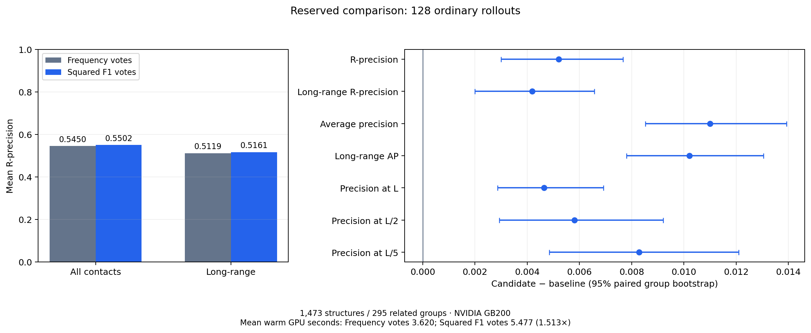

For this setup, the supported recipe is 128 ordinary rollouts, full-rollout
proofreading, then contact votes weighted by the square of each rollout's
predicted F1. Predicted precision is the mean reader correctness over unique
parsed contacts, including invalid ones; predicted recall is the global head.
Only eligible unique pairs contribute votes. Each rollout's F1 is its predicted
precision/recall harmonic mean, floored at 1e-8 before squaring. The result is
a contact ranking, not calibrated pair probabilities. The simpler frequency
rule remains a reasonable choice when its lower cost is more valuable than
the measured accuracy gain.

The models, policy pair, seeds, cohort, primary outcome and stopping rule were
frozen before new test generation; no additional test configurations were
evaluated. This is confirmation on the previously reserved exp356 cohort, not
an untouched external benchmark. The cohort was used for the reader release,
and generator pretraining decontamination is not established. Per-protein
metrics, the nine paired contrasts and all 2,946 contemporaneous stage timings
are in `data/reserved_test/`; the complete-cohort identity and source checks
are in `data/reserved_test_complete.json`.

### Larger ordinary pools on H100

All 64 independent 512/2,048-rollout pools are complete on the 32-protein pilot.
Frequency R-precision is 0.60276 and 0.60299 respectively, versus 0.60365 at
128 rollouts. The 2,048-minus-128 paired difference is −0.00066
(95% interval −0.00489–0.00352); long-range difference is −0.00241
(−0.00656–0.00191). Mean warm H100 time rises from 7.165 to 109.962 seconds,
a factor of 15.35. Full-universe AP improves by 0.01334 (0.00847–0.01985).
Candidate coverage reaches 99.21%, but this does not translate into a better
top-R map. These H100 results corroborate the separately timed GB200 frequency
plateau. Data are in `data/pilot_large/` and `data/pilot_pool_scaling/`.

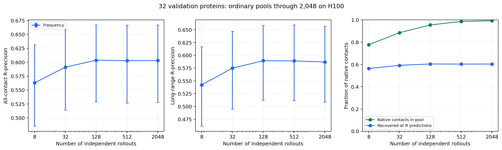

### Fixed-length contact selection and overconfidence

All 256 continuations and their 512 nested L/2L prefix maps are complete on the
same 32 pilot proteins. EOS is disabled, and each trajectory contains exactly
L or 2L unique contacts. This adaptive diagnostic was added after observing five
short pilot proteins, before the original 15-policy pilot completed; it is not
a prespecified confirmation. The L prefix is scored before generation continues.

| Budget | Policy | Mean rollout precision | Mean rollout recall | Predicted precision | Four-rollout sum-q R-precision | Mean warm H100 seconds |
| --- | --- | ---: | ---: | ---: | ---: | ---: |
| L | Ordinary control | 0.43345 | 0.50986 | 0.44090 | 0.57152 | 32.183 |
| L | Top 10% of 16 proposals | 0.49286 | 0.57157 | 0.49471 | 0.57084 | 104.599 |
| 2L | Ordinary control | 0.27788 | 0.63900 | 0.36290 | 0.56116 | 64.270 |
| 2L | Top 10% of 16 proposals | 0.28286 | 0.64964 | 0.52488 | 0.53276 | 267.704 |

At L, filtering improves average individual-rollout precision and recall, but
with four rollouts the R-precision difference is −0.00068 (95% paired interval
−0.01806–0.01717), at 3.25 times the cost. At 2L the reader becomes particularly
overconfident on guided contacts. Four-rollout R-precision loses 0.02839
(−0.04961 to −0.00827) and long-range R-precision loses 0.03341
(−0.05675 to −0.01023), at 4.17 times the cost. With a single 2L rollout,
all-contact R-precision loses 0.10258 (−0.14695 to −0.05601).

These results are consistent with distribution shift and score exploitation
when guidance is forced far beyond normal stopping; they do not identify a
unique causal mechanism. Better per-rollout precision need not produce a better
ensemble map. Neither fixed-length filtering curve improves on the measured
ordinary-pool accuracy/cost frontier. Results, paired comparisons and timings
are in `data/length_probe/`. L and 2L outputs share trajectories and must not be
treated as independent samples; intervals resample the same 32 homology groups.

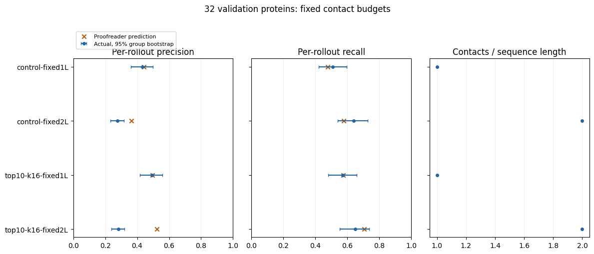

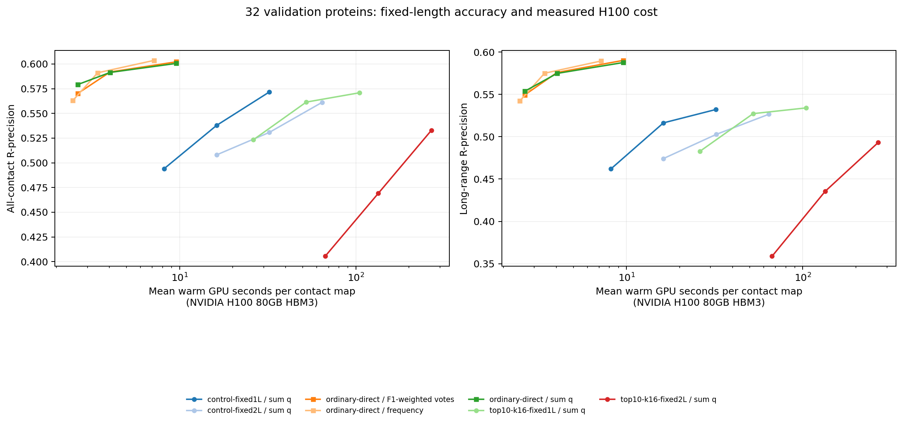

A retrospective decomposition of these same complete continuations shows that
both contact selection and retrospective scoring degrade beyond L. In guided
rollouts, the newly added second L contacts have actual precision **0.07286**,
while their mean predicted correctness is **0.50726**. For control, the same
quantities are 0.12232 and 0.24450. This is not merely a shift in the total
number of predictions.

The first L contact identities and labels are verified identical across prefix
records. After the guided continuation, their mean predicted correctness rises
from 0.49471 to 0.54250, while their actual precision remains 0.49286. Their
Brier score worsens by 0.02068 (95% paired group interval 0.01511–0.02654), and
mean within-rollout AUROC declines by 0.04665 (−0.06241 to −0.03346). Thus later
forced contacts can also harm judgments of earlier contacts. This exploratory
diagnostic uses all 32 proteins and all four trajectories, with no new model
inference. Data are in `data/prefix_revision/`; AUROC excludes trajectories
without both label classes.

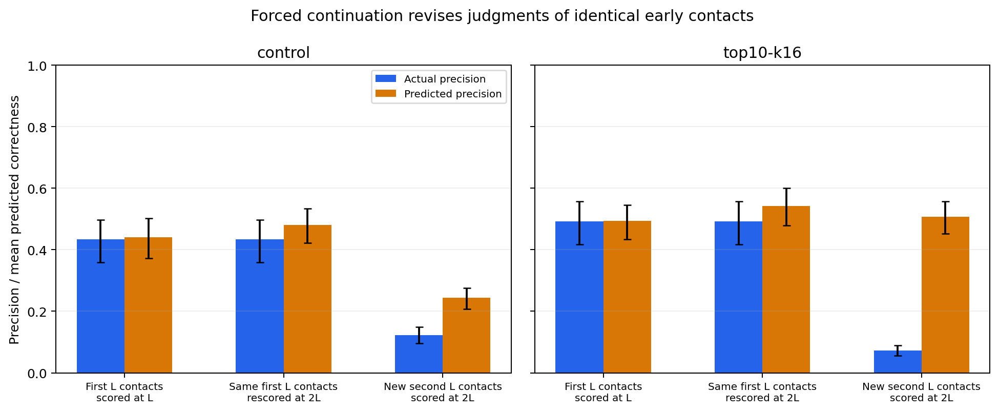

## Scientific conclusion

The proofreader is most useful here for weighting ordinary rollout pools.
Increasing ordinary pools from eight to 128 yields a substantial validation
gain, while increasing further to 512 or 2,048 does not establish a better
top-R map. At 128 rollouts, the selected squared-F1 vote rule confirms a smaller
but positive reserved-cohort gain: +0.00520 overall and +0.00419 long-range
R-precision, at 51.3% extra measured warm GPU time.

The guided sampler identifies more accurate individual contacts but produces
shorter, lower-coverage trajectories. Lookahead, population search, repair,
forced longer generation, and the tested threshold mixtures fail to improve
the measured ordinary-sampling quality/cost frontier. Forced continuation also
exposes severe overconfidence and worsens earlier-contact judgments. These
results support ordinary generation plus rollout-quality aggregation for the
current frozen models; they do not prove that every future guidance method
or within-rollout threshold schedule will fail.

All planned and reported phases are complete. The successful warm-inference
ledger totals 55.663 H100 GPU-hours and 5.769 GB200 GPU-hours, including 2.241
GB200 GPU-hours for the reserved comparison. These are not billed totals:
staging, loading, queueing, smoke checks and work lost to preemption are excluded.
Mixture and weight-refinement analyses reuse existing outputs and are not
counted again. The ledger and source timing hashes are in `data/compute_ledger.csv`
and its provenance JSON. All owned Iris jobs are terminal; native Jobs, Pods,
and bootstrap resources were cleaned up. No shared cluster configuration changed.
