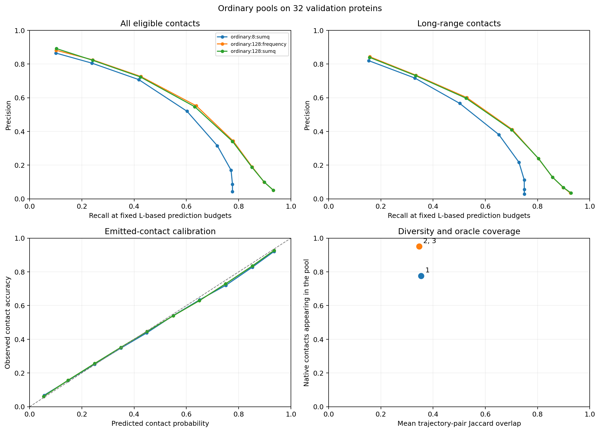

---
marinfold_experiment:
  issue: 368
  title: 'exp: proofreader guided inference for accurate contact maps'
  kind: evals
  branch: codex/exp368-proofreader-guidance
---

# exp: proofreader guided inference for accurate contact maps

**Issue:** [#368](https://github.com/Open-Athena/MarinFold/issues/368) · **Kind:** `evals` · **Branch:** `codex/exp368-proofreader-guidance`

## Question

Can the released exp356 proofreader improve complete MarinFold contact maps by guiding candidate selection, lookahead, population search, repair, or aggregation at inference time?

## Hypothesis

Proofreader guidance will improve precision and recall at matched compute, with lookahead benefiting from the model's demonstrated retrospective contact judgments. Strong guidance may sacrifice candidate coverage or exploit score errors, so actual contact accuracy and diversity must be measured.

## Background

Builds on #356 and PR #358. Freeze generator exp277 step 266344 and proofreader exp356-exp277-frozen-contact-pdb50k-v2 step 18000. The user authorized autonomous implementation, CoreWeave execution, and job monitoring. Existing checkpoints and targets are co-located in CoreWeave us-east-02a.

## Approach

1. Implement and verify cached, batched contact proposals and proofreader readout against the released inference implementation. Preserve actual prompts and original contact semantics.
2. Use a deterministic group-aware validation pilot for candidate-ranking diagnostics and end-to-end policy comparisons: top-percentile filtering; soft probability weighting; short lookahead; population search; one-pass suffix repair; and larger independent rollout pools with alternative aggregators.
3. Measure all/long-range R-precision, average precision over the full eligible pair universe, precision at fixed L-based budgets, recall/precision curves, candidate coverage, diversity, and per-input GPU time. Include a fast ordinary-generation baseline and matched-compute comparisons; distinguish compute envelopes from exact matching.
4. Extend promising policies to a larger validation panel. Freeze selection and stopping rules before one final reserved-test comparison. Never select policies on test results.
5. Save resumable per-input artifacts, source hashes, timing CSVs, job and recovery metadata. Publish figures and a written result report, including negative results.

## Success criteria

At least one guided policy should improve final contact-map quality over ordinary sampling and proofreader-weighted aggregation at comparable measured GPU cost, with paired group-bootstrap uncertainty. A complete null result is acceptable if the planned policy families are tested and the failure mode is measured.

## Results

Implementation and validation are in progress on 2026-10-21. Five CPU tests
cover cache isolation, full-forward equivalence, proposal resampling, lookahead
commit boundaries, repair-prefix reconstruction, and full-universe AP. The first
H100 smoke test verified that every frozen backbone weight matches the original
generator. It also caught a BF16 incremental/full-forward discrepancy (maximum
0.02394 contact probability); the experiment therefore tests FP32 cached search
and rescores final maps through the released BF16 full-forward implementation.
The complete guided pilot is still pending; partial cohorts are not used for
policy selection. The ordinary nested-pool baseline is complete on all 32
pilot structures. Sum-q R-precision rises from 0.5792 at eight rollouts to 0.5993
at 128; long-range R-precision rises from 0.5537 to 0.5806. The paired all-contact
gain is 0.0200 (95% group-bootstrap interval 0.0050–0.0329). Oracle candidate
coverage rises from 0.7765 to 0.9509. At 128 rollouts, frequency alone gives
0.6040 all-contact and 0.5864 long-range R-precision. These pilot means should
not be compared with means on the larger validation cohort.

Two aggregation variants were added after observing the pilot: confidence as a
tie-breaker for integer vote counts, and votes weighted by predicted rollout F1.
Their all-contact gains over frequency at 128 rollouts are 0.0004 and 0.0018;
both paired 95% intervals include zero. These are exploratory validation results.
CSV inputs and timings are in `data/pilot_pool/`; the figure is
`plots/pilot_pool.png`. An independent-pool latency benchmark requests each
pool in a single vLLM call, avoiding the staged baseline's repeated batch costs.

Ordinary-pool diagnostics now include fixed sequence-length-budget precision/recall
curves, emitted-contact calibration and trajectory overlap. On the 128-rollout
pilot, mean absolute error in per-rollout predicted precision is 0.0606 and in
predicted recall is 0.0547, averaged within each structure and then across the
32 structures. Mean pairwise trajectory Jaccard overlap is 0.3473 (at most 128
deterministically sampled trajectory pairs per protein). These measurements are
for ordinary generation; guided-rollout calibration is evaluated separately.
The calibration curve pools contacts, whereas the reported error means weight
structures equally. Figures and diagnostic CSVs are generated by
`diagnose_maps.py` and `plot_diagnostics.py`.

### Frozen pilot protocol

`pilot.json` fixes 32 validation proteins from 32 distinct homology groups,
spanning 33–937 residues. One representative per group is chosen by a SHA256
key, then 32 uniformly spaced length ranks are selected. Neither contact labels
nor previous model quality enters panel selection. Four independent prompts and
sampler seeds are used per guided policy and protein. The same prompt identities
seed the ordinary rollout pool.

The pilot includes an ordinary grammar-constrained control, uniform selection
from 16 proposals, top 10/25/50% of 16 proposals, top 10% of 64, soft weights
q^beta for beta 1/2/4, top-10% selection with 10% unguided exploration, 8/32-contact
lookahead with two continuations per proposal, ranking by total expected correct
contacts, eight-particle search in blocks of eight, and one-pass suffix repair.
Percentile gates retain ceil(fraction*K) proposals: the nominal 10% gate keeps
2/16 or 7/64. Generator probability is already represented by proposal sampling;
it is not multiplied into resampling weights again.

The constrained sampler permits valid contacts with sequence separation at least
six and no duplicate pairs. It samples the first endpoint, then the second,
using temperature 1 and top-p .95 after each grammar mask. It is consequently a
grammar-conditioned generator, with its own matched control. EOS is sampled
once at each contact boundary, without proofreader intervention. Lookahead uses
a fixed contact horizon and does not commit its future tokens; this is
length-conditioned evidence, not a trained terminal-value estimate. Population
search ranks current prefixes by predicted F1 and applies a 0.1 Jaccard penalty
while selecting survivors; descendants contribute one final map per run.
Repair uses future evidence to locate the lowest-confidence contact in the
first half, discards that contact and its suffix, then regenerates with guidance.

Independent ordinary generation uses the original unconstrained vLLM recipe.
Nested pools of 8, 32 and 128 rollouts are generated in waves of 8, 24 and 96,
so their cumulative generation and proofreading costs are measured directly.
Aggregation compares frequency, sum q, mean q, sqrt(frequency)*mean q, and sum q
with inverse-neighbor weights for trajectories whose Jaccard similarity is at
least 0.8. These pool comparisons retain the actual generator's invalid and
duplicate diagnostics; map metrics consider only eligible unique pairs.

Primary outcomes are all-contact and long-range (separation at least 24)
R-precision and AP over the complete eligible pair universe, including all
unproposed pairs at score zero. We also report precision at L, L/2 and L/5,
candidate-pool oracle recall, and measured H100 inference time. Timing includes
discarded proposals, lookahead, repair and final rescoring; model loading is
reported separately. Cost claims distinguish measured envelopes from exact
matching. Group bootstrap intervals retain a mean-over-structures estimand.

After the pilot, choose at most three methods on the validation accuracy/cost
frontier, with all-contact R-precision primary and long-range R-precision used
to reject gains limited to local contacts. Extend these methods to the remaining
validation groups before writing a fixed test plan. No reserved-test scores are
read for tuning, panel selection or stopping decisions. The existing test set
was previously used for the proofreader release, which is disclosed in the
eventual report; generator pretraining decontamination is not established.

### Execution and recovery

Jobs are independent batch H100 root jobs on `cw-us-east-02a`, submitted through
the central `marin` controller. Inputs and weights are already in its regional
S3 store. Outputs live under
`s3://marin-us-east-02a/MarinFold/exp368/`. The standalone Iris submission client
is pinned to `af9c6789e8` because the older workstation client is rejected by the
current controller. `data/dispatches.jsonl` records exact commands, source hashes,
job IDs and monitoring ownership. Per-rollout commit markers permit restart
without losing completed trajectories. A changed code or plan requires a new
output prefix. No new model training is part of this experiment.

A temporary eight-GPU RNO server staged a shared 6.014 GB model/input copy to
use available capacity. Iris preempted it four times; `--max-retries=0` only
disabled failure retries, while preemption retries defaulted to 1000. Local
state was lost, the staging counter reset, and repeated input transfers exceeded
the intended 9.5 GB campaign ceiling. The server was canceled when this was
detected at 15:20 UTC. `data/preemption_incident.json` records the evidence.
Initial recovery launches were restricted to storage-colocated `cw-us-east-02a`.
`recover_task.py` downloads and verifies each original task's frozen source
bundle and resumes directly from its durable S3 trajectories. Twelve independent
H100 recovery jobs retain the original sampling plan and sharding. The ordinary
baseline is also queued on all 1,375 structures from the 255 remaining validation
groups, excluding every pilot group. No guided winner or test policy is selected.

After a prolonged East capacity wait, a task-owned object-store bucket was
created in `RNO2A`. `prepare_regional_mirror.py` made one 6,014,167,823-byte copy
of the inputs to
`s3://marinfold-exp368-rno2a/MarinFold/exp368/inputs-v1/`. It persists multipart
progress and reserves each 32 MiB source read before transfer, with a cumulative
7 GB cap that survives preemption. A server-side copy attempt was rejected at
its first part; its empty upload was explicitly aborted before the streaming
copy. The streaming mirror completed successfully in about 70 seconds.
`regional_inputs.py` checks the full reader, head, reconstructed-generator and
target hashes against the original pilot. Regional recovery jobs use identical
H100 hardware and original frozen task bundles, with large weight reads now
colocated. New larger phases also write to the regional bucket. The small
existing guided results retain their original durable prefix for resumption.

The regional ordinary-generation bootstrap now uses the vLLM container's existing
interpreter instead of installing a second CUDA/PyTorch environment solely for
staging. A separate two-protein smoke run verified identical input and generator
hashes and completed all 8/32/128 rollout waves. Scientific recovery still executes
each task's original immutable source bundle. `watch_scoring.py` is a finite local
dependency watcher: it submits the five declared scoring tasks only after their
matching generation jobs succeed, records every launch, and exits after submission.
The active experiment monitor continues to check the scoring jobs themselves.

## Conclusion

_(Fill in after results are in.)_
