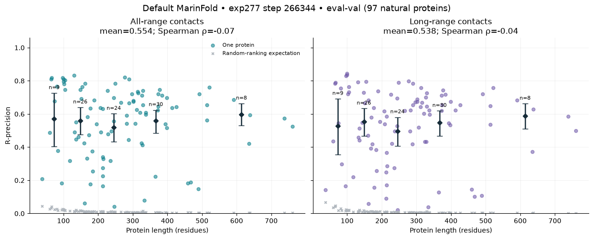
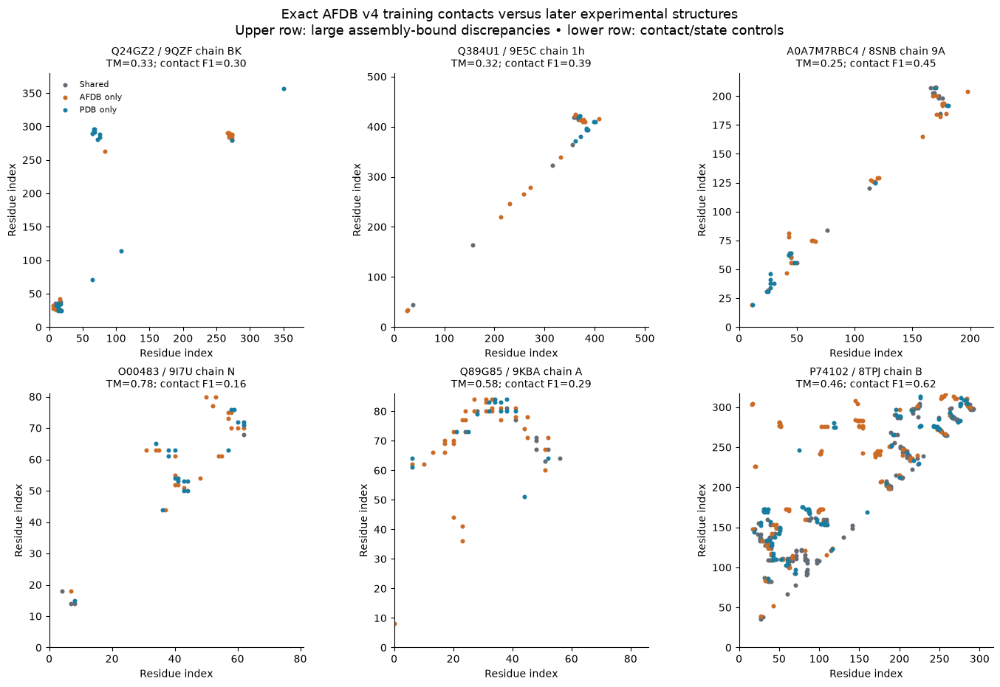
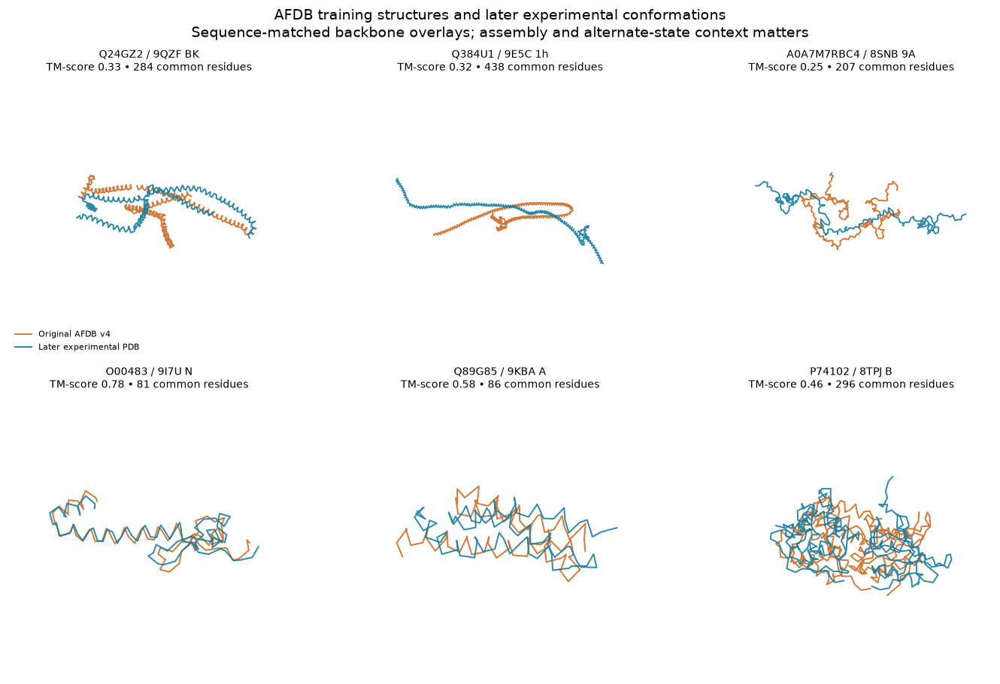
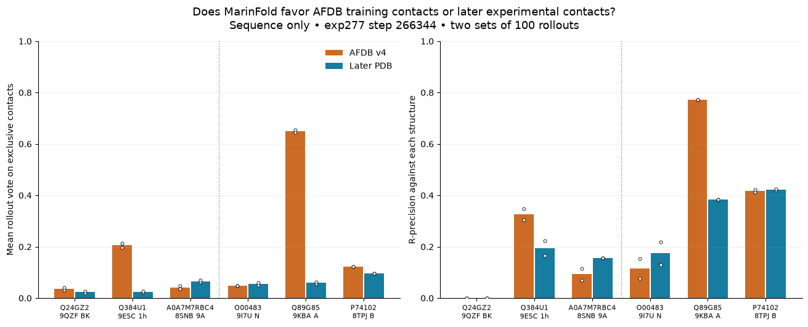

---
marinfold_experiment:
  issue: 369
  title: 'exp: default-model contact spiking, length dependence, and AFDB error preference'
  kind: evals
  branch: exp369/default-model-analyses
---

# exp: default-model contact spiking, length dependence, and AFDB error preference

**Issue:** [#369](https://github.com/Open-Athena/MarinFold/issues/369) · **Kind:** `evals` · **Branch:** `exp369/default-model-analyses`

## Question

For the registered default contacts-v1-exp277-m2-p06-full-epoch-1.5B checkpoint at step 266344: (1) how many true contacts, or what fraction, put generation on the right path, and does coverage of secondary-structure elements help; (2) how does eval-val R-precision vary with length; (3) on verified AFDB training entries contradicted by subsequently released experimental structures, does MarinFold favor the AFDB contacts or the experimental contacts?

## Hypothesis

A few distributed correct contacts may disambiguate the fold more efficiently than uniformly sampled contacts. Predictions on training-label errors may reveal whether the model generalizes beyond its AFDB supervision.

The exp277 training configuration concatenates native AFDB, native ESM-Atlas, and ProteinMPNN redesigns of those predicted structures. There is no direct experimental PDB training arm. Preference for one label set in these cases is descriptive; it does not by itself establish memorization or error correction.

## Approach

Use only the 97 natural eval-val proteins for routine analyses; do not score eval-test. Pin the registered model and exact data provenance. Reuse existing default-model per-protein scores for the length plot. Freeze nested random and secondary-structure-balanced oracle prompts; report all- and long-range R-precision after removing every supplied pair, with an unconditioned comparator scored on the identical remaining universe. Use 100 resampled rollouts per condition, T=1, top-p=.95, top-k disabled, and the established completion/validity checks. Repeat context draws and report protein-bootstrap uncertainty. Include count, fraction, and element-coverage views and predeclared improvement/accuracy thresholds.

Audit AFDB candidates against the exact retained training corpus and source structure version. Confirm sequence/construct mapping, PDB release chronology, experimental context, structural discrepancy, and common resolved residues before treating a case as a training error. Evaluate unconditioned MarinFold against both structures and compare support on their exclusive contact sets. Treat biologically valid alternate states separately from unambiguous errors.

## Success criteria

Reproducible plots and source CSVs, explicit subset/completeness counts, checkpoint/run/step provenance, per-input timings for new inference, uncertainty, and an honest account of eligible or rejected AFDB cases. Maintain README and summary PDF; publish reusable artifacts. Prepare and verify locality/cost options before inference submission per the eval-checkpoint skill. No shared-cluster restart or cross-region transfer over 10 GB is authorized.

## Results

### Model and execution

The registry default is `contacts-v1-exp277-m2-p06-full-epoch-1.5B`, step **266344**. The exact published file hashes are in exp277's `data/publication_manifest.json`. Workers verify all checkpoint and tokenizer files before loading. The compatible copy already resides at `s3://marin-us-east-02a/MarinFold/exp304/model/exp277-step-266344`; weights stay within CoreWeave. The approved execution is one H100 for validation, followed by 12 independent H100 workers at batch priority. Outputs are under `s3://marin-us-east-02a/MarinFold/exp369/spiking-v2/`.

### Accuracy versus length — complete

The existing canonical exp277 rollout evaluation contains all **97 eval-val proteins**. Mean all-range R-precision is **0.5537** (95% protein-bootstrap CI **0.5118–0.5940**); long-range is **0.5380** (**0.4940–0.5803**). Length has no detectable monotonic association with either score: Spearman rho **−0.068**, p **0.507** for all-range and **−0.036**, p **0.726** for long-range. This is a statement about this sample; the longest bin has only eight proteins.

`plot_length.py` regenerates the plot and `data/length_*.csv` from exp277's archived scores and the exp245 split manifest. `data/length_statistics.json` records source hashes. All-range means resolved residue pairs separated by at least six positions; long-range uses at least 24.

### Contact injection — running

The frozen plan has **6,664 conditions / 666,400 rollouts**, covering 97 proteins and two independent context draws. Each condition has 100 newly resampled sequence documents. Count doses are 0, 1, 2, 4, 8, 16, 32, 64, 128 where truth remains; fraction doses are 1%, 2%, 5%, 10%, 20%, 40%, 60%, 80% of all true contacts. Fractions use floor with a minimum of one contact. Random and SSE-balanced conditions use nested subsets.

SSEs are contiguous DSSP helix or strand segments of the experimental chain. The balanced ordering selects a contact incident to an element with the smallest current supplied-contact count. An edge touching two elements credits both. Elements with no eligible unused contacts stop competing; coil-only contacts are last. Additional doses record the first point where each coverable element has one, two, or four incident contacts, saturating elements that have fewer available contacts. Random sampling is evaluated at the same contact counts. These are oracle interventions, using experimental contacts and secondary structure.

`summarize_contexts.py` records actual budgets and coverage independently of predictions. One-contact coverage requires a mean of 16.9 contacts (median 15.5), or 7.04% of true contacts on average. At that same count, random sampling covers 58.2% of elements on average. The balanced policy includes fewer long-range contacts at this dose (62.0% versus 68.8%); the comparison therefore measures the specified sampling policies, not coverage alone with every other contact property held fixed.

Every supplied pair is removed from both the prediction candidate set and the truth set before recomputing R. The unconditioned comparator is rescored on exactly the same remaining universe for each intervention, avoiding improvement from merely removing easy positives. The predeclared thresholds are a mean gain of at least 0.05 with a positive 95% bootstrap lower bound, and mean remaining-contact R-precision of at least 0.80. Counts with no remaining truth are excluded and denominators are reported. A threshold is the first tested dose satisfying the criterion, not an interpolated guarantee for every protein.

`prepare_spiking.py` freezes the plan and records its hash in `data/spiking_plan_manifest.json`. `dispatch_spiking.py --smoke --submit` runs the initial 1,000-rollout validation. The full launch uses `dispatch_spiking.py --submit`; the case launch uses `--cases --submit`. `analyze_spiking.py --run <output-prefix>` requires all conditions before publishing the curves. Checkpoint, prompt, plan, worker, completion, and vote-array provenance are saved with per-condition timings. Every requested sample is retained; malformed statements and nonexistent-residue pairs are counted and cannot vote. The canonical score includes valid live pairs from all samples; a sensitivity score gives zero votes to any unfinished or invalid rollout, retaining the denominator of 100.

The smoke run passed all 1,000 completions, with no unfinished, malformed, or out-of-range outputs. On 7qp5_A, the two unconditioned scores were 0.5477 and 0.5560, versus the archived 0.5560. The initial 12-worker run was submitted on 2026-10-21; its job IDs are in `data/jobs_full_v1.json`. It exposed an incorrect orchestration gate: isolated out-of-range model predictions stopped a whole shard, although the canonical evaluator simply ignores nonexistent pairs. The correction retains every draw without retries or selection and reports those errors plus a zero-invalid-rollout sensitivity analysis. Original attempts remain under `spiking-v1`; corrected runs use `spiking-v2`. The corrected case run completed all 1,200 samples. The full corrected sweep restarted on twelve H100s at 14:45 UTC; current job IDs are in `data/jobs_full.json`. A revision-matched isolated Iris client was built from Marin `af9c6789e8` because older workstation clients were rejected by the current controller. A task-local copy of that revision's cluster connection config points to the existing RNO2A kubeconfig; no cluster configuration was changed.

### AFDB versus later PDB structures — complete

The candidate screen starts from retained AFDB entries in the actual decontaminated training corpus, joins SIFTS, and screens 700 recent-PDB candidates. Of these, 357 have usable sequence/construct mappings and enough common contacts; 206 fail mapping, 108 fail the length/truncation filter, and 29 have too few common contacts. There were no fetch/parse failures. This is a targeted search, not an unbiased prevalence estimate or exhaustive search for the first experimental structure.

Twenty candidates were checked against their **original AFDB v4 coordinates**. Regenerated contacts exactly reproduce each saved training document. Source objects were created in November 2022, before the selected experimental releases in 2023–2025. The six inference cases use identical sequences and only mutually resolved residues when comparing labels. Three show large global discrepancies in their assembly-bound structures:

| Training accession | Later PDB chain | Protein | Common-residue TM-score | Contact F1 |
|---|---|---|---:|---:|
| Q24GZ2 | 9QZF BK | Centrosomal protein | 0.331 | 0.302 |
| Q384U1 | 9E5C 1h | Dynein regulatory complex subunit 2 | 0.318 | 0.390 |
| A0A7M7RBC4 | 8SNB 9A | Tex36 / CFAP95 | 0.249 | 0.453 |
| O00483 | 9I7U N | NDUFA4 | 0.784 | 0.163 |
| Q89G85 | 9KBA A | SemiSWEET | 0.584 | 0.286 |
| P74102 | 8TPJ B | Orange carotenoid-binding protein | 0.464 | 0.620 |

NDUFA4 has severe contact disagreement despite substantial backbone similarity. SemiSWEET and photoactivated OCP are alternate-state controls. The three largest global discrepancies also differ in assembly context; they establish disagreement with the subsequently observed state, not that an isolated monomer must have that state. Their sparse nonlocal contacts warrant case-by-case interpretation.

`data/afdb_selected_cases.csv` records release dates, resolutions, identities, original source URLs, structure/document hashes, and qualifications. `screen_training_errors.py`, `confirm_training_errors.py`, and `prepare_cases.py` reproduce selection and structural comparisons. Sequence-only MarinFold predictions use two independent sets of 100 rollouts. `analyze_cases.py` reports R-precision against both label sets plus mean vote support on AFDB-only versus PDB-only contacts and the probability a PDB-only contact outranks an AFDB-only contact (ties count half). The exclusive-contact comparison avoids treating shared contacts or unequal set sizes as a preference.

The six exact training documents and their source-index rows are saved in `data/afdb_training_membership.json`. `plot_structures.py` shows sequence-matched least-squares backbone overlays; the separately computed TM-scores use structural alignment. `publish_to_hf.py --upload` packages code, source CSVs, figures, frozen plans, and original case structures into a versioned public archive. `data/public_artifacts.json` records its URI, size, and SHA-256. `collect_run.py` inventories remote outputs and enforces a transfer budget before collecting vote matrices, timings, and optional raw completions; completed outputs can be included in the public archive with `--run-dir`.

Full sweep predictions are published incrementally by `publish_predictions.py --upload`, only after every planned condition for a protein is present and checksummed. The content-addressed public bundles contain raw completions, both vote matrices, timings, and completion records. `data/public_predictions.json` lists their URLs and hashes. `publish_predictions.py --restore --run <directory>` restores them anonymously for `analyze_spiking.py`; this avoids requiring CoreWeave credentials to reproduce the plots.

### MarinFold preference on the six cases

All 1,200 sequence-only rollouts completed without hitting the token cap. Six rollouts (0.5%) contained malformed statements or out-of-range final pairs. All samples were retained; zeroing these six rollouts gives the same qualitative conclusions. Pure generation took 65.55 seconds on one H100; model initialization took 63.55 seconds separately.

| Accession / case | R-precision versus AFDB | R-precision versus PDB | AFDB-only mean vote | PDB-only mean vote | Interpretation |
|---|---:|---:|---:|---:|---|
| Q24GZ2, centrosomal | 0.000 | 0.000 | 0.036 | 0.023 | Neither structure is recovered; low support for both |
| Q384U1, dynein regulatory complex | 0.326 | 0.194 | 0.206 | 0.025 | Favors AFDB training contacts |
| A0A7M7RBC4, Tex36/CFAP95 | 0.093 | 0.156 | 0.041 | 0.066 | Weak experimental preference, poor overall accuracy |
| O00483, NDUFA4 | 0.115 | 0.174 | 0.048 | 0.055 | Low support; exclusive-contact ranking is essentially tied |
| Q89G85, SemiSWEET state control | 0.773 | 0.385 | 0.650 | 0.059 | Strongly favors AFDB conformation |
| P74102, OCP state control | 0.417 | 0.422 | 0.123 | 0.095 | Mixed: AFDB has greater mean exclusive support, PDB wins more pairwise rankings |

Mean votes are fractions of rollouts containing a contact, averaged over the respective exclusive contact set. R-precision uses each structure's own R, so the exclusive-contact contrast is the more direct preference diagnostic. The probability a PDB-only contact outranks an AFDB-only contact is 0.207 for dynein, 0.594 for Tex36, 0.374 for the centrosomal case, 0.495 for NDUFA4, 0.035 for SemiSWEET, and 0.572 for OCP. OCP's disagreement between average support and pairwise ranking reflects uneven vote distributions; it does not support a simple winner. These selected examples cannot estimate error-correction prevalence across the training corpus.

## Conclusion

The existing default-model evaluation shows no detectable length trend across these 97 proteins. On the three largest verified AFDB/PDB structural disagreements, MarinFold does not reliably recover the later experimental state: it favors AFDB for dynein, weakly favors PDB for Tex36, and recovers neither contact set for the centrosomal protein. Assembly and biological-state differences remain essential qualifications. The contact-injection dose response is still running.
