---
marinfold_experiment:
  issue: 373
  title: 'exp: ProteinMPNN-only prediction diversity and Neff dependence on eval-val'
  kind: evals
  branch: codex/exp373-diversity-neff
---

# exp: ProteinMPNN-only prediction diversity and Neff dependence on eval-val

[Issue #373](https://github.com/Open-Athena/MarinFold/issues/373) · [Summary PDF](plots/summary.pdf) · [Frozen plan](PLAN.md) · [Public artifacts](https://huggingface.co/buckets/open-athena/MarinFold/tree/data/exp373-mpnn-diversity-neff/v1) · Completed 2026-10-30

**ProteinMPNN-only produces substantially more diverse contact predictions, but the extra diversity mostly adds benchmark errors.** On 97 natural proteins, mean fixed-prompt Jaccard distance increases from **0.708 to 0.813**, while standard 100-randomized-prompt R-precision falls from **0.554 to 0.463**. After 300 fixed-prompt samples, both models discover about 96% of true contacts, but MPNN-only discovers 58% more false contacts. Its high-to-low Neff accuracy drop is smaller, yet the continuous Neff interaction is inconclusive and absolute low-Neff accuracy does not improve.

## Question and hypothesis

Does removing native-sequence training documents broaden the distribution of predicted contacts and reduce accuracy degradation at low effective MSA depth? The prespecified hypotheses were greater contact-set diversity after count and prompt controls, and a smaller accuracy dependence on Neff. A separate requirement for calling diversity useful was better correct-contact coverage or ensemble quality at comparable prediction quality. Neither checkpoint receives an MSA at inference.

## Approach

The [protocol](PLAN.md) and [machine-readable plan](data/plan.json) were frozen before inference. We evaluated two pinned 1.5B checkpoints:

| Role | W&B run / registry nickname | Step |
|---|---|---:|
| Full-data default | `contacts-v1-exp277-m2-p06-full-epoch-1.5B` | 266344 |
| ProteinMPNN-only | `contacts-v1-exp364-mpnn-only-1ep-lr5e-4-cooldown-1.5B` | 186884 |

The checkpoints are publicly available with their tokenizers: [default](https://huggingface.co/buckets/open-athena/MarinFold/tree/checkpoints/contacts-v1-exp277-m2-p06-full-epoch-1.5B/hf/step-266344) and [MPNN-only](https://huggingface.co/buckets/open-athena/MarinFold/tree/checkpoints/contacts-v1-exp364-mpnn-only-1ep-lr5e-4-cooldown-1.5B/hf/step-186884). Execution reused existing same-region S3 exports on `cw-us-east-02a`; downloaded file hashes were checked and recorded.

- **Cohorts:** all 97 natural eval-val proteins are primary; all 19 eval-denovo proteins are secondary and reported separately. Eval-test was not scored. Definitions, sequences, resolved residues and contact truth come from exp245.
- **Sampling:** each checkpoint/protein/temperature receives 300 samples from one fixed prompt, partitioned into three independent seed blocks of 100, plus 100 samples from the same randomized prompt bank. Temperatures are 0.7, **1.0 primary**, and 1.3: **278,400 samples in 1,392 complete conditions**.
- **Inference:** H100, vLLM 0.9.2, BF16, context 8192, top-p 0.95, top-k disabled, prefix caching disabled, identical tokenizer and prompt tokens. Initial budget is `min(6L+128, 8192−prompt_tokens)`. Capped prefixes continue within the original context under the exp364 policy; no sample is replaced or excluded. Exact seeds and prefixes are saved.
- **Contact scoring:** undo position offsets, canonicalize orientation, fold retractions in order, deduplicate, and restrict primary statistics to resolved pairs separated by at least six residues. Long range means separation ≥24. Exp89's exact truth threshold (≥0.001), stable vote ranking and scorer produce precision-at-L/L/2/L/5/R and AUC. R-precision measures precision among the top R ranked pairs, where R is the true-contact count.
- **Diversity and controls:** mean Jaccard distance over all 44,850 pairs of fixed-prompt samples per protein; both-empty distance is zero. Match contact counts by thinning each paired sample to the smaller count. Also report randomized prompts, seed blocks, unrestricted valid pairs, entropy, discovery curves and a shuffle preserving every sample size and every contact frequency.
- **Uncertainty:** equal weight per protein; 10,000 paired protein bootstrap draws, seed 373. Samples from one protein are not independent biological replicates. Bracketed intervals below are 95% percentile intervals; secondary/exploratory comparisons are not multiplicity-adjusted.

## Results

### 1. Greater diversity survives the controls

All contrasts below are MPNN-only minus default on the 97 natural proteins at temperature 1.

| Diversity endpoint | Difference [95% CI] |
|---|---:|
| **Fixed prompt, all range: primary Jaccard distance** | **+0.1046 [0.0866, 0.1229]** |
| Fixed prompt, matched contact counts | +0.1064 [0.0891, 0.1244] |
| Randomized prompts | +0.1008 [0.0836, 0.1189] |
| Fixed prompt, long range | +0.1054 [0.0871, 0.1238] |
| Fixed prompt, long range, matched counts | +0.1027 [0.0859, 0.1202] |
| Fixed prompt, unrestricted valid contacts | +0.1059 [0.0880, 0.1242] |

The three 100-sample seed blocks give differences of +0.1050, +0.1042 and +0.1046. Contact-inclusion entropy rises from 0.0362 to 0.0484 bits per candidate pair, a difference of +0.0123 [0.0098, 0.0147]. Thus the effect is reproducible across sampling blocks and is not explained by prompt randomization or output size.

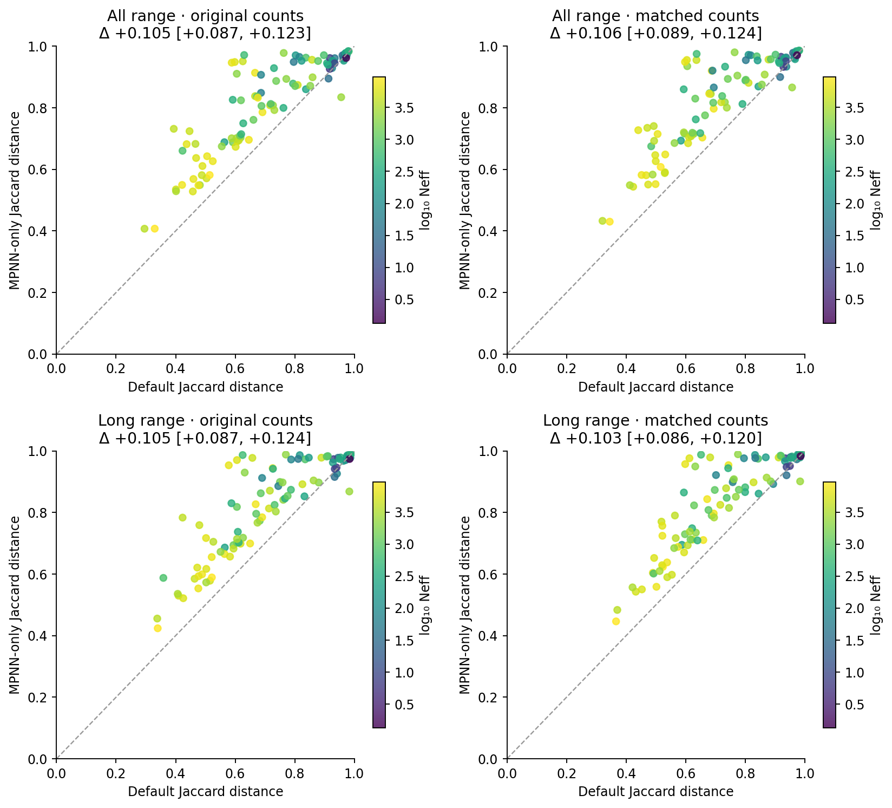

Each point is one protein. MPNN-only generates modestly more resolved contacts per sample: 276.4 versus 260.9, or 0.959 versus 0.906 contacts per residue. The long-range fraction is essentially unchanged (0.650 versus 0.653). Protein length is exactly paired; the exploratory diversity-difference slope against log10(length) is −0.0023 [−0.0759, 0.0675]. Source tables: [diversity contrasts](data/diversity_contrasts.csv), [seed blocks](data/seed_blocks.csv), [single-sample summaries](data/single_rollout_contrasts.csv).

### 2. The extra diversity mainly adds errors

The following are means over proteins at temperature 1. Single-rollout precision/recall average all 300 fixed-prompt samples within each protein; discovery measures the union of their contacts. “False” means absent from the benchmark contact truth.

| All-range measure | Default | MPNN-only | Paired difference [95% CI] |
|---|---:|---:|---:|
| Single-rollout precision | 0.4114 | 0.2976 | −0.1137 [−0.1355, −0.0923] |
| Single-rollout recall | 0.4137 | 0.3080 | −0.1057 [−0.1278, −0.0838] |
| True-contact coverage after 300 samples | 0.9643 | 0.9673 | +0.0029 [−0.0033, 0.0095] |
| Distinct true contacts discovered | 248.7 | 249.3 | +0.6 [−1.1, 2.3] |
| Distinct false contacts discovered | 5,641.9 | 8,902.3 | +3,260.4 [2,367.5, 4,298.0] |
| Ensemble R-precision, 300 fixed prompts | 0.5394 | 0.4541 | −0.0854 [−0.1092, −0.0629] |
| **Ensemble R-precision, 100 randomized prompts** | **0.5540** | **0.4628** | **−0.0911 [−0.1113, −0.0719]** |

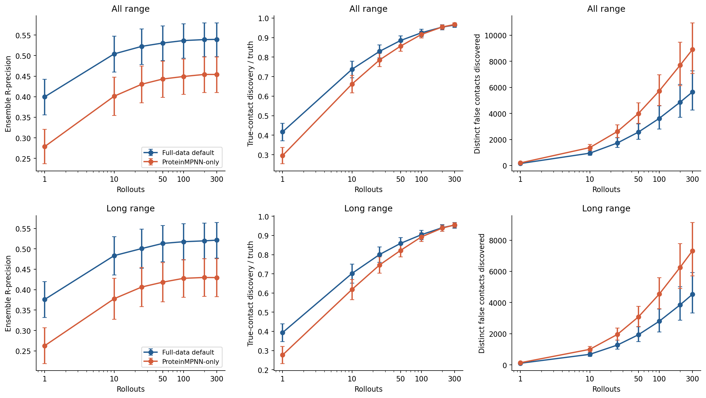

Additional samples improve both ensembles, but MPNN-only remains less accurate at every plotted sample count. At 100 fixed samples its true-contact coverage is still lower (0.916 versus 0.925); by 300 samples the coverage difference is inconclusive, while false discovery is 58% higher. Long-range results agree: 300-sample coverage is 0.955 versus 0.954, false discovery is 7,311 versus 4,524, and R-precision is 0.430 versus 0.521. Primary randomized-prompt long-range R-precision is 0.4427 versus 0.5391, difference −0.0964 [−0.1184, −0.0758].

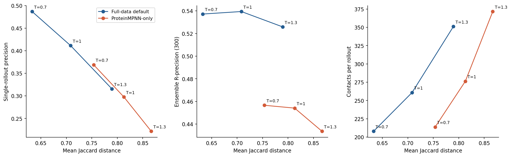

Increasing temperature broadens predictions and reduces individual precision for both models. Across the three temperatures, default fixed-prompt ensemble R-precision stays at 0.526–0.539, above MPNN-only's 0.434–0.457. The three-point sweep provides no demonstrated ensemble advantage at comparable quality; it is not a post-hoc temperature optimization. Source tables: [accuracy](data/accuracy_summary.csv), [discovery curves](data/curve_summary.csv), [all canonical metrics including AUC](data/metrics.csv).

### 3. Neff: smaller extreme-tier drop, inconclusive continuous interaction

Neff is exp260's redundancy-weighted `n_eff_0.8`, not raw sequence count. All 97 natural proteins have metadata. The four fixed tiers contain **4, 10, 28 and 55 proteins**. Scores below use the primary 100 matched randomized prompts at temperature 1.

| Neff tier | n | Default all-range R | MPNN-only all-range R | Paired difference [95% CI] |
|---|---:|---:|---:|---:|
| <10 | 4 | 0.2799 | 0.2629 | −0.0169 [−0.0367, 0.0046] |
| 10–<100 | 10 | 0.3455 | 0.2702 | −0.0754 [−0.1363, −0.0163] |
| 100–<1000 | 28 | 0.4214 | 0.3068 | −0.1146 [−0.1598, −0.0718] |
| ≥1000 | 55 | 0.6793 | 0.5918 | −0.0875 [−0.1124, −0.0647] |

| Neff tier | n | Default long-range R | MPNN-only long-range R | Paired difference [95% CI] |
|---|---:|---:|---:|---:|
| <10 | 4 | 0.2782 | 0.2503 | −0.0278 [−0.0347, −0.0203] |
| 10–<100 | 10 | 0.3412 | 0.2300 | −0.1112 [−0.1783, −0.0444] |
| 100–<1000 | 28 | 0.3949 | 0.2716 | −0.1233 [−0.1743, −0.0758] |
| ≥1000 | 55 | 0.6674 | 0.5825 | −0.0849 [−0.1109, −0.0617] |

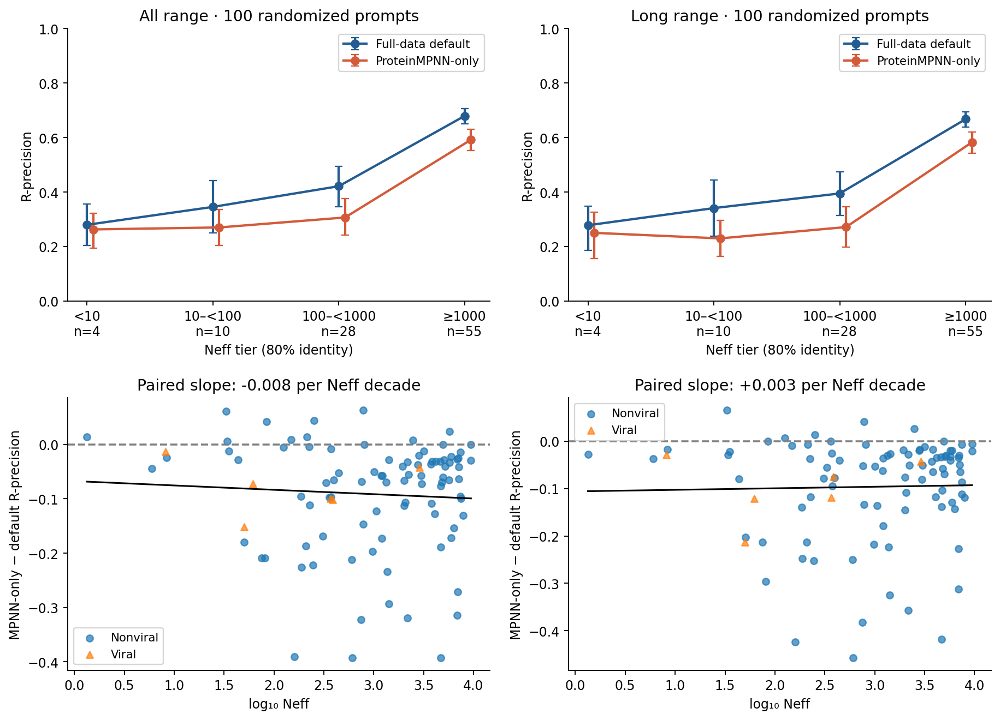

The prespecified extreme-tier contrast supports a **smaller relative drop**. The all-range high-minus-low drop is 0.3994 for default and 0.3289 for MPNN-only; their difference is **−0.0705 [−0.1026, −0.0401]**. The long-range difference is −0.0571 [−0.0840, −0.0328]. This arises because the MPNN-only deficit is smaller in the four lowest-Neff proteins, not because its absolute low-Neff accuracy is higher. Those proteins are `7xcd_A`, `7xp9_A`, `8eb9_A` and `8ec3_A`; four observations provide limited evidence about the broader low-Neff population.

The continuous contrast does **not** establish flatter dependence. All-range accuracy slopes are +0.1808 for default and +0.1728 for MPNN-only per log10 Neff unit; the paired interaction is **−0.0080 [−0.0276, 0.0165]**. Long range gives +0.0033 [−0.0173, 0.0300]. The gap is largest in the middle tiers, so a single linear interaction and an extreme-tier contrast summarize different features of the data.

Length/viral adjustment leaves the all-range interaction inconclusive: −0.0063 [−0.0288, 0.0210]; excluding the six viral proteins gives −0.0078 [−0.0294, 0.0203]. The 300-fixed-prompt extreme-tier contrast also favors a smaller MPNN-only drop, −0.0894 [−0.1414, −0.0417]. Absolute MPNN-only accuracy is lower in both viral and nonviral subsets: paired differences −0.0801 [−0.1166, −0.0463] and −0.0919 [−0.1140, −0.0712], respectively.

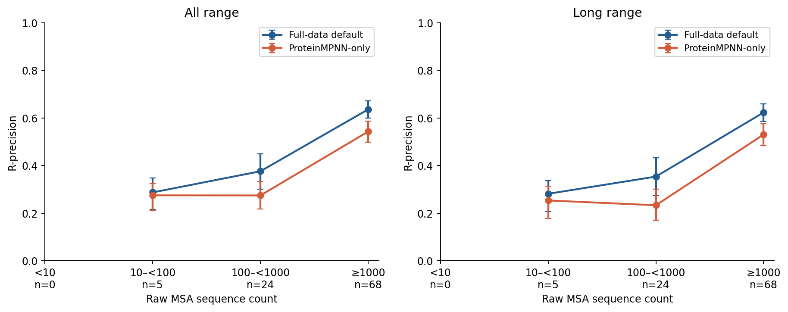

Raw-depth tiers contain **0, 5, 24 and 68** proteins. There is no raw-depth <10 group and hence no high-minus-low contrast for it. Its continuous all-range interaction is −0.0121 [−0.0350, 0.0160]. Exploratorily, the diversity gap grows with Neff (+0.0423 [0.0253, 0.0602] per decade), while its association with native similarity at 40% coverage is inconclusive. A larger MPNN-only ensemble-gain slope versus Neff is also inconclusive (+0.0209 [−0.0003, 0.0449]). Full tables: [tiers](data/tier_accuracy.csv), [drop contrasts](data/drop_contrasts.csv), [slopes](data/slopes.csv), [subgroups](data/subgroups.csv), [exploratory associations](data/exploratory_associations.csv).

### 4. Coordinated patterns occur in both models

Curveball shuffling preserves exactly every rollout's contact count and every pair's inclusion frequency. For each protein/model we ran ten 3,000-trade null replicates, with independent 1,500-trade runs as a mixing check. Both models show broader pairwise-distance distributions than these controls: observed-minus-null Jaccard SD is 0.0197 [0.0171, 0.0225] for default and 0.0169 [0.0145, 0.0197] for MPNN-only. Excess overlap SD is similar (3.85 versus 3.96 contacts; paired difference 0.10 [−0.40, 0.60]).

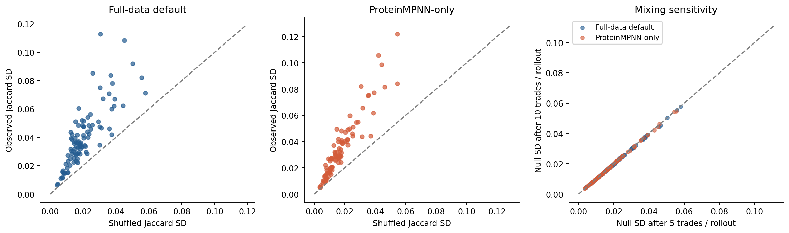

The full-chain versus half-chain mean null Jaccard-SD change is only −0.00019 and −0.00012, respectively, small relative to the observed excess; this diagnoses finite-chain sensitivity, not exact uniform mixing. These results show contact dependencies beyond the margins in **both** models. They neither establish distinct physical conformations nor support uniquely stronger coordination in MPNN-only. Source: [shuffle replicates](data/shuffle_controls.csv), [paired summaries](data/shuffle_summary.csv).

The following eight proteins were selected **before inference**, by evenly spaced Neff ranks. Every panel uses the same frequency scale (0–1) and difference scale (−1 to +1). Some examples preserve similar patterns and scores (`8akh_A`: both R=0.626; `7wzm_A`: 0.713 versus 0.711). Others have diffuse MPNN-only frequencies and substantially worse ranking (`8cpn_A`: 0.512 versus 0.226; `8b2s_A`: 0.667 versus 0.398). These are descriptions of the frozen panel, not examples selected for large effects.

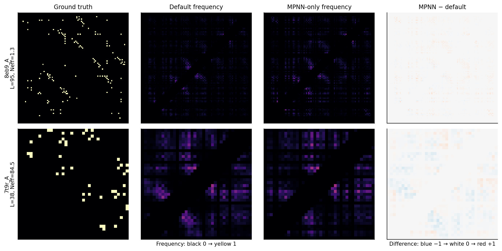

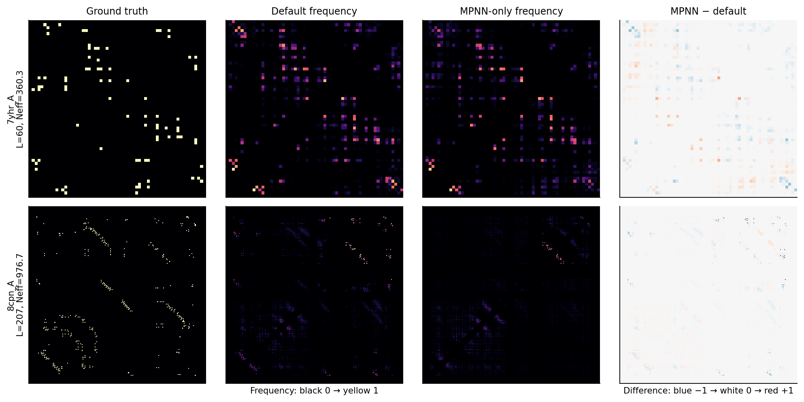

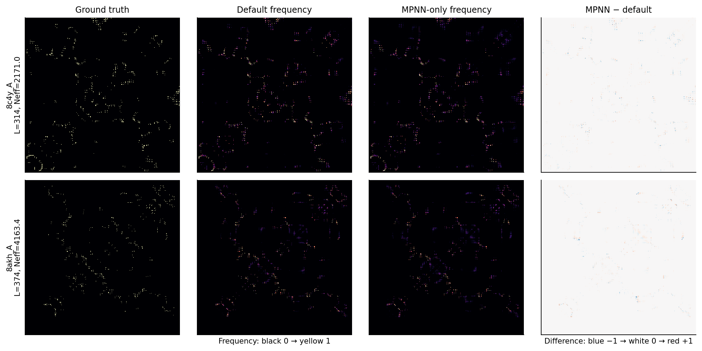

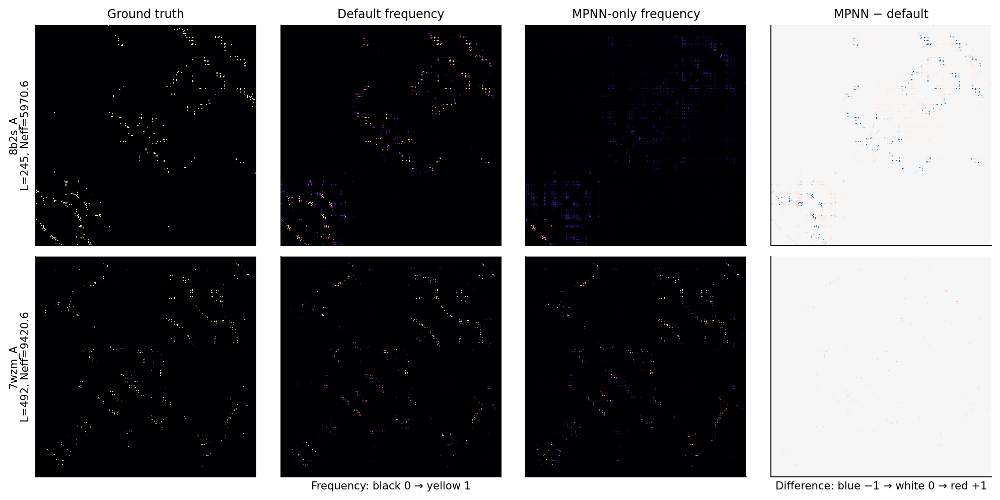

[Compact contact-map source data](data/panel_contacts.csv.gz) allow all panels to be redrawn without raw samples.

### 5. Sequence-similarity evidence does not resolve the mechanism

The [corpus audit](data/training_similarity_coverage.csv) traces both recipes to their actual configured sources. Default includes 3,963,003 native AFDB and 65,553,178 native ESM-Atlas documents, plus 31,702,680 AFDB-derived and 130,872,044 ESM-derived redesign documents. MPNN-only uses the latter **162,574,724 redesign documents**.

Existing exp245 residual searches cover surviving native AFDB/ESM-Atlas sequences. At ≥50% coverage of the shorter sequence, 96/97 proteins have a reported surviving match; median and maximum best identity are 0.299, reflecting the decontamination cutoff. At ≥40% coverage, all 97 have a match, median best identity is 0.506, and two reach ≥0.9. These are historical alignment results, not a fresh search of the final token caches.

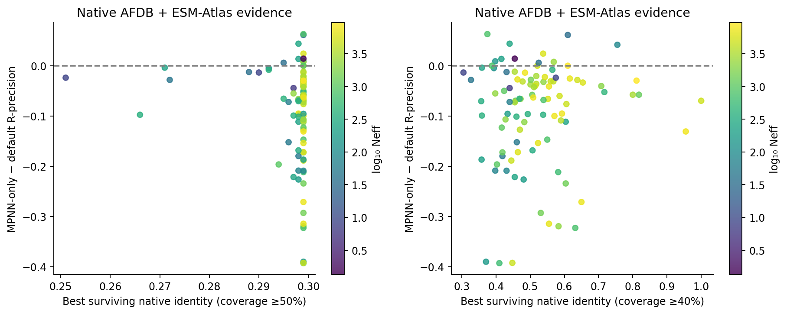

At 40% coverage, the association of paired accuracy difference with native identity is inconclusive: slope +0.059 [−0.085, 0.217] per identity unit. MPNN-only remains less accurate both below identity 0.4 (13 proteins; difference −0.076 [−0.144, −0.019]) and above it (84; −0.093 [−0.115, −0.073]). At 50% coverage the fitted slope is negative (−2.02 [−5.14, −0.70]), but it is estimated over the severely restricted range imposed by filtering; it should not be interpreted as a general retrieval relationship.

**No complete eval-versus-redesign sequence search or redesign-corpus KNN null was found in available artifacts.** Similarity coverage for all 162.6 million redesign documents is unmeasured, not zero. The existing decontaminated native AFDB-only sequence-KNN score is 0.407 on these 97 proteins; it excludes ESM-Atlas and all redesigns and is not a matched null for either complete recipe. Removing native documents does not remove backbone ancestry or prove absence of retrieval/memorization. See [audit provenance and limitations](data/similarity_audit.json), [native search coverage](data/native_similarity_coverage.csv), and [KNN context](data/native_knn_context.csv).

### 6. Designed proteins: secondary, smaller and less certain effects

The 19 designs are never pooled with the natural proteins. Fixed-prompt Jaccard difference is +0.0457 [−0.0017, 0.0976], and the count-matched difference is +0.0247 [−0.0207, 0.0757]; neither establishes increased diversity. Randomized-prompt all-range R-precision is 0.7082 for default versus 0.6613 for MPNN-only, difference −0.0469 [−0.0857, −0.0159]. Long-range scores are 0.6706 versus 0.6289, difference −0.0417 [−0.0937, 0.0071]. Three designs lack Neff metadata; all 19 retain their prediction scores.

### 7. Output integrity and execution

All 278,400 samples were retained, including malformed statements and capped outputs. No canonical contact set was empty. There were 264 samples with a malformed statement, 2,893 with an invalid position, and 392 with unexpected text; categories can overlap. MPNN-only actually had fewer malformed statements (13 versus 342 across the full experiment), so the diversity gap is not explained by greater syntax failure. Duplicate and near-diagonal contacts are counted and removed during canonicalization; no retractions occurred.

There were **1,501 continuations (0.54%)**: none at temperature 1, two at 0.7, and 1,499 at 1.3. **17 samples remained capped (0.0061%)**: one default sample on the 30-residue design `5sbj_A` at temperature 0.7, and 16 on the 761-residue natural protein `7znz_A` at 1.3 (four default, twelve MPNN-only). No cap affects the primary temperature-1 comparisons. [Diagnostic counts](data/diagnostic_counts.csv) and [all continuation cases](data/continuation_diagnostics.csv) preserve the breakdown.

Twelve independent batch H100 shards completed successfully after two successful 100-sample smoke tests. Eight initial production attempts hit artifact-upload rate limits; completed conditions were reused and publication was changed to a direct bucket API with bounded retries. The scientific worker/parser programs and frozen plan are identical across all production bundles. A prior smoke environment dependency conflict was resolved before production by isolating the HF publisher environment. [Runtime versions](data/runtime_versions.json), [launch/source records](data/launches.json), and [execution summary](data/execution_summary.json) record these details.

Retained conditions sum to **5.20 GPU-hours of pure inference**; this excludes setup, artifact publication and discarded failed-attempt work. [Timings](data/timings.csv) record every protein/model/prompt-mode/temperature condition, model load and stage time separately, and hardware metadata. The analysis and final [validation](data/validation.json) check all 1,392 conditions, 27,840 canonical metric rows, exact seed derivations, paired prompt tokens, continuation-prefix hashes, context limits and checkpoint-file identity across workers. Ten unit tests cover parser invariants, known diversity values, exact shuffle margins and agreement with the canonical scorer.

## Reproducibility and limitations

The [public artifact root](https://huggingface.co/buckets/open-athena/MarinFold/tree/data/exp373-mpnn-diversity-neff/v1) contains 921 MB of compressed raw samples, all prompts/token IDs/seeds, completion markers, checkpoint hashes, source bundles, analysis tables, inputs, figures and the PDF. The [raw inventory](data/raw_inventory.csv) gives per-file SHA256 checksums; the [publication manifest](data/publication_manifest.json) records report/input/table hashes verified by anonymous readback. Large per-rollout diagnostics live there rather than in git. All figures can be regenerated from the committed small tables.

Use the committed `uv.lock` with this experiment's `pyproject.toml`. From the repository root, the plotting command is `uv run --project experiments/exp373_evals_mpnn_diversity_neff python experiments/exp373_evals_mpnn_diversity_neff/plot.py`; replace the final script name with `build_summary.py` to rebuild the PDF. For full recomputation, run the scripts in this order with that same interpreter prefix: [restore_inputs.py](restore_inputs.py), [fetch.py](fetch.py), [analyze.py](analyze.py) with `--shuffles 0`, [shuffle.py](shuffle.py) with `--workers 4 --repeats 10`, [summarize.py](summarize.py), [sensitivity.py](sensitivity.py), [panel.py](panel.py), [validate_results.py](validate_results.py), then the plotting/PDF scripts. The raw-input restore downloads only the 116 selected proteins. Exact sample seeds use the first eight SHA256 bytes, big-endian, modulo `2**63-1`, as implemented in [contacts.py](contacts.py).

The Neff join validates unique protein stems, exact evaluation sequences against exp245 and MSA query length against the frozen exp260 table; original A3M query sequences were not independently re-fetched. Neff associations are observational. Unequal training exposure/schedules and one selected checkpoint per recipe prevent causal isolation of native-document removal. The low-Neff tier has only four natural proteins, secondary intervals are unadjusted, and contact-list variation does not demonstrate physical conformational variation.

## Conclusion

The diversity hypothesis is supported on natural eval-val proteins, including count, prompt and seed-block controls. The added diversity primarily expands false-contact discovery and does not improve ensemble accuracy or establish better true-contact coverage at comparable quality. The Neff hypothesis receives **partial, contrast-specific support**: the extreme-tier drop is smaller, but the continuous interaction is inconclusive and low-Neff absolute accuracy is not improved. The current full-data default remains the stronger contact predictor in this comparison. The available sequence-search evidence cannot establish that either effect is caused by reduced retrieval or memorization.
