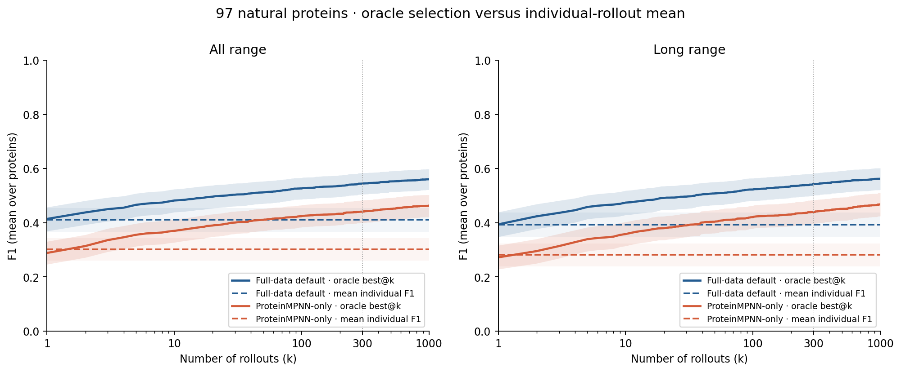
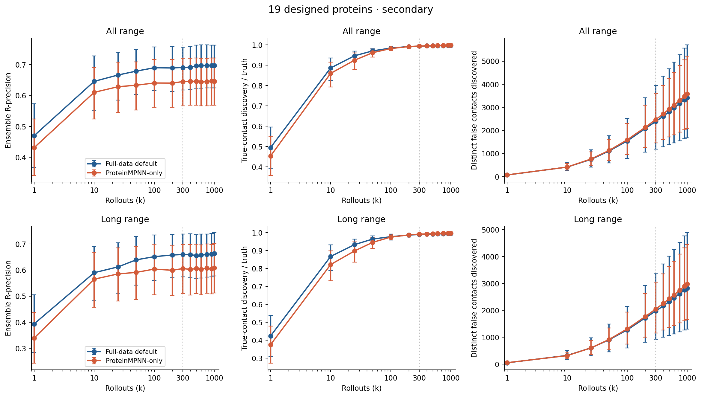
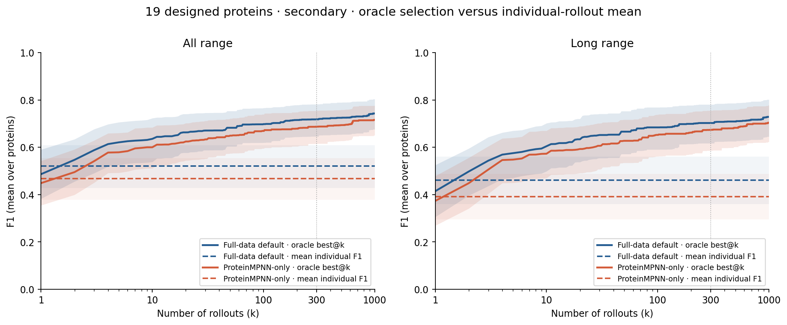

---
marinfold_experiment:
  issue: 373
  title: 'exp: ProteinMPNN-only prediction diversity and Neff dependence on eval-val'
  kind: evals
  branch: codex/exp373-diversity-neff
---

# exp: ProteinMPNN-only prediction diversity and Neff dependence on eval-val

[Issue #373](https://github.com/Open-Athena/MarinFold/issues/373) · [Summary PDF](plots/summary.pdf) · [Frozen plan](PLAN.md) · [1,000-rollout follow-up plan](EXTENSION_PLAN.md) · [Public artifacts](https://huggingface.co/buckets/open-athena/MarinFold/tree/data/exp373-mpnn-diversity-neff/v2-1000) · Updated 2026-10-30

**ProteinMPNN-only produces substantially more diverse contact predictions, but the extra diversity mostly adds benchmark errors.** On 97 natural proteins, mean fixed-prompt Jaccard distance increases from **0.708 to 0.813**, while standard 100-randomized-prompt R-precision falls from **0.554 to 0.463**. Extending fixed-prompt sampling to **1,000** reveals a small MPNN-only true-contact coverage advantage (**99.0% versus 98.5%**), accompanied by **53% more false contacts**. Default remains better even with oracle selection: **best@1,000 F1 is 0.561 versus 0.463**, compared with mean individual F1 of **0.412 versus 0.302**. MPNN-only's high-to-low Neff accuracy drop is smaller, yet the continuous Neff interaction is inconclusive and absolute low-Neff accuracy does not improve.

## Question and hypothesis

Does removing native-sequence training documents broaden the distribution of predicted contacts and reduce accuracy degradation at low effective MSA depth? The prespecified hypotheses were greater contact-set diversity after count and prompt controls, and a smaller accuracy dependence on Neff. A separate requirement for calling diversity useful was better correct-contact coverage or ensemble quality at comparable prediction quality. Neither checkpoint receives an MSA at inference.

## Approach

The [protocol](PLAN.md) and [machine-readable plan](data/plan.json) were frozen before inference. We evaluated two pinned 1.5B checkpoints:

| Role | W&B run / registry nickname | Step |
|---|---|---:|
| Full-data default | `contacts-v1-exp277-m2-p06-full-epoch-1.5B` | 266344 |
| ProteinMPNN-only | `contacts-v1-exp364-mpnn-only-1ep-lr5e-4-cooldown-1.5B` | 186884 |

The checkpoints are publicly available with their tokenizers: [default](https://huggingface.co/buckets/open-athena/MarinFold/tree/checkpoints/contacts-v1-exp277-m2-p06-full-epoch-1.5B/hf/step-266344) and [MPNN-only](https://huggingface.co/buckets/open-athena/MarinFold/tree/checkpoints/contacts-v1-exp364-mpnn-only-1ep-lr5e-4-cooldown-1.5B/hf/step-186884). Execution reused existing same-region S3 exports on `cw-us-east-02a`; downloaded file hashes were checked and recorded.

- **Cohorts:** all 97 natural eval-val proteins are primary; all 19 eval-denovo proteins are secondary and reported separately. Eval-test was not scored. Definitions, sequences, resolved residues and contact truth come from exp245.
- **Original sampling:** each checkpoint/protein/temperature receives 300 samples from one fixed prompt, partitioned into three independent seed blocks of 100, plus 100 samples from the same randomized prompt bank. Temperatures are 0.7, **1.0 primary**, and 1.3: **278,400 samples in 1,392 complete conditions**.
- **Requested follow-up:** after the original analysis, a separate [extension protocol](EXTENSION_PLAN.md) was frozen before new inference. Temperature-1 fixed-prompt sampling extends to **1,000 per model/protein**, adding 700 samples in seed blocks 3–9 while retaining the original 300 byte for byte. This adds **162,400 samples**, giving **440,800 overall**. Discovery, ensemble and oracle-F1 curves use the extended samples. The original diversity controls, temperature sweep, contact maps and Neff analyses retain their original sample counts.
- **Inference:** H100, vLLM 0.9.2, BF16, context 8192, top-p 0.95, top-k disabled, prefix caching disabled, identical tokenizer and prompt tokens. Initial budget is `min(6L+128, 8192−prompt_tokens)`. Capped prefixes continue within the original context under the exp364 policy; no sample is replaced or excluded. Exact seeds and prefixes are saved.
- **Contact scoring:** undo position offsets, canonicalize orientation, fold retractions in order, deduplicate, and restrict primary statistics to resolved pairs separated by at least six residues. Long range means separation ≥24. Exp89's exact truth threshold (≥0.001), stable vote ranking and scorer produce precision-at-L/L/2/L/5/R and AUC. R-precision measures precision among the top R ranked pairs, where R is the true-contact count.
- **Diversity and controls:** mean Jaccard distance over all 44,850 pairs of the original 300 fixed-prompt samples per protein; both-empty distance is zero. Match contact counts by thinning each paired sample to the smaller count. Also report randomized prompts, seed blocks, unrestricted valid pairs, entropy, discovery curves and a shuffle preserving every sample size and every contact frequency.
- **Individual and oracle F1:** compute `2 TP / (predicted contacts + true contacts)` separately for each rollout in the same resolved-pair universe. An empty prediction scores zero; all proteins have nonempty truth in both ranges. Oracle best@k is the best single-rollout F1 among the **first k samples in their seeded order**, macro-averaged across proteins. It requires ground truth for selection and is an upper bound, not an inference-time selector. All- and long-range oracles are optimized separately and can select different rollouts. The dashed comparison is the mean individual F1 across all 1,000 samples, first within each protein and then across proteins. It is not F1 computed from averaged precision and recall. Oracle best@1 uses one draw per protein, so it need not exactly equal the 1,000-draw mean.
- **Uncertainty:** equal weight per protein; 10,000 paired protein bootstrap draws, seed 373. Samples from one protein are not independent biological replicates. Bracketed intervals below are 95% percentile intervals; secondary/exploratory comparisons are not multiplicity-adjusted.

## Results

### 1. Greater diversity survives the controls

All contrasts below are MPNN-only minus default on the 97 natural proteins at temperature 1.

| Diversity endpoint | Difference [95% CI] |
|---|---:|
| **Fixed prompt, all range: primary Jaccard distance** | **+0.1046 [0.0866, 0.1229]** |
| Fixed prompt, matched contact counts | +0.1064 [0.0891, 0.1244] |
| Randomized prompts | +0.1008 [0.0836, 0.1189] |
| Fixed prompt, long range | +0.1054 [0.0871, 0.1238] |
| Fixed prompt, long range, matched counts | +0.1027 [0.0859, 0.1202] |
| Fixed prompt, unrestricted valid contacts | +0.1059 [0.0880, 0.1242] |

The three 100-sample seed blocks give differences of +0.1050, +0.1042 and +0.1046. Contact-inclusion entropy rises from 0.0362 to 0.0484 bits per candidate pair, a difference of +0.0123 [0.0098, 0.0147]. Thus the effect is reproducible across sampling blocks and is not explained by prompt randomization or output size.

Each point is one protein. MPNN-only generates modestly more resolved contacts per sample: 276.4 versus 260.9, or 0.959 versus 0.906 contacts per residue. The long-range fraction is essentially unchanged (0.650 versus 0.653). Protein length is exactly paired; the exploratory diversity-difference slope against log10(length) is −0.0023 [−0.0759, 0.0675]. Source tables: [diversity contrasts](data/diversity_contrasts.csv), [seed blocks](data/seed_blocks.csv), [single-sample summaries](data/single_rollout_contrasts.csv).

### 2. The extra diversity mainly adds errors

The following are means over the 97 natural proteins at temperature 1. The follow-up extends the fixed-prompt discovery and ensemble curves to **1,000 rollouts** and adds single-rollout F1 and oracle best@k. Discovery measures the union of sampled contacts; “false” means absent from the benchmark contact truth. The original single-rollout precision/recall results remain available in the [300-sample summaries](data/single_rollout_summary.csv).

| All-range measure | Default | MPNN-only | Paired difference [95% CI] |
|---|---:|---:|---:|
| **Mean individual-rollout F1, all 1,000 samples** | **0.4115** | **0.3020** | **−0.1095 [−0.1314, −0.0881]** |
| Oracle best@300 F1 | 0.5447 | 0.4409 | −0.1038 [−0.1248, −0.0830] |
| **Oracle best@1,000 F1** | **0.5607** | **0.4628** | **−0.0980 [−0.1166, −0.0799]** |
| True-contact coverage after 1,000 samples | 0.9851 | 0.9901 | +0.0050 [0.0011, 0.0096] |
| Distinct true contacts discovered, 1,000 samples | 254.2 | 255.6 | +1.4 [0.4, 2.7] |
| Distinct false contacts discovered, 1,000 samples | 8,011.0 | 12,290.8 | +4,279.8 [3,036.2, 5,716.2] |
| Ensemble R-precision, 1,000 fixed prompts | 0.5414 | 0.4549 | −0.0865 [−0.1105, −0.0635] |
| **Ensemble R-precision, 100 randomized prompts** | **0.5540** | **0.4628** | **−0.0911 [−0.1113, −0.0719]** |

The dotted line marks the original 300-sample limit. All **3,248 original protein/range/k rows** reproduce to numerical precision (absolute tolerance 10⁻¹²). At k=300, true-contact coverage was 0.9643 versus 0.9673, with an inconclusive paired difference. At k=1,000, the MPNN-only advantage is **0.50 percentage points [0.11, 0.96]**. This is a small, now-resolved coverage benefit: about **1.4 more true contacts**, alongside **4,280 more false contacts**, per protein.

The ensembles largely plateau after 300 samples. Default R-precision changes from 0.5394 to 0.5414, gain +0.0020 [−0.0001, 0.0042]; MPNN-only changes from 0.4541 to 0.4549, gain +0.0009 [−0.0011, 0.0028]. Default remains more accurate at every plotted sample count. From k=300 to 1,000, default discovers another 5.5 true and 2,369 false contacts per protein; MPNN-only discovers another 6.3 true and 3,389 false contacts.

**Extra sampling does find better individual predictions in both models.** From k=300 to 1,000, oracle F1 rises by **0.0161 [0.0120, 0.0205]** for default and **0.0218 [0.0168, 0.0275]** for MPNN-only. Nevertheless, MPNN-only's best@1,000 remains lower by 0.0980 [0.0799, 0.1166]. The dashed lines show ordinary mean individual F1 over the 1,000 samples; the solid curves require ground truth to choose the best sample. Shading gives pointwise 95% protein-bootstrap intervals, not simultaneous bands or rollout-level uncertainty. F1 here scores individual contact sets; the separate R-precision curves score vote ensembles.

Long-range results agree: best@1,000 F1 is **0.5625 versus 0.4679**, mean individual F1 is **0.3938 versus 0.2815**, and ensemble R-precision is **0.5217 versus 0.4320**, in default/MPNN-only order. MPNN-only's long-range coverage advantage is +0.0064 [0.0007, 0.0132], accompanied by 10,348 versus 6,608 false contacts. Primary randomized-prompt long-range R-precision remains 0.5391 for default versus 0.4427 for MPNN-only, paired difference −0.0964 [−0.1184, −0.0758].

Sources: [extended protein-level curves](data/ensemble_curves_1000.csv), [curve means and intervals](data/curve_summary_1000.csv), [oracle curves at every integer k](data/oracle_summary_1000.csv), [paired model contrasts](data/curve_contrasts_1000.csv), [300→1,000 gains](data/extension_gains_1000.csv), and [individual F1 scores](data/rollout_f1_1000.csv.gz). Mean individual F1 is stable across the extension: the 1,000-minus-300 mean changes are +0.0002 and +0.0001 for default and MPNN-only, both with intervals spanning zero; [seed-block summaries](data/f1_seed_blocks_1000.csv) retain the breakdown.

Increasing temperature broadens predictions and reduces individual precision for both models. This original sweep still uses **300 fixed-prompt samples at each temperature**. Default ensemble R-precision stays at 0.526–0.539, above MPNN-only's 0.434–0.457. The three-point sweep provides no demonstrated ensemble advantage at comparable quality; it is not a post-hoc temperature optimization. Source tables: [original accuracy](data/accuracy_summary.csv), [original discovery curves](data/curve_summary.csv), [all original canonical metrics including AUC](data/metrics.csv).

### 3. Neff: smaller extreme-tier drop, inconclusive continuous interaction

Neff is exp260's redundancy-weighted `n_eff_0.8`, not raw sequence count. All 97 natural proteins have metadata. The four fixed tiers contain **4, 10, 28 and 55 proteins**. Scores below use the primary 100 matched randomized prompts at temperature 1.

| Neff tier | n | Default all-range R | MPNN-only all-range R | Paired difference [95% CI] |
|---|---:|---:|---:|---:|
| <10 | 4 | 0.2799 | 0.2629 | −0.0169 [−0.0367, 0.0046] |
| 10–<100 | 10 | 0.3455 | 0.2702 | −0.0754 [−0.1363, −0.0163] |
| 100–<1000 | 28 | 0.4214 | 0.3068 | −0.1146 [−0.1598, −0.0718] |
| ≥1000 | 55 | 0.6793 | 0.5918 | −0.0875 [−0.1124, −0.0647] |

| Neff tier | n | Default long-range R | MPNN-only long-range R | Paired difference [95% CI] |
|---|---:|---:|---:|---:|
| <10 | 4 | 0.2782 | 0.2503 | −0.0278 [−0.0347, −0.0203] |
| 10–<100 | 10 | 0.3412 | 0.2300 | −0.1112 [−0.1783, −0.0444] |
| 100–<1000 | 28 | 0.3949 | 0.2716 | −0.1233 [−0.1743, −0.0758] |
| ≥1000 | 55 | 0.6674 | 0.5825 | −0.0849 [−0.1109, −0.0617] |

The prespecified extreme-tier contrast supports a **smaller relative drop**. The all-range high-minus-low drop is 0.3994 for default and 0.3289 for MPNN-only; their difference is **−0.0705 [−0.1026, −0.0401]**. The long-range difference is −0.0571 [−0.0840, −0.0328]. This arises because the MPNN-only deficit is smaller in the four lowest-Neff proteins, not because its absolute low-Neff accuracy is higher. Those proteins are `7xcd_A`, `7xp9_A`, `8eb9_A` and `8ec3_A`; four observations provide limited evidence about the broader low-Neff population.

The continuous contrast does **not** establish flatter dependence. All-range accuracy slopes are +0.1808 for default and +0.1728 for MPNN-only per log10 Neff unit; the paired interaction is **−0.0080 [−0.0276, 0.0165]**. Long range gives +0.0033 [−0.0173, 0.0300]. The gap is largest in the middle tiers, so a single linear interaction and an extreme-tier contrast summarize different features of the data.

Length/viral adjustment leaves the all-range interaction inconclusive: −0.0063 [−0.0288, 0.0210]; excluding the six viral proteins gives −0.0078 [−0.0294, 0.0203]. The 300-fixed-prompt extreme-tier contrast also favors a smaller MPNN-only drop, −0.0894 [−0.1414, −0.0417]. Absolute MPNN-only accuracy is lower in both viral and nonviral subsets: paired differences −0.0801 [−0.1166, −0.0463] and −0.0919 [−0.1140, −0.0712], respectively.

Raw-depth tiers contain **0, 5, 24 and 68** proteins. There is no raw-depth <10 group and hence no high-minus-low contrast for it. Its continuous all-range interaction is −0.0121 [−0.0350, 0.0160]. Exploratorily, the diversity gap grows with Neff (+0.0423 [0.0253, 0.0602] per decade), while its association with native similarity at 40% coverage is inconclusive. A larger MPNN-only ensemble-gain slope versus Neff is also inconclusive (+0.0209 [−0.0003, 0.0449]). Full tables: [tiers](data/tier_accuracy.csv), [drop contrasts](data/drop_contrasts.csv), [slopes](data/slopes.csv), [subgroups](data/subgroups.csv), [exploratory associations](data/exploratory_associations.csv).

### 4. Coordinated patterns occur in both models

Curveball shuffling preserves exactly every rollout's contact count and every pair's inclusion frequency. For each protein/model we ran ten 3,000-trade null replicates, with independent 1,500-trade runs as a mixing check. Both models show broader pairwise-distance distributions than these controls: observed-minus-null Jaccard SD is 0.0197 [0.0171, 0.0225] for default and 0.0169 [0.0145, 0.0197] for MPNN-only. Excess overlap SD is similar (3.85 versus 3.96 contacts; paired difference 0.10 [−0.40, 0.60]).

The full-chain versus half-chain mean null Jaccard-SD change is only −0.00019 and −0.00012, respectively, small relative to the observed excess; this diagnoses finite-chain sensitivity, not exact uniform mixing. These results show contact dependencies beyond the margins in **both** models. They neither establish distinct physical conformations nor support uniquely stronger coordination in MPNN-only. Source: [shuffle replicates](data/shuffle_controls.csv), [paired summaries](data/shuffle_summary.csv).

The following eight proteins were selected **before inference**, by evenly spaced Neff ranks. Every panel uses the same frequency scale (0–1) and difference scale (−1 to +1). Some examples preserve similar patterns and scores (`8akh_A`: both R=0.626; `7wzm_A`: 0.713 versus 0.711). Others have diffuse MPNN-only frequencies and substantially worse ranking (`8cpn_A`: 0.512 versus 0.226; `8b2s_A`: 0.667 versus 0.398). These are descriptions of the frozen panel, not examples selected for large effects.

[Compact contact-map source data](data/panel_contacts.csv.gz) allow all panels to be redrawn without raw samples.

### 5. Sequence-similarity evidence does not resolve the mechanism

The [corpus audit](data/training_similarity_coverage.csv) traces both recipes to their actual configured sources. Default includes 3,963,003 native AFDB and 65,553,178 native ESM-Atlas documents, plus 31,702,680 AFDB-derived and 130,872,044 ESM-derived redesign documents. MPNN-only uses the latter **162,574,724 redesign documents**.

Existing exp245 residual searches cover surviving native AFDB/ESM-Atlas sequences. At ≥50% coverage of the shorter sequence, 96/97 proteins have a reported surviving match; median and maximum best identity are 0.299, reflecting the decontamination cutoff. At ≥40% coverage, all 97 have a match, median best identity is 0.506, and two reach ≥0.9. These are historical alignment results, not a fresh search of the final token caches.

At 40% coverage, the association of paired accuracy difference with native identity is inconclusive: slope +0.059 [−0.085, 0.217] per identity unit. MPNN-only remains less accurate both below identity 0.4 (13 proteins; difference −0.076 [−0.144, −0.019]) and above it (84; −0.093 [−0.115, −0.073]). At 50% coverage the fitted slope is negative (−2.02 [−5.14, −0.70]), but it is estimated over the severely restricted range imposed by filtering; it should not be interpreted as a general retrieval relationship.

**No complete eval-versus-redesign sequence search or redesign-corpus KNN null was found in available artifacts.** Similarity coverage for all 162.6 million redesign documents is unmeasured, not zero. The existing decontaminated native AFDB-only sequence-KNN score is 0.407 on these 97 proteins; it excludes ESM-Atlas and all redesigns and is not a matched null for either complete recipe. Removing native documents does not remove backbone ancestry or prove absence of retrieval/memorization. See [audit provenance and limitations](data/similarity_audit.json), [native search coverage](data/native_similarity_coverage.csv), and [KNN context](data/native_knn_context.csv).

### 6. Designed proteins: secondary, smaller and less certain effects

The 19 designs are never pooled with the natural proteins. Fixed-prompt Jaccard difference is +0.0457 [−0.0017, 0.0976], and the count-matched difference is +0.0247 [−0.0207, 0.0757]; neither establishes increased diversity. Randomized-prompt all-range R-precision is 0.7082 for default versus 0.6613 for MPNN-only, difference −0.0469 [−0.0857, −0.0159]. Long-range scores are 0.6706 versus 0.6289, difference −0.0417 [−0.0937, 0.0071]. Three designs lack Neff metadata; all 19 retain their prediction scores.

The same 1,000-sample extension was run on all 19 designs. Their all-range oracle best@1,000 F1 is **0.7428 versus 0.7158**, paired difference −0.0270 [−0.0472, −0.0077]. Mean individual F1 is **0.5205 versus 0.4670**, difference −0.0535 [−0.1094, −0.0036]. Oracle gains from 300 to 1,000 are +0.0250 [0.0131, 0.0396] and +0.0286 [0.0157, 0.0430], respectively. Fixed-prompt ensemble R-precision at 1,000 is 0.6972 versus 0.6459. These are secondary comparisons with unadjusted intervals.

### 7. Output integrity and execution

All 278,400 original samples were retained, including malformed statements and capped outputs. No canonical contact set was empty. There were 264 samples with a malformed statement, 2,893 with an invalid position, and 392 with unexpected text; categories can overlap. MPNN-only actually had fewer malformed statements (13 versus 342 in the original experiment), so the diversity gap is not explained by greater syntax failure. Duplicate and near-diagonal contacts are counted and removed during canonicalization; no retractions occurred.

There were **1,501 continuations (0.54%)**: none at temperature 1, two at 0.7, and 1,499 at 1.3. **17 samples remained capped (0.0061%)**: one default sample on the 30-residue design `5sbj_A` at temperature 0.7, and 16 on the 761-residue natural protein `7znz_A` at 1.3 (four default, twelve MPNN-only). No cap affects the primary temperature-1 comparisons. [Diagnostic counts](data/diagnostic_counts.csv) and [all continuation cases](data/continuation_diagnostics.csv) preserve the breakdown.

For the original experiment, twelve independent batch H100 shards completed successfully after two successful 100-sample smoke tests. Eight initial production attempts hit artifact-upload rate limits; completed conditions were reused and publication was changed to a direct bucket API with bounded retries. The scientific worker/parser programs and frozen plan are identical across the original production bundles. A prior smoke environment dependency conflict was resolved before production by isolating the HF publisher environment. [Runtime versions](data/runtime_versions.json), [launch/source records](data/launches.json), and [execution summary](data/execution_summary.json) record these details.

The original retained conditions sum to **5.20 GPU-hours of pure inference**; this excludes setup, artifact publication and discarded failed-attempt work. [Timings](data/timings.csv) record every protein/model/prompt-mode/temperature condition, model load and stage time separately, and hardware metadata. The original analysis and [validation](data/validation.json) check all 1,392 conditions, 27,840 canonical metric rows, exact seed derivations, paired prompt tokens, continuation-prefix hashes, context limits and checkpoint-file identity across workers. Thirteen unit tests now cover parser invariants, known diversity values, exact shuffle margins, agreement with the canonical scorer, individual F1, prefix-oracle ordering and bootstrap equivalence.

The 1,000-sample extension retained all **162,400 new rollouts**, including 126 with a malformed statement, 618 with an invalid position and 138 with unexpected text; categories can overlap. There were **zero continuations, zero final caps and no empty canonical contact sets**. Twelve extension shards succeeded after one vLLM initialization failure was restarted with the identical source bundle; the failed attempt generated no samples. The extension added **2.57 GPU-hours of pure inference**. Its [timings](data/timings_1000.csv), [worker metadata](data/workers_1000.csv), [launches](data/launches_1000.json), [execution record](data/execution_summary_1000.json) and [validation](data/validation_1000.json) record the complete run. Every original 300-sample file passed its frozen SHA256 check; checkpoint hashes, paired prompt tokens, index ranges, seeds and parsed contacts also passed validation. The [analysis regression checks](data/analysis_validation_1000.json) reproduce every original discovery/ensemble point and verify bounded, monotonic oracle F1 curves.

## Reproducibility and limitations

The immutable [original artifact root, v1](https://huggingface.co/buckets/open-athena/MarinFold/tree/data/exp373-mpnn-diversity-neff/v1) contains 921 MB of compressed raw samples, all prompts/token IDs/seeds, completion markers, checkpoint hashes, source bundles, and the original report. The [raw inventory](data/raw_inventory.csv) gives per-file SHA256 checksums; the [original publication manifest](data/publication_manifest.json) records hashes verified by anonymous readback.

The [extension root, v2-1000](https://huggingface.co/buckets/open-athena/MarinFold/tree/data/exp373-mpnn-diversity-neff/v2-1000) holds 442 MB of new compressed 700-sample files, extension source bundles, all inputs and tables, and the updated report, figures and PDF. A full 1,000-sample condition concatenates its original 300 records from v1 with these new 700; original files were not overwritten. The [prefix inventory](data/extension_prefix_inventory.csv), [extension inventory](data/raw_inventory_1000.csv) and [extension publication manifest](data/publication_manifest_1000.json) preserve their identities. The compact [individual F1 table](data/rollout_f1_1000.csv.gz) supports every oracle curve without fetching raw predictions. All figures can be regenerated from the committed small tables.

Use the committed `uv.lock` with this experiment's `pyproject.toml`. From the repository root, the plotting command is `uv run --project experiments/exp373_evals_mpnn_diversity_neff python experiments/exp373_evals_mpnn_diversity_neff/plot.py`; replace the final script name with `build_summary.py` to rebuild the PDF. For full recomputation, run the scripts in this order with that same interpreter prefix: [restore_inputs.py](restore_inputs.py), [fetch.py](fetch.py), [analyze.py](analyze.py) with `--shuffles 0`, [shuffle.py](shuffle.py) with `--workers 4 --repeats 10`, [summarize.py](summarize.py), [sensitivity.py](sensitivity.py), [panel.py](panel.py), and [validate_results.py](validate_results.py). Then run `fetch.py --extend`, [validate_extension.py](validate_extension.py), [extend_analysis.py](extend_analysis.py) with `--workers 4`, and the plotting/PDF scripts. The raw-input restore downloads only the 116 selected proteins. Exact sample seeds use the first eight SHA256 bytes, big-endian, modulo `2**63-1`, as implemented in [contacts.py](contacts.py).

The Neff join validates unique protein stems, exact evaluation sequences against exp245 and MSA query length against the frozen exp260 table; original A3M query sequences were not independently re-fetched. Neff associations are observational. Unequal training exposure/schedules and one selected checkpoint per recipe prevent causal isolation of native-document removal. The low-Neff tier has only four natural proteins, secondary intervals are unadjusted, and contact-list variation does not demonstrate physical conformational variation.

## Conclusion

The diversity hypothesis is supported on natural eval-val proteins, including count, prompt and seed-block controls. Extending to 1,000 samples reveals a **small MPNN-only true-contact coverage advantage**, at the cost of substantially more false-contact discovery. More sampling improves oracle single-rollout F1 in both models, while ensemble accuracy changes little beyond 300. **Default remains better in mean individual F1, oracle best@1,000 F1 and ensemble R-precision.** The Neff hypothesis receives **partial, contrast-specific support**: the extreme-tier drop is smaller, but the continuous interaction is inconclusive and low-Neff absolute accuracy is not improved. The available sequence-search evidence cannot establish that either effect is caused by reduced retrieval or memorization.
