---
marinfold_experiment:
  issue: 373
  title: 'exp: ProteinMPNN-only prediction diversity and Neff dependence on eval-val'
  kind: evals
  branch: codex/exp373-two-epoch
---

# exp: ProteinMPNN-only prediction diversity and Neff dependence on eval-val

[Issue #373](https://github.com/Open-Athena/MarinFold/issues/373) · [Summary PDF](plots/summary.pdf) · [Two-epoch plan](TWO_EPOCH_PLAN.md) · [Public artifacts](https://huggingface.co/buckets/open-athena/MarinFold/tree/data/exp373-mpnn-diversity-neff/v3-two-epoch) · Updated 2026-11-02

**The two-epoch 5e-4 model substantially improves on the one-epoch MPNN-only model, while remaining behind full-data default on natural proteins.** Its randomized-prompt R-precision rises from **0.463 to 0.521**, versus **0.554** for default. Its oracle best@1,000 F1 rises from **0.463 to 0.527**, versus **0.561** for default. It is less diverse than the one-epoch model, though still more diverse than default. At 1,000 rollouts, its true-contact coverage advantage over default is **0.71 percentage points**, with **20% more false contacts**; the one-epoch model had 53% more. Thus the added diversity still mostly adds benchmark errors, but the cost is substantially smaller with the stronger checkpoint. The two-epoch 1e-3 model improves less. **The primary two-epoch model does not establish reduced Neff dependence**, including on the extreme-tier contrast that favored the one-epoch model.

This update includes both completed models from the [#364 handoff](https://github.com/Open-Athena/MarinFold/issues/364#issuecomment-6589622938). It adds **440,800 rollouts**, for **881,600 production rollouts** across four models, and updates every analysis and figure. Original predictions and published v1/v2 artifacts remain immutable.

## Question and approach

Does removing native-sequence training data broaden predicted contact distributions and reduce accuracy degradation at low effective MSA depth? Greater diversity must survive contact-count and prompt controls; useful diversity should improve correct-contact discovery or prediction accuracy. No model receives an MSA at inference.

The [original plan](PLAN.md), [1,000-rollout extension](EXTENSION_PLAN.md), and [two-epoch follow-up](TWO_EPOCH_PLAN.md) were frozen before their respective inference runs. The two-epoch 5e-4 checkpoint is the primary follow-up specified by the handoff; 1e-3 is a secondary learning-rate comparison.

| Label | Pinned training run / model nickname | Step |
|---|---|---:|
| Default | `contacts-v1-exp277-m2-p06-full-epoch-1.5B` | 266344 |
| MPNN 1 ep, 5e-4 | `contacts-v1-exp364-mpnn-only-1ep-lr5e-4-cooldown-1.5B` | 186884 |
| MPNN 2 ep, 5e-4 | `contacts-v1-exp364-mpnn-only-2ep-lr5e-4-1.5B` | 373768 |
| MPNN 2 ep, 1e-3 | `contacts-v1-exp364-mpnn-only-2ep-lr1e-3-1.5B` | 373768 |

All are 1.5B contacts-v1 models. New exports, including tokenizers, were read from `s3://marin-us-east-02a/MarinFold/exp364_models_mpnn_only_lr_sweep/runs/<run-name>/hf/step-373768`, beside compute in `cw-us-east-02a`. Each worker verified all six files against the [supplied SHA256 manifests](data/two_epoch_export_manifests.json). The older checkpoints have public HF exports: [default](https://huggingface.co/buckets/open-athena/MarinFold/tree/checkpoints/contacts-v1-exp277-m2-p06-full-epoch-1.5B/hf/step-266344) and [one epoch](https://huggingface.co/buckets/open-athena/MarinFold/tree/checkpoints/contacts-v1-exp364-mpnn-only-1ep-lr5e-4-cooldown-1.5B/hf/step-186884). New predictions and manifests are public; these two-epoch weights were accessed through their pinned S3 exports, not through the old one-epoch registry alias.

- **Cohorts:** the same 97 natural eval-val proteins are primary; 19 eval-denovo designs are secondary and never pooled with them. Eval-test was not scored. Exp245 sequences, resolved residues and contact truth are unchanged.
- **Sampling:** for each model/protein, 300 fixed-prompt rollouts at temperatures 0.7 and 1.3, **1,000 at primary temperature 1**, and 100 matched randomized prompts at each temperature. New temperature-1 fixed rollouts were generated as 300 then 700, matching the original call boundaries. Diversity, shuffles, temperature comparisons and contact maps use the first 300; the primary Neff analysis uses 100 randomized prompts.
- **Runtime:** H100, vLLM 0.9.2, BF16 inference, context 8192, top-p 0.95, top-k disabled, prefix caching disabled. Prompt tokens, sample seeds and continuation policy match the original run. Initial budget is `min(6L+128, 8192−prompt_tokens)`; capped prefixes continue within that context. No sample is replaced or excluded.
- **Contact scoring:** undo offsets, canonicalize orientation, apply retractions in order and deduplicate. Primary all-range contacts are resolved pairs separated by ≥6 residues; long range uses ≥24. The unchanged exp89 scorer uses truth threshold ≥0.001 and stable vote ranking. R-precision evaluates the top R pairs, where R is the true-contact count. Precision-at-L/L/2/L/5/R and AUC are retained in [all canonical metrics](data/two_epoch/metrics.csv).
- **Diversity:** mean Jaccard distance over all 44,850 pairs of 300 fixed-prompt contact sets per protein; both-empty distance is zero. Controls include per-rollout count matching by thinning, randomized prompts, three independent seed blocks, unrestricted valid pairs, entropy, and shuffles preserving every rollout size and contact frequency.
- **Oracle and ordinary F1:** each rollout scores `2 TP / (predicted contacts + true contacts)` in the same candidate universe. Empty predictions score zero; every protein has nonempty truth in both ranges. Oracle best@k selects the highest single-rollout F1 among the first k samples in their seeded order, then averages proteins equally. It uses ground truth and is not a usable inference-time selector or an expectation over random sample permutations. All- and long-range oracles select independently. Dashed plot lines average individual F1 over all 1,000 rollouts within each protein, then across proteins. This is not F1 of averaged precision and recall; best@1 need not equal the 1,000-draw mean.
- **Uncertainty:** 10,000 paired protein-bootstrap draws, seed 373, equal protein weights. Brackets are 95% percentile intervals; curve bands are pointwise. Rollouts are not independent biological replicates. Secondary comparisons are unadjusted for multiplicity. All six pairwise model contrasts are saved, including each two-epoch model versus one epoch.

Training exposure and learning-rate schedules differ. The one-epoch model is a cooldown fork; the two-epoch runs trained from scratch for two epochs. These comparisons do not isolate an extra epoch or removal of native documents causally.

## Results

### 1. Two epochs at 5e-4 improve accuracy and reduce the diversity excess

Natural proteins, temperature 1; all-range values unless marked long:

| Metric | Default | MPNN 1 ep, 5e-4 | MPNN 2 ep, 5e-4 | MPNN 2 ep, 1e-3 |
|---|---:|---:|---:|---:|
| R-precision, 100 randomized prompts | 0.5540 | 0.4628 | **0.5211** | 0.4790 |
| Long-range R, 100 randomized prompts | 0.5391 | 0.4427 | **0.5067** | 0.4603 |
| Jaccard distance, 300 fixed prompts | 0.7083 | 0.8130 | **0.7576** | 0.8022 |
| Mean individual F1, 1,000 fixed prompts | 0.4115 | 0.3020 | **0.3718** | 0.3197 |
| Oracle best@1,000 F1 | 0.5607 | 0.4628 | **0.5266** | 0.4798 |
| Ensemble R, 1,000 fixed prompts | 0.5414 | 0.4549 | **0.5203** | 0.4733 |

The two-epoch 5e-4 model improves primary R over one epoch by **+0.0583 [0.0425, 0.0763]**. Its remaining default deficit is **−0.0329 [−0.0489, −0.0177]**, versus −0.0911 for one epoch. At two epochs, 1e-3 trails 5e-4 by **0.0421 [0.0277, 0.0575]**. Sources: [accuracy summaries](data/two_epoch/accuracy_summary.csv), [individual summaries](data/two_epoch/single_rollout_summary_aggregate.csv), [extended curve summaries and all contrasts](data/two_epoch/curve_summary.csv).

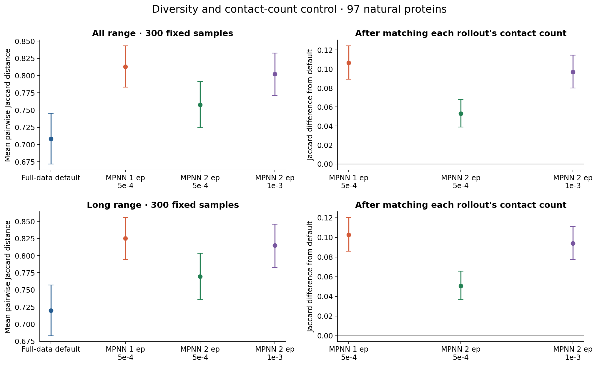

The stronger 5e-4 checkpoint is **less diverse than one epoch**, paired Jaccard difference **−0.0554 [−0.0692, −0.0427]**, while remaining more diverse than default:

| Control: Jaccard difference versus default | MPNN 1 ep, 5e-4 | MPNN 2 ep, 5e-4 | MPNN 2 ep, 1e-3 |
|---|---:|---:|---:|
| Fixed 300 | +0.1046 [0.0866, 0.1229] | +0.0493 [0.0352, 0.0641] | +0.0939 [0.0764, 0.1124] |
| Matched contact counts | +0.1064 [0.0891, 0.1244] | +0.0530 [0.0389, 0.0679] | +0.0969 [0.0801, 0.1145] |
| Randomized 100 | +0.1008 [0.0836, 0.1189] | +0.0455 [0.0335, 0.0582] | +0.0867 [0.0711, 0.1037] |
| Unrestricted valid pairs | +0.1059 [0.0880, 0.1242] | +0.0521 [0.0381, 0.0670] | +0.0954 [0.0781, 0.1140] |

Long-range contacts agree. Independent 100-sample seed-block differences for two-epoch 5e-4 are +0.0500, +0.0485 and +0.0492; for 1e-3 they are +0.0940, +0.0930 and +0.0947. These checks support differences in the contact-sampling distribution beyond count or prompt effects. Sources: [diversity and entropy](data/two_epoch/diversity_summary.csv), [count controls](data/two_epoch/count_control_summary.csv), [seed blocks](data/two_epoch/seed_blocks.csv), [unrestricted pairs](data/two_epoch/unrestricted_diversity_summary.csv).

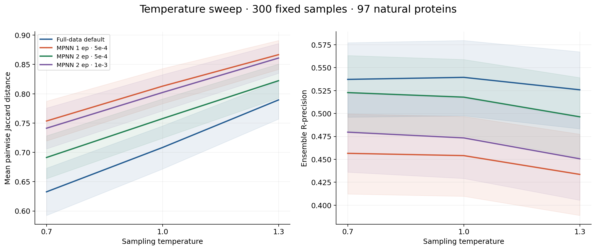

The temperature sweep retains 300 fixed rollouts at each temperature, so its temperature-1 ensemble score differs from the 1,000-rollout endpoint. It shows the diversity/accuracy tradeoff for every checkpoint; it is not a post-hoc temperature selection.

### 2. Through 1,000 rollouts: a smaller error cost, without overtaking default

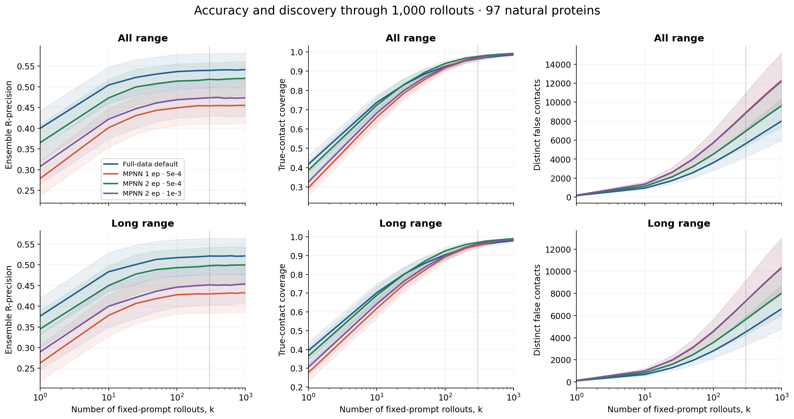

| All-range discovery at k=1,000 | Default | MPNN 1 ep, 5e-4 | MPNN 2 ep, 5e-4 | MPNN 2 ep, 1e-3 |
|---|---:|---:|---:|---:|
| True-contact coverage | 98.51% | 99.01% | **99.22%** | 99.02% |
| Distinct true contacts per protein | 254.2 | 255.6 | **256.2** | 255.9 |
| Distinct false contacts per protein | 8,011.0 | 12,290.8 | **9,624.8** | 12,191.8 |

Two-epoch 5e-4 gains **0.71 percentage points [0.34, 1.15]** of coverage versus default: **2.0 [1.1, 3.2] additional true contacts**, alongside **1,614 [721, 2,476] additional false contacts** per protein. Its false-contact count is 20.1% higher than default, down from 53.4% for one epoch. Relative to one epoch it removes **2,666 [1,574, 3,879] false contacts**; its extra coverage over one epoch is inconclusive (+0.21 percentage points [−0.02, 0.46]). “False” here means absent from the benchmark truth within its resolved-pair universe, not proof of physical impossibility.

From 300 to 1,000, two-epoch 5e-4 adds 4.5 true and 2,679 false contacts per protein. Its ensemble R increases only **+0.0024 [0.0002, 0.0050]**, to 0.5203. Gains for default, one epoch and two-epoch 1e-3 are +0.0020, +0.0009 and −0.0001, respectively, with intervals spanning zero. The ensembles largely plateau, and default remains ahead at every plotted k. [Sources and paired gains](data/two_epoch/extension_gains.csv).

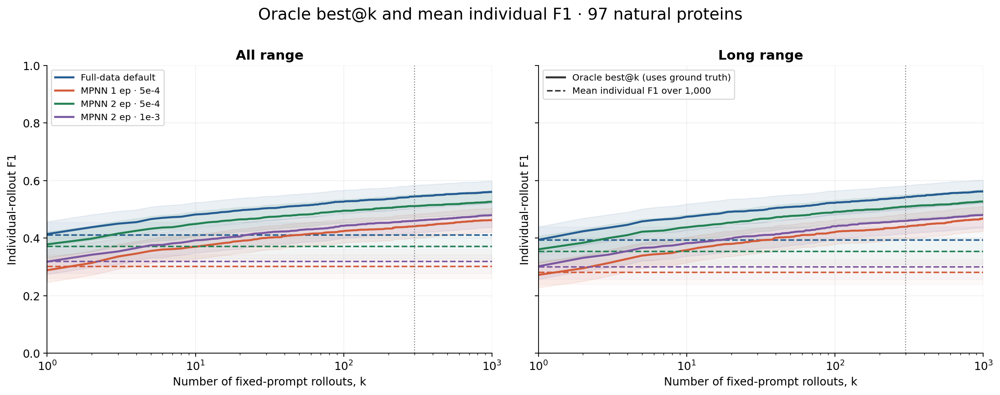

**Additional samples find better individual predictions in all four models.** Oracle F1 gains from 300 to 1,000 are:

| Model | Oracle gain, k=300→1,000 [95% CI] |
|---|---:|
| Default | +0.0161 [0.0120, 0.0205] |
| MPNN 1 ep, 5e-4 | +0.0218 [0.0168, 0.0275] |
| MPNN 2 ep, 5e-4 | +0.0152 [0.0115, 0.0196] |
| MPNN 2 ep, 1e-3 | +0.0197 [0.0156, 0.0243] |

Two-epoch 5e-4 improves best@1,000 over one epoch by **+0.0639 [0.0467, 0.0816]** and mean individual F1 by **+0.0699 [0.0521, 0.0897]**. It remains below default in oracle F1 (**−0.0341 [−0.0483, −0.0214]**) and ordinary mean F1 (**−0.0397 [−0.0576, −0.0228]**). The 1e-3 model also improves oracle F1 over one epoch, but by only +0.0171 [0.0038, 0.0310].

Long-range best@1,000 F1 is **0.5625 / 0.4679 / 0.5273 / 0.4807**, and mean individual F1 is **0.3938 / 0.2815 / 0.3542 / 0.3004**, in the table's four-model order. Mean individual F1 is stable between the first 300 and all 1,000 draws: every natural-protein all-range change has magnitude ≤0.0003 and an interval spanning zero. Solid curves use ground truth for selection; dashed lines show ordinary rollout quality. R-precision in the preceding figure instead scores vote ensembles.

Sources: [every integer-k oracle curve](data/two_epoch/oracle_summary.csv), [928,000 individual all/long F1 scores](data/two_epoch/rollout_f1_1000.csv.gz), [per-protein ensemble/discovery curves](data/two_epoch/ensemble_curves_1000.csv), [F1 seed blocks](data/two_epoch/f1_seed_blocks.csv), [mean-F1 stability](data/two_epoch/mean_f1_1000_minus_300.csv).

### 3. Neff: the strongest MPNN checkpoint does not establish flatter dependence

Neff is exp260's redundancy-weighted `n_eff_0.8`, not raw MSA sequence count. All 97 natural proteins have metadata. Primary scores use 100 randomized prompts at temperature 1.

| Neff tier | n | Default R | MPNN 1 ep, 5e-4 | MPNN 2 ep, 5e-4 | MPNN 2 ep, 1e-3 |
|---|---:|---:|---:|---:|---:|
| <10 | 4 | 0.2799 | 0.2629 | 0.2829 | 0.2701 |
| 10–<100 | 10 | 0.3455 | 0.2702 | 0.3165 | 0.2648 |
| 100–<1000 | 28 | 0.4214 | 0.3068 | 0.3603 | 0.3061 |
| ≥1000 | 55 | 0.6793 | 0.5918 | 0.6575 | 0.6212 |

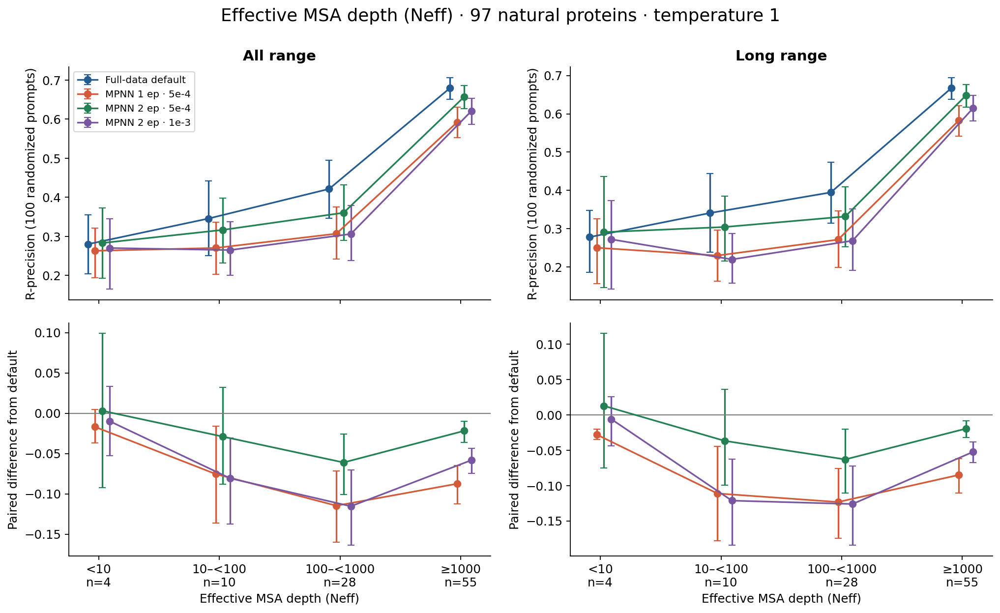

Two-epoch 5e-4's lowest-tier point estimate slightly exceeds default, but the difference is **+0.0031 [−0.0921, 0.0989]**. This does not establish better low-Neff accuracy. The four proteins are `7xcd_A`, `7xp9_A`, `8eb9_A` and `8ec3_A`.

| All-range contrast versus default | MPNN 1 ep, 5e-4 | MPNN 2 ep, 5e-4 | MPNN 2 ep, 1e-3 |
|---|---:|---:|---:|
| Difference in high-minus-low tier drop | −0.0705 [−0.1026, −0.0401] | **−0.0249 [−0.1229, 0.0735]** | −0.0483 [−0.0936, −0.0034] |
| Continuous interaction per log10 Neff | −0.0080 [−0.0276, 0.0165] | **−0.0028 [−0.0233, 0.0212]** | +0.0077 [−0.0101, 0.0332] |

A negative contrast means less accuracy loss at low Neff relative to default. The extreme-tier evidence from the one-epoch model **does not carry over clearly to two-epoch 5e-4**. Its long-range extreme-tier difference is also inconclusive, −0.0323 [−0.1360, 0.0627]. The largest deficits still occur in the middle tiers, so a linear slope and an extreme-tier contrast describe different features.

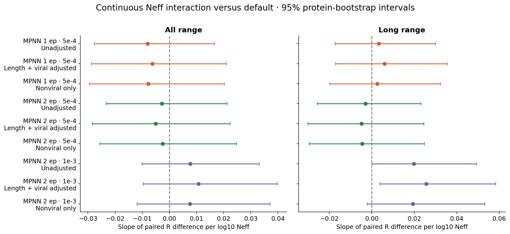

Length/viral adjustment and exclusion of six viral proteins leave the 5e-4 continuous interaction inconclusive. For two-epoch 1e-3, the long-range interaction is instead **positive**, +0.0198 [0.0001, 0.0492], and +0.0257 [0.0039, 0.0584] after adjustment; excluding viral proteins gives +0.0194 [−0.0022, 0.0533]. These secondary, unadjusted comparisons do not support a broadly flatter dependence. For two-epoch 5e-4 the all-range accuracy difference from default is −0.0142 [−0.0342, 0.0040] on six viral proteins and −0.0341 [−0.0517, −0.0180] on 91 nonviral proteins.

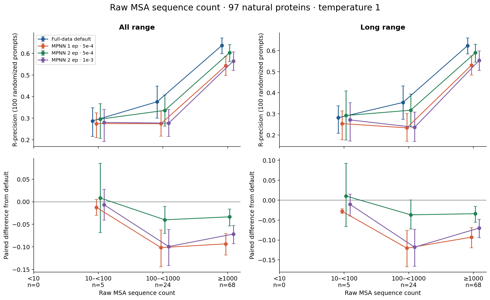

Raw-depth tiers contain **0, 5, 24 and 68 proteins**. No raw-depth <10 group exists, so no extreme-tier drop can be estimated. Two-epoch 5e-4's raw-depth interaction is −0.0027 [−0.0272, 0.0230]. [Tier tables](data/two_epoch/tier_accuracy.csv), [extreme drops](data/two_epoch/drop_contrasts.csv), [all slopes](data/two_epoch/slopes.csv), [subgroups](data/two_epoch/subgroups.csv) and [exploratory diversity/ensemble-gain associations](data/two_epoch/exploratory_associations.csv) retain every model and contrast, including the fixed-prompt sensitivity.

### 4. All four models show dependencies beyond contact frequencies

Ten Curveball null replicates per model/protein preserve every sample's contact count and every contact's frequency. Each uses 3,000 trades, with independent 1,500-trade runs as a mixing check. Observed-minus-null Jaccard SD is **0.0197 / 0.0169 / 0.0186 / 0.0182** in four-model order; every interval is above zero. Excess overlap SD is **3.85 / 3.96 / 4.25 / 4.42 contacts**. Neither new model's excess differs clearly from default on either statistic. Full-minus-half-chain null Jaccard-SD changes are −0.00020 / −0.00012 / −0.00014 / −0.00014, small relative to the observed excess; this diagnoses finite-chain sensitivity, not exact uniform mixing.

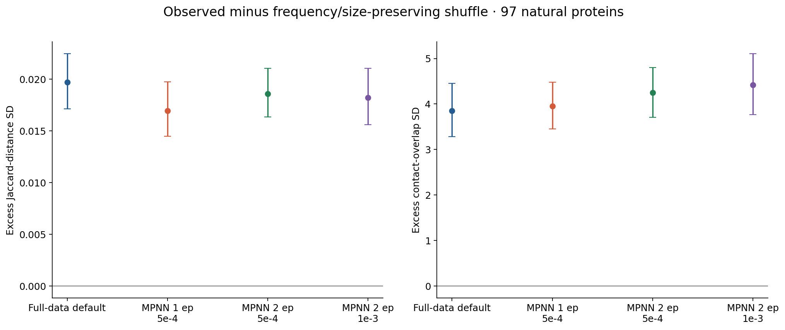

These results support contact dependencies in all four models. They do not establish physical conformational states or uniquely stronger redesign-only coordination. Sources: [new shuffle replicates](data/shuffle_controls_two_epoch.csv), [four-model per-protein summaries](data/two_epoch/shuffle_per_protein.csv), [means and contrasts](data/two_epoch/shuffle_summary.csv).

The eight contact-map examples were chosen by evenly spaced Neff ranks before the original inference. The update retains those proteins and the first-300-sample frequency scale of 0–1, with truth and all four models side by side. [Compact source data](data/two_epoch/panel_contacts.csv.gz).

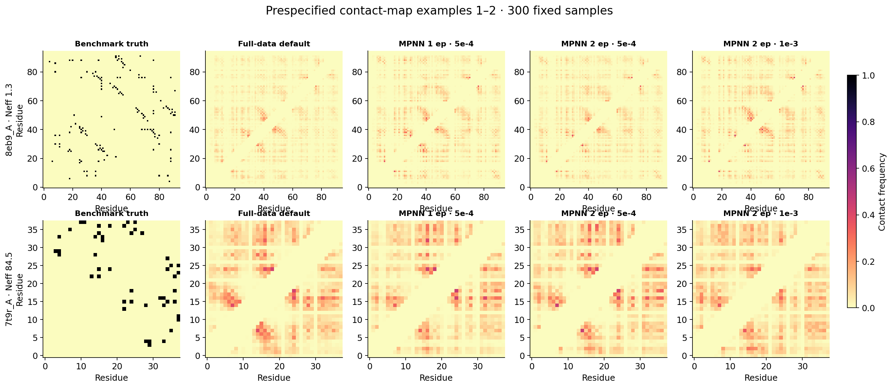
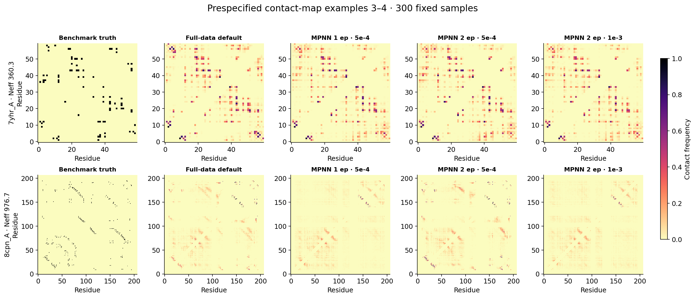
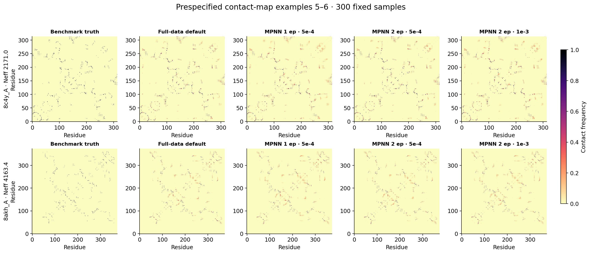
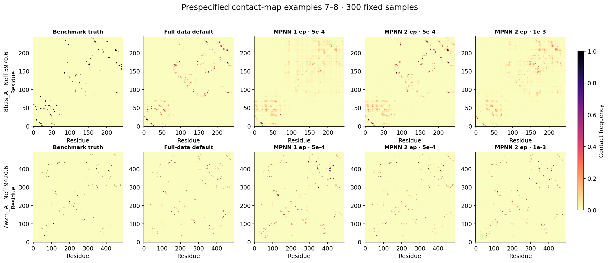

### 5. Sequence similarity still does not identify the mechanism

The [training-corpus audit](data/training_similarity_coverage.csv) identifies 3,963,003 native AFDB and 65,553,178 native ESM-Atlas documents in default, alongside 31,702,680 AFDB-derived and 130,872,044 ESM-derived redesign documents. All three MPNN models use the same **162,574,724 redesign-document corpus**; additional epochs do not change its sequence-search coverage.

Historical exp245 residual searches cover surviving native AFDB/ESM-Atlas sequences. At ≥50% coverage of the shorter sequence, 96/97 proteins have a reported surviving match; median and maximum best identity are 0.299, reflecting the decontamination cutoff. At ≥40% coverage, all 97 have a match, median identity is 0.506, and two reach ≥0.9. These are not fresh searches of the final token caches.

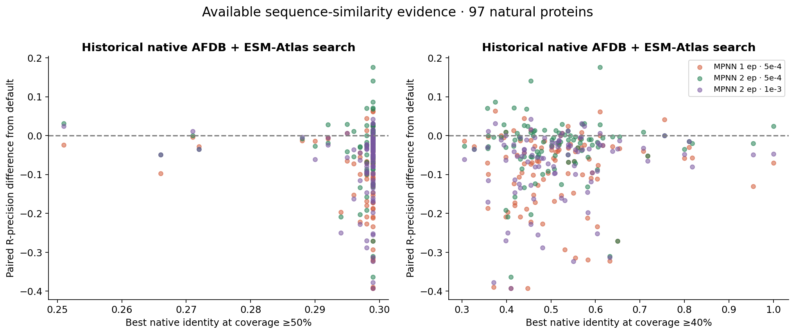

At 40% coverage, the two-epoch 5e-4 accuracy-difference slope versus native identity is inconclusive, +0.023 [−0.106, 0.136]; the other two redesign checkpoints' intervals also span zero. Fifty-percent-coverage associations are constrained by the narrow identity range imposed by filtering. **No complete eval-versus-redesign sequence search or matched redesign KNN null is available.** Similarity to that corpus is unmeasured, not zero. The existing native AFDB-only KNN R-precision of 0.407 excludes ESM-Atlas and redesigns and is not a matched null for any complete recipe. Removing native documents retains backbone ancestry and cannot establish absence of retrieval or memorization. [Audit provenance](data/similarity_audit.json), [search coverage](data/native_similarity_coverage.csv), [KNN context](data/native_knn_context.csv).

### 6. Designed proteins remain a separate, less certain result

All 19 designs are retained; three lack Neff metadata. These comparisons use unadjusted secondary intervals.

| All-range metric | Default | MPNN 1 ep, 5e-4 | MPNN 2 ep, 5e-4 | MPNN 2 ep, 1e-3 |
|---|---:|---:|---:|---:|
| R, 100 randomized prompts | 0.7082 | 0.6613 | 0.6687 | 0.6623 |
| R, 1,000 fixed prompts | 0.6972 | 0.6459 | 0.6599 | 0.6553 |
| Mean individual F1, 1,000 fixed | 0.5205 | 0.4670 | 0.4789 | 0.4764 |
| Oracle best@1,000 F1 | 0.7428 | 0.7158 | 0.7171 | 0.7091 |

The two-epoch 5e-4 improvement over one epoch is inconclusive for primary R (+0.0074 [−0.0133, 0.0278]) and oracle best@1,000 (+0.0013 [−0.0289, 0.0234]). Against default its primary R is lower by −0.0394 [−0.0920, −0.0013], while oracle F1 (−0.0257 [−0.0641, 0.0006]) and mean individual F1 (−0.0416 [−0.0883, 0.0009]) have intervals spanning zero. Its fixed-prompt Jaccard increase over default is +0.0400 [0.0018, 0.0817]. Natural-protein improvements therefore should not be generalized automatically to designs.

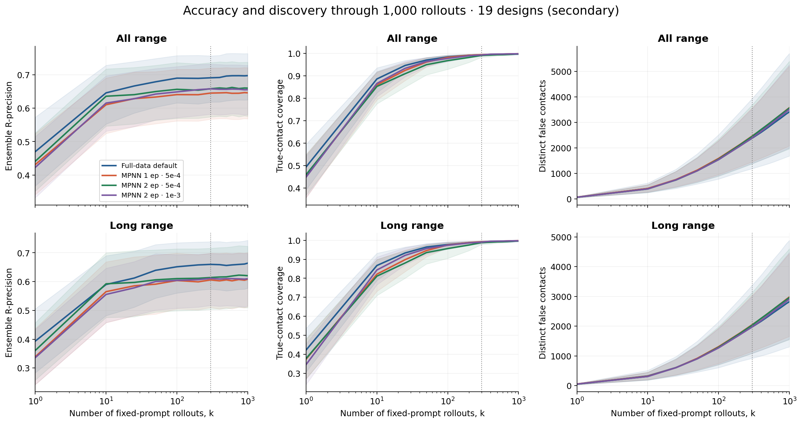
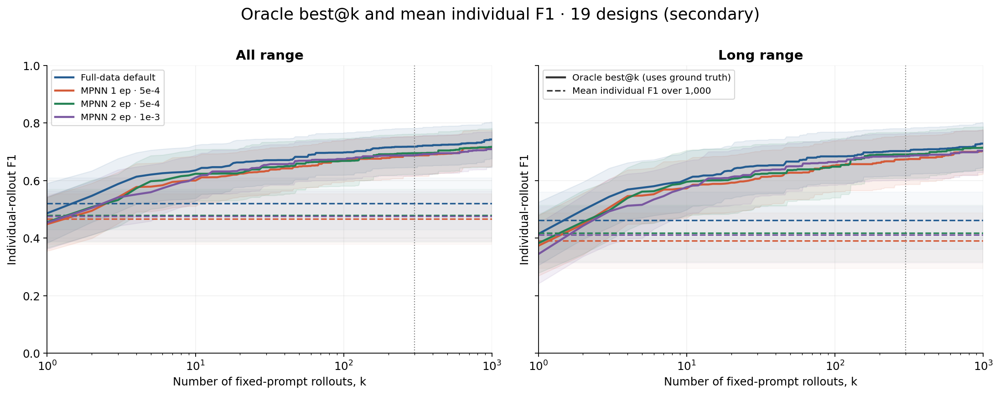

## Validation and execution

All **1,392 new conditions and 440,800 samples** passed the [raw-output audit](data/validation_two_epoch.json), including exact paired prompts/seeds, continuation seeds, context limits, parsed contacts, checkpoint hashes and matching recorded runtime versions. All **1,624 original raw files are unchanged**. The four-model reduction has **55,680 canonical metric rows**, and all **6,496 first-300 protein/range/k rows** reproduce within 10⁻¹². [Analysis checks](data/two_epoch/analysis_validation.json) and 15 unit tests cover parser/scorer behavior, shuffle margins, oracle ordering, individual F1 and complete protein/model pairing.

New outputs contain 202 samples with malformed statements, 3,853 with invalid positions and 247 with unexpected text; categories overlap. All are retained, and no canonical set is empty. There were **1,177 prefix continuations and four final caps**, all at temperature 1.3. The caps are on `7znz_A` (761 residues), two-epoch 5e-4: three fixed and one randomized. There are **no continuations or caps at primary temperature 1**. [Diagnostics](data/diagnostics_two_epoch.csv).

Both 100-sample smoke tests and all twelve production H100 shards succeeded on their first attempt. New inference used **8.64 GPU-hours**; production task wall time summed across GPUs was **10.02 hours**, including setup/publication. Runs stayed beside the checkpoint exports; weights were not transferred across regions. Every condition has [timings](data/timings_two_epoch.csv) and [worker metadata](data/workers_two_epoch.csv). [Launch/source records](data/launches_two_epoch.json) and the [execution summary](data/execution_summary_two_epoch.json) identify all jobs and timestamps. These evaluations did not initialize W&B runs.

The independent #364 randomized-100 evaluation uses seed 0 rather than this experiment's paired SHA-derived seeds. Natural-protein R differs by at most **0.0036** across both new models and ranges. On designs, the largest discrepancy is two-epoch 5e-4 long-range R: **0.6309 here versus 0.6371 in #364**, difference −0.0062 [−0.0218, 0.0100]. All eight paired difference intervals span zero. Input hashes and all **4,640 reference metric-row candidate/truth/top counts match exactly**, supporting a stochastic-draw explanation rather than a scoring-universe mismatch. These intervals resample proteins conditional on the two realized evaluations; they are not estimates from repeated seed replicates. [Per-protein reference scores](data/two_epoch/reference_per_protein.csv), [comparison intervals](data/two_epoch/reference_difference_summary.csv), [reference provenance](data/two_epoch/reference_validation.json), [protocol comparison](data/two_epoch_reference_protocol.json).

## Reproducibility and limitations

The public [v3-two-epoch root](https://huggingface.co/buckets/open-athena/MarinFold/tree/data/exp373-mpnn-diversity-neff/v3-two-epoch) holds **1.423 GB of new compressed raw predictions**, token IDs, prompts, seeds, source bundles, all report inputs and tables, figures and PDF. Each new fixed-temperature-1 file contains its full 1,000 samples. [Raw inventory](data/raw_inventory_two_epoch.csv) and [publication manifest](data/publication_manifest_two_epoch.json) record SHA256 identities; every published report artifact is verified by anonymous readback.

The immutable [v1 root](https://huggingface.co/buckets/open-athena/MarinFold/tree/data/exp373-mpnn-diversity-neff/v1) contains the original 300-fixed/100-randomized samples, and [v2-1000](https://huggingface.co/buckets/open-athena/MarinFold/tree/data/exp373-mpnn-diversity-neff/v2-1000) contains the older models' additional 700 fixed-temperature-1 samples. Their 1,000-sample conditions concatenate v1 and v2. Original timing totals were 5.20 and 2.57 inference GPU-hours; their retry/diagnostic histories remain in their execution records and the [archived two-model writeup](https://github.com/Open-Athena/MarinFold/blob/c04f94b61c2fbe879cfc15899ed41585a3bbd82b/experiments/exp373_evals_mpnn_diversity_neff/README.md).

Use this directory's pinned `pyproject.toml` and `uv.lock`. From the repository root, run `uv run --project experiments/exp373_evals_mpnn_diversity_neff python experiments/exp373_evals_mpnn_diversity_neff/two_epoch_plot.py` to regenerate all figures from committed tables; replace the script with `build_summary.py` to assemble the PDF. Every plot has a metadata sidecar and its generating command printed in the PDF.

For raw recomputation, use the same interpreter prefix: `restore_inputs.py`; `fetch.py`; `fetch.py --extend`; `fetch.py --two-epoch`; `validate_two_epoch.py`; `two_epoch_analysis.py --workers 4`; `shuffle.py --two-epoch --workers 4 --repeats 10`; `two_epoch_summary.py`; `check_two_epoch_reference.py`; then the plotting/PDF scripts. This reuses committed original source tables, whose full reconstruction procedure is in the archived report. `publish_to_hf.py --two-epoch` writes only the new v3 root. For new inference, run `launch.py --two-epoch --smoke --submit`, wait for completion, then `fetch.py --two-epoch --smoke` and `validate_smoke.py --two-epoch` before `launch.py --two-epoch --submit`. The [machine-readable plan](data/two_epoch_plan.json) pins all settings; omitting `--submit` only builds the source bundle. Sample seeds are the first eight SHA256 bytes of the frozen stem/mode/block/index key, big-endian modulo `2**63−1`; continuation seeds additionally incorporate the prompt and generated prefix.

Neff joins validate unique stems, exact evaluation sequences and MSA query length; original A3M query sequences were not independently fetched. Neff associations are observational, the lowest tier has four proteins, and secondary intervals are unadjusted. Unequal training schedules/exposure, one checkpoint per recipe and incomplete redesign-sequence searches limit causal interpretation. Contact-set variation does not demonstrate physical conformational variation.

## Conclusion

The two-epoch 5e-4 model closes much of the one-epoch accuracy gap and reduces excess diversity and false-contact discovery. It remains more diverse than default under the controls and has a small coverage advantage at 1,000 rollouts, while **default remains better in mean individual F1, oracle best@1,000 F1 and ensemble accuracy on natural proteins**. The 1e-3 model improves less. Extra sampling improves oracle F1 for all four models, with little ensemble improvement after 300. **Reduced Neff dependence is not established for the strongest redesign-only checkpoint**; the one-epoch extreme-tier result is not a general conclusion across models. Available sequence evidence still cannot attribute these effects to reduced retrieval or memorization.
