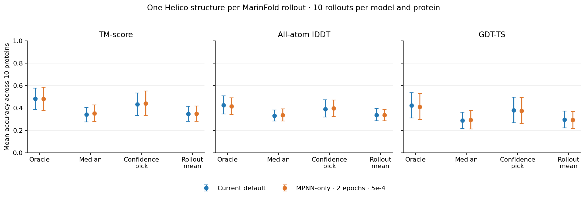
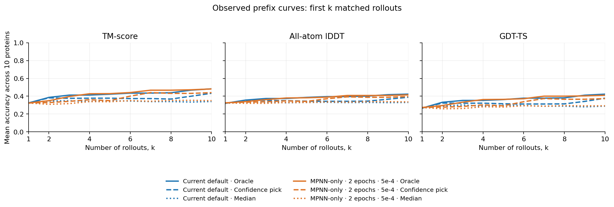
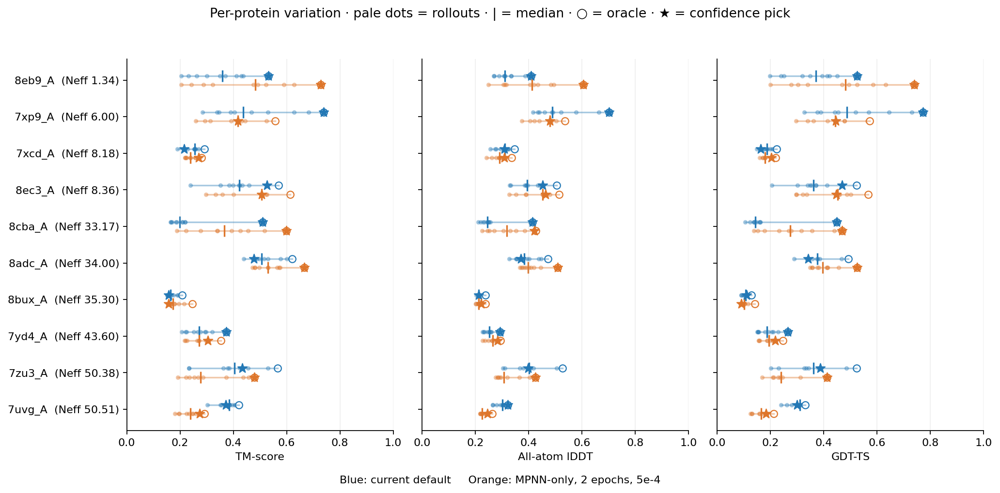

---
marinfold_experiment:
  issue: 381
  title: 'exp: individual MarinFold rollouts through Helico on the ten lowest-Neff eval-val proteins'
  kind: evals
  branch: codex/exp381-rollout-helico
---

# exp: individual MarinFold rollouts through Helico on the ten lowest-Neff eval-val proteins

**Issue:** [#381](https://github.com/Open-Athena/MarinFold/issues/381).
Follow-up to [#373](../exp373_evals_mpnn_diversity_neff/README.md).
The [frozen plan](PLAN.md) and [machine-readable protocol](data/plan.json)
predate all Helico predictions.

## Question and hypothesis

Does sampling ten individual MarinFold contact sets produce useful structural
diversity after Helico folding, and can Helico confidence identify the most
accurate structure? Compare the current default with the ProteinMPNN-only,
two-epoch, learning-rate 5e-4 checkpoint. The hypothesis is that oracle structural
accuracy improves with multiple rollouts, but confidence selection may capture
only part of that opportunity.

## Results

**Completed all 200 Helico predictions on Modal H100 GPUs. There is no clear
MarinFold model winner on this pilot. Helico confidence selection improves
substantially over average individual-rollout accuracy for both models, while
leaving a measurable gap to the oracle.**

The table averages per-protein summaries over the same ten proteins. Oracle
selection is metric-specific; confidence selection chooses one structure per
protein using only Helico's ranking score.

| MarinFold model | Selection over 10 rollouts | TM-score | All-atom lDDT | GDT-TS |
|---|---|---:|---:|---:|
| Current default | Oracle | **0.483** | **0.423** | **0.423** |
| Current default | Median | 0.340 | 0.330 | 0.289 |
| Current default | Confidence pick | 0.433 | 0.388 | 0.378 |
| Current default | Individual-rollout mean | 0.347 | 0.337 | 0.295 |
| MPNN-only, 2 epochs, lr5e-4 | Oracle | **0.481** | **0.415** | **0.410** |
| MPNN-only, 2 epochs, lr5e-4 | Median | 0.350 | 0.336 | 0.292 |
| MPNN-only, 2 epochs, lr5e-4 | Confidence pick | 0.440 | 0.397 | 0.373 |
| MPNN-only, 2 epochs, lr5e-4 | Individual-rollout mean | 0.348 | 0.336 | 0.293 |

For the confidence-selected structure, the **two-epoch minus default** paired
differences are TM-score **+0.007 [−0.086, +0.090]**, lDDT **+0.008
[−0.059, +0.073]**, and GDT-TS **−0.005 [−0.098, +0.080]** (95% protein
bootstrap intervals). Every model-difference interval, including oracle,
median and rollout mean, contains zero. This is absence of a clear winner in
ten proteins, not an equivalence result. See [paired_model_deltas.csv](data/paired_model_deltas.csv).

**Sampling does produce useful structural diversity.** Relative to the mean
individual rollout, confidence selection gains **+0.086 TM-score [0.017,
0.159]** for the default and **+0.092 [0.037, 0.154]** for the two-epoch model.
The corresponding oracle gains are +0.136 and +0.134. Confidence selection
therefore leaves average TM-score gaps of **0.050** and **0.041** to oracle,
respectively, and selects the TM-score oracle on **4/10 proteins** for each model.
The same qualitative confidence-over-mean gain appears for lDDT and GDT-TS;
[selection_gains.csv](data/selection_gains.csv) contains paired intervals for all
three metrics. This experiment does not compare against a structure folded from
an aggregated contact-vote map, so it does not establish that individual-rollout
folding beats contact aggregation.

For the observed prefixes, oracle mean TM-score rises from **0.324 to 0.483**
for the default and **0.324 to 0.481** for the two-epoch model between k=1 and
k=10. At k=5 it is 0.423 and 0.429. Confidence-selected mean TM-score reaches
0.433 and 0.440 at k=10. Its curve can decline when a later, more confident
prediction is less accurate; only the oracle is guaranteed to increase.

The model comparison varies markedly by protein. On **8eb9_A**, the two-epoch
confidence pick improves TM-score from **0.531 to 0.728**; on **7xp9_A**, it
falls from **0.738 to 0.417**. On **8cba_A**, confidence finds a rare strong
default rollout: median 0.198 versus selected 0.510. Both models remain poor
on **8bux_A**: oracle TM-scores are only 0.209 and 0.246. Full per-rollout
results are in [per_rollout_metrics.csv](data/per_rollout_metrics.csv), and every
selection at every k is in [per_protein_selection.csv](data/per_protein_selection.csv).

For completeness, confidence-selected TM-score is 0.460/0.456 (default/two-epoch)
on the eight non-viral proteins and 0.324/0.375 on the two viral proteins.
These tiny descriptive subgroups do not support a viral-specific conclusion;
[viral_status_summary.csv](data/viral_status_summary.csv) includes all metrics.

## Cohort and inputs

Select the ten lowest `msa_neff` values among the 97 natural eval-val proteins,
with stem as the tie-breaker. Neff is exp260's sequence weighting at 80% identity
(`n_eff_0.8`); it differs from the raw number of MSA sequences. No eval-test
structures or labels are read. Two targets are viral (`7xcd_A`, `7zu3_A`). This
small pilot is not the separately frozen raw-MSA-depth <10 benchmark: none of
these ten has raw depth below ten.

| Protein | Neff | Raw MSA depth | MarinFold sequence length | Helico resolved length |
|---|---:|---:|---:|---:|
| 8eb9_A | 1.34 | 24 | 95 | 89 |
| 7xp9_A | 6.00 | 13 | 84 | 76 |
| 7xcd_A | 8.18 | 21 | 178 | 178 |
| 8ec3_A | 8.36 | 25 | 168 | 155 |
| 8cba_A | 33.17 | 129 | 214 | 195 |
| 8adc_A | 34.00 | 38 | 215 | 207 |
| 8bux_A | 35.30 | 466 | 334 | 289 |
| 7yd4_A | 43.60 | 203 | 185 | 179 |
| 7zu3_A | 50.38 | 151 | 132 | 126 |
| 7uvg_A | 50.51 | 231 | 183 | 166 |

The models are `contacts-v1-exp277-m2-p06-full-epoch-1.5B`, step **266344**
(the registered default when this experiment was frozen), and
`contacts-v1-exp364-mpnn-only-2ep-lr5e-4-1.5B`, step **373768**
([training run](https://wandb.ai/open-athena/MarinFold/runs/contacts-v1-exp364-mpnn-only-2ep-lr5e-4-1.5B)).
The [plan](data/plan.json) records both checkpoint locations and export identities.

Reuse rollouts 0–9 of the 100 randomized-prompt samples already generated on
CoreWeave for each model/target in exp373. Temperature is 1, top-p is 0.95,
top-k is disabled; every rollout has a separately randomized contacts-v1 prompt.
Both models receive identical prompt tokens, offsets and sampling seeds for
each rollout index. This is a deterministic index-based selection, with no
filtering by accuracy. All source checksums and parsed contact sets are verified;
all selected completions finish normally. Original raw-file URIs and hashes are
in [source_raw_inventory.csv](data/source_raw_inventory.csv); original measured
100-rollout batch timings are in [reused_marinfold_timings.csv](data/reused_marinfold_timings.csv).
Those timings are not newly measured per-rollout times.

As in Helico's existing FoldBench benchmark, Helico receives the **resolved
protein sequence**, not the full MarinFold prompt sequence. The exp245 resolved
position list maps the contact indices, and the resulting sequence must exactly
match the verified Helico reference sequence. Keep every live contact with both
endpoints resolved and mapped sequence separation ≥6. No voting, top-L cut,
ground-truth contact filtering, or averaging is applied. Unlisted pairs stay
UNKNOWN. [contact_inputs.csv](data/contact_inputs.csv) records removed and effective
counts for every rollout. Extra waters and non-protein entities in the CIFs are
excluded from both model input and scoring; see [reference_audit.csv](data/reference_audit.csv).

## Helico and scoring

Use `contacts-msafree-01-step-6000.pt`, SHA256
`779d540e5bb45cd26bb970188da2f1937ed3079942923a1356c29d06f20fe644`, at
[Helico source b10385d](https://github.com/Open-Athena/helico/tree/b10385d736673c81b10e70d1099962af6f2573c0).
Its supported `load_model` API reads the saved training configuration and strictly
loads the weights. The complete saved configuration is retained in
[helico_checkpoint_config.json](data/helico_checkpoint_config.json).
Run six trunk recycles, one diffusion sample per contact set, bfloat16, no MSA,
on Modal H100 GPUs, with at most four concurrent workers. Use distinct
SHA256-derived seeds per (protein, rollout), paired across MarinFold models.
There is no second choice among multiple Helico diffusion samples for one rollout.

Save full-precision coordinates, a viewable PDB, confidence, timing, and worker
metadata for each of the 200 inputs. Score after inference, matching reference
atoms by resolved residue index and atom name. Every score uses the native
protein as its reference. The three metrics are reported on **0–1** scales:

- **TM-score:** CA coordinates, fixed residue correspondence, normalized by
  the number of reference CA atoms, using the official
  [TMscore program](https://github.com/pylelab/USalign/blob/23f14ffcf8647f2dc1c0e01043db3a7f3a661c28/TMscore.cpp).
  No sequence or structural realignment is allowed.
- **GDT-TS:** the same program's optimized fractions within 1, 2, 4 and 8 Å,
  averaged and normalized to reference length. This is not a single-fit Kabsch
  threshold calculation. TMscore prints these scores to four decimal places.
- **lDDT:** all resolved native heavy atoms, 15 Å reference-distance inclusion
  radius, 0.5/1/2/4 Å distance-error thresholds, excluding within-residue pairs,
  using [Biotite 1.5.0](https://www.biotite-python.org/latest/apidoc/biotite.structure.lddt.html).
  Missing predicted reference atoms remain in the denominator. Atom names are
  matched directly, without symmetry-based side-chain renaming. CA-only lDDT is
  also saved as a diagnostic.

These definitions differ from the older Helico benchmark's single-fit GDT-TS,
structurally realigned TM-score, and matched-atom lDDT with within-residue pairs.
Do not compare their numerical values directly. Scorer tests cover rigid-motion
invariance, missing-residue penalties, within-residue exclusions, and rejection
of residue-shifted structural alignments.

For each protein, compute the metric-specific **oracle maximum**, the **median**
over ten structures, the accuracy of the **top confidence pick**, and the
**mean individual-rollout accuracy**. Confidence selection uses only Helico's
`ranking_score` (monomer pTM with its clash penalty), breaking ties by the lowest
rollout index. The same selected structure supplies all three metrics; the oracle
may select different structures for different metrics. Average protein summaries
with equal weight. Confidence intervals bootstrap the ten proteins 10,000 times
with seed381, and model differences pair the same proteins. Prefix curves use
the first k saved rollouts, k=1…10; they are observed prefixes of this sample,
not expectations over every possible rollout order.

## Reproduction and artifacts

The [summary PDF](plots/summary.pdf) includes the narrative and all three figures.
The production [Modal run](https://modal.com/apps/open-athena/main/ap-TSSWBiJZdoScbSdURxo2sX)
completed on 2026-11-03. [execution_log.json](data/execution_log.json) records the
startup/input gates and both successful runs. All failed gates stopped before
any prediction; the two successful smoke predictions are included in the 200.

All 200 predictions have **100% reference Cα coverage**, finite metrics and
verified output checksums. Heavy-atom coverage is **99.58–100%**. The only missing
reference atom names are selenomethionine `SE` atoms: six each in `7xcd_A`,
`8adc_A` and `8bux_A`, and three in `7zu3_A`; canonical methionine predictions
contain `SD` instead. The frozen atom-name matching convention penalizes these
missing reference atoms in all-atom lDDT, identically for both models. They do
not affect Cα TM-score or GDT-TS. See [missing_reference_atoms.csv](data/missing_reference_atoms.csv).

The default and two-epoch rollouts supply **140.7** and **165.4** effective
contacts per prediction on average. Of 14,895/17,901 original contacts,
791/1,320 have unresolved endpoints and another 34/38 have mapped separation
below six. Contact count is allowed to differ naturally; it is not an equal-budget
comparison. All 200 ranking scores equal pTM, with zero clash penalties.

Measured inference totals **1,367.6 GPU-seconds (0.380 H100-hours)**, with a
median **6.66 seconds per structure**. Model setup totals 80.5 seconds across
five distinct workers, including the smoke worker. At the
[Modal H100 rate](https://modal.com/pricing) of $0.001097/second, the measured
inference component is **$1.50**, excluding startup, failed startup gates, volume
commits, idle time, CPU and RAM; this is not an invoice. The conservative
prelaunch GPU estimate was $5.97. [timings.csv](data/timings.csv) retains every
per-input measurement and worker identity. Setup fields are repeated per input
for provenance and must be deduplicated by worker before summing.

From this experiment directory, `uv sync` installs the pinned analysis environment.
`uv run python analyze.py` regenerates figures from committed small CSVs;
`uv run python build_summary.py` rebuilds the summary PDF. For complete rescoring,
run `uv run python restore_public.py`, `uv run python setup_metrics.py`, then
`uv run python score.py`. Restoring public inputs and structures needs no login
and does not require a GPU; TMscore compilation requires g++.

To rerun prediction, check out Helico at the pinned revision and set `HELICO_REPO`.
After restoring inputs, run `HELICO_DRY_RUN=1 uv run python run_helico.py`,
`uv run python run_helico.py --smoke`, `uv run python score.py --smoke`, then
`uv run python run_helico.py`. The runner resumes saved task identities on the
experiment's Modal volume; remove neither original outputs nor identities to
silently overwrite this run. A new stochastic experiment needs a new output tag
and explicit protocol. Modal account access and the checkpoint/CCD volumes are
required only for prediction, not analysis.

Public artifact root:
`hf://buckets/open-athena/MarinFold/data/exp381-rollout-helico-low-neff/v1`.
`inputs.tar.gz` contains just this pilot's ten reference structures, target
sequences/mappings, 200 contact lists, and selected original raw rollout records.
`structures.tar.gz` contains all 200 full-precision coordinate arrays, PDBs,
confidence/timing records, and TMscore inputs/stdout. `source.tar.gz` contains the
reproduction scripts and environment lock. `data/` and `plots/` mirror the small
analysis artifacts. `publish_to_hf.py` publishes and checks anonymous readback
of every file; [public_artifacts.json](data/public_artifacts.json) records hashes.

## Limitations

This is an exploratory ten-protein, ten-rollout pilot. The intervals describe
resampling these proteins, not uncertainty from new training runs or repeated
sets of ten rollouts. The oracle uses the answer and is not a deployable selector.
The two checkpoints differ in more than one training attribute, so any difference
does not isolate the causal effect of ProteinMPNN-only training. Helico folds the
resolved sequences used in the established benchmark; these are shorter than the
full input sequences for nine targets. Results do not establish full eval-val,
held-out eval-test, or whole-sequence folding performance.

## Conclusion

On these ten lowest-Neff eval-val proteins, the default and ProteinMPNN-only
two-epoch MarinFold checkpoints yield similar aggregate structural accuracy
through Helico. Ten separate contact-conditioned structures expose substantial
oracle gains, and Helico confidence recovers much of that improvement. The
remaining selection gap and large protein-to-protein variation justify testing
more rollouts and a larger eval-val cohort before choosing between checkpoints
or drawing conclusions about the value of ProteinMPNN-only training.
